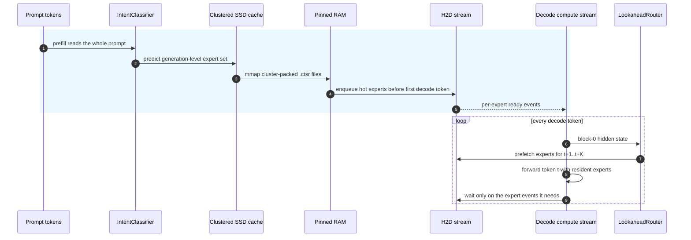
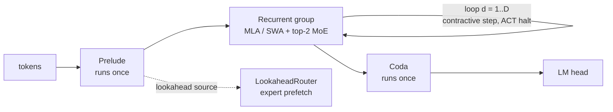
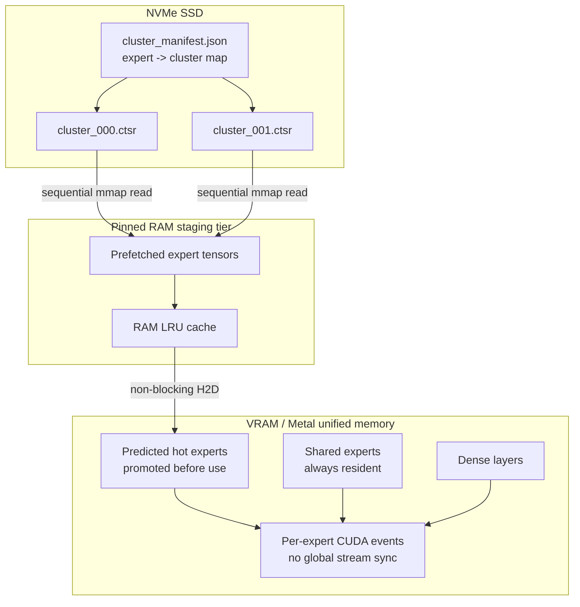
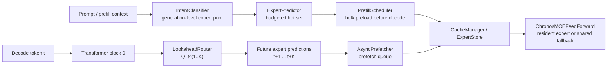
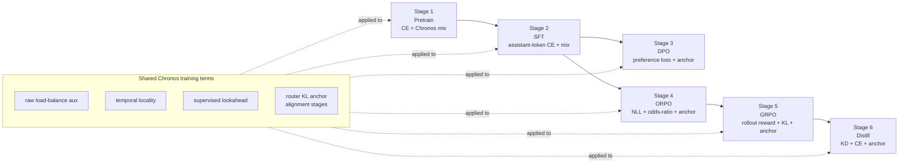
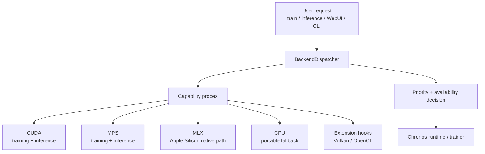
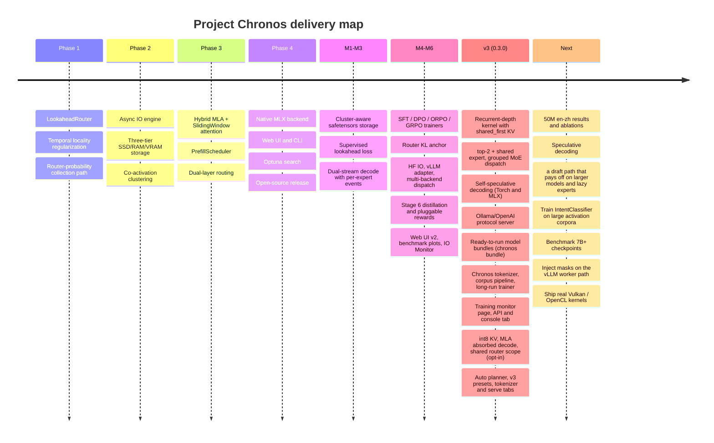
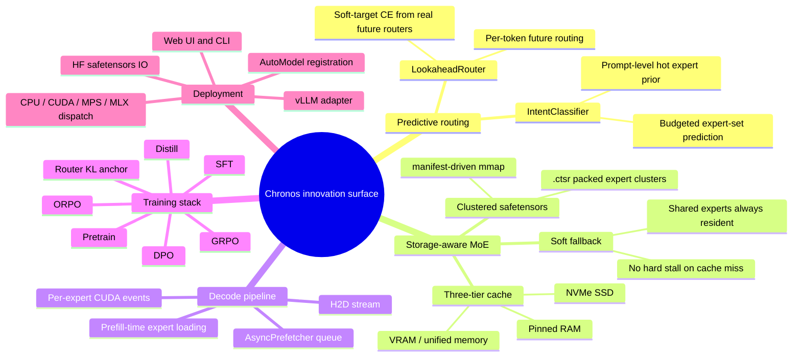

# Project Chronos (Experimental)

**A storage-aware MoE stack built for SSD+DRAM hybrid inference, with a full six-stage training pipeline.**

[](https://pypi.org/project/Project_Chronos/)
[](LICENSE)
[](https://python.org)

[中文文档](README_zh.md)

---

## Why reactive MoE offload breaks down

Mainstream MoE models such as Mixtral, DeepSeek-MoE, and Qwen-MoE make routing decisions **at decode time, token by token**. The model discovers which experts it needs only when the next token is already on the critical path. If those experts are not resident in VRAM, generation stalls while weights are moved from SSD to RAM to VRAM.

That is not a tuning issue. It is an architectural mismatch.

Most offload runtimes assume the model was originally designed for full VRAM residency, then try to patch storage pressure afterward. On consumer hardware, that usually means the decode loop ends up paying the IO bill over and over again.

---

## Chronos in one line

**Move IO into prefill. Move synchronization down to the expert-event level.**



Two things matter here:

1. **Prefill-time loading**: `PrefillScheduler` and `IntentClassifier` bulk-load predicted experts before the first decode token.
2. **Per-expert event sync (M3)**: `promote_to_vram(blocking=False)` records a `torch.cuda.Event` on the `_h2d_stream`, and the compute stream waits only on the experts it actually needs. No more `stream.synchronize()` for the whole system.

Under a simulated 30 ms SSD delay, the new path keeps **35 ms+ per token** of pipeline slack compared with the older blocking path.

---

## v3 kernel: recurrent-depth MoE (0.3.0)

v3 reuses a few physical layers many times. A prelude runs once, each shared recurrent group loops `recurrent_depth` times with a contractive update `h ← h + dt·(block(h + e_loop) − h)`, and a coda runs once. The 50M demo has 6 physical layers that execute as 18 virtual layers (prelude 1, 4 recurrent layers × depth 4, coda 1).



**What changed from v2**

| | v2 | v3 |
|---|---|---|
| Attention inside the loop | Iteration 0 only (`first_only`) | Every iteration |
| KV cache per recurrent layer | 1 slot; the every-iteration attention switch rewrote it each iteration (measured prefill+decode vs full-forward gap 0.94) | `shared_first`: Q recomputed each iteration, K/V from iteration 0, so KV slots = physical layers |
| Routing | top-1 (gate received no CE gradient) | top-2 + 1 shared expert |
| MoE dispatch | Python loop over experts with `.item()` syncs | Sorted grouped dispatch: `gather_mm` on MLX, `argsort` + `index_add_` on Torch |
| Early exit | Host sync every step | Tensor-only ACT, exact and batch-invariant; decode can exit per token without KV gaps |
| Decoding | Plain autoregressive | Recurrent-depth self-speculative decoding |

`per_iteration` (one KV slot per virtual layer) is kept as an ablation. Old v2 checkpoints load as `first_only`; their logits match a stored golden tensor within 1e-5.

**Self-speculative decoding (no extra parameters).** The same model drafts γ tokens at a shallow depth and verifies them with one full-depth batched forward pass. Greedy output is token-for-token identical to full-depth greedy. Sampling uses rejection sampling, which preserves the full-depth distribution. After a rejection, the cache is truncated: MLA slices `c_kv`, and the sliding-window cache keeps `window + γ_max` entries. Torch (`chronos/runtime/speculative.py`) and MLX (`chronos/mlx/speculative.py`, `ChronosMLXInferenceEngine.generate(speculative=True)`) share the algorithm. Tests cover greedy identity, the rejection distribution and rollback against a fresh prefill on both backends. The Web UI Inference tab has a switch for it, with draft depth and γ.

For the 50M demo it is exact but not faster on any runtime we measured (pretrain step-13,996 checkpoint, greedy, batch 1, FLORES+ dev en→zh, draft depth 1, γ 4; reports in `reports/speculative/`):

| Runtime | Plain tok/s | Speculative tok/s | Ratio | Acceptance |
|---|---|---|---|---|
| MLX GPU bf16, all experts in DRAM | 112.0 | 107.4 | 0.96× | 42 % |
| MLX GPU bf16, lazy experts (12 of 216 pages resident) | 43.7 | 32.0 | 0.73× | 42 % |
| Torch MPS fp32, all experts | 32.1 | 25.9 | 0.81× | 40 % |
| Torch MPS fp32, lazy experts | 17.0 | 14.7 | 0.86× | 40 % |

At this size a full-depth step costs about as much as a batched verify pass. With lazy experts, drafts and verify passes also route to different experts, so speculative decoding read 1.4–1.6× more expert pages from SSD. Greedy outputs were identical in CPU fp32 and Torch MPS fp32. In GPU bf16, near-tie tokens flipped in 2 of 24 sentences. The switch therefore stays off by default.

**Precision chain.** One compute dtype runs end to end. FP32 is used only where it pays: RMSNorm statistics, SDPA softmax, RoPE tables, router softmax, LM-head logits and optimizer master weights. The MLX↔Torch bf16 bridge is bit-exact. `auto` picks bf16 on MLX GPU and CUDA, and fp32 on CPU and MPS (MPS bf16 measured slower; see below).

**Tooling added in v3**

| Command | What it does |
|---|---|
| `chronos tokenizer` | Self-built byte-fallback BPE with script-aware pre-tokenization and language-balanced merges; writes an HF-compatible `tokenizer.json` + chat template |
| `chronos longrun --spec recipe.json` (alias `run`) | Time-budgeted MLX run: warmup + cosine per phase wall-clock budget, NaN rollback, bit-exact resume, validation CE; tasks add their own metrics by subclassing `LongRun` (`task_eval`) |
| `chronos serve` | Ollama/OpenAI protocol server on the native runtime (see below) |
| `chronos monitor` | Read-only training monitor page + JSON API (see below) |

`chronos.model.factory.fit_config` searches for a configuration that matches total and active parameter targets.

**Kernel and extensions.** The `chronos` package trains general models and carries no task-specific code. Task tooling lives in extensions that import the kernel. The en↔zh translation demo is one: `demos/translation` (`chronos-translate`: corpus pipeline, BLEU/chrF runs, model bundles; see its README). It is not part of the `Project_Chronos` wheel and is not published on PyPI; install it from a checkout with `pip install -e demos/translation`. The 50M en→zh status, the released model `chronos-enzh-50m-sft` with its measurements, and the model bundle are documented in [`demos/translation/README.md`](demos/translation/README.md).

**Inference and memory options (all off by default).** Each option is a config field and a `chronos serve` / Inference-tab override. Tests compare each one with its reference path on Torch and MLX.

| Field | Values (default first) | Effect |
|---|---|---|
| `kv_cache_dtype` | `auto`, `int8` | `int8` stores MLA `c_kv` and SWA k/v per token in groups of 32 with a scale; rollback and speculative decoding work on it |
| `mla_decode` | `expanded`, `absorbed`, `auto` | `absorbed` scores against `c_kv` without expanding K/V. `auto` absorbs only short cached chunks; it is opt-in because a bf16 prefill (expanded) followed by absorbed decode drifted from the full forward pass (max logit gap 0.06, measured) |
| `mla_cache_rope` | `false`, `true` | Also caches the roped key, trading memory for decode speed |
| `router_scope` | `per_iteration`, `shared` | `shared` reuses iteration 0's experts for the rest of the loop, so fewer experts are resident per token |
| `draft_exit_kl_coef`, `draft_exit_depth` | `0`, `1` | Training term: KL from the shallow exit to the detached full-depth logits, which raises speculative acceptance |
| `max_resident_experts`, `ram_budget_mb` | unset | Hard caps on the fast tier and the RAM tier. LRU eviction never evicts experts the lookahead router predicts. Prefetch covers every loop iteration of a virtual layer |

Web UI: the Tokenizer tab (extract → train → evaluate) and the Serve tab (start/stop `chronos serve`; the API key goes through the environment, never argv).

---

## Native kernel (0.3.2): minimind removed

Up to 0.3.1a3, Chronos took its config base, RoPE tables, gated FFN, dense attention and trainer utilities from [minimind](https://github.com/jingyaogong/minimind). It loaded them at import time: `chronos.deps` git-cloned the `master` branch into `~/.cache/chronos/minimind-master/` and put that folder first on `sys.path`. 0.3.2 replaces those pieces with `chronos/model/kernel.py`. Nothing is downloaded, and `sys.path` is not changed.

**Why it was migrated**

- **Reproducibility.** The clone followed an unpinned `master`, so two installs could run different kernel code.
- **Offline installs.** On a machine without the cache, `import chronos` ran `git clone` and failed without network access.
- **Namespace collisions.** minimind's top-level `model`, `trainer` and `dataset` packages went first on `sys.path`. They shadowed any user module with the same name.
- **Dense mode was broken.** `use_hybrid_attention=False` used minimind's `Attention`, which crashed in every recurrent mode (`The size of tensor a (8) must match the size of tensor b (1024)`). It also could not use the shared KV cache.
- **BF16 checkpoints were overwritten as FP16.** The Torch pretrain save called minimind's `lm_checkpoint`. That function rewrote the release file `chronos_<H>_moe.pth` as FP16 right after Chronos had saved it in BF16.
- **Trainer logs were lost.** The Web UI captured trainer output by patching `trainer_utils.Logger`. The trainers import `Logger` by name at load time, so the patch never reached them.

**What the native kernel does**

- `ChronosBaseConfig` keeps the old field names and defaults. RoPE/YaRN tables and FFN parameter names are unchanged too, so existing checkpoints and sidecars load as before.
- One FP32 RoPE table per `(dim, base, scaling, device)` is shared by all layers and grows on demand. Before, every attention layer kept its own copy.
- `GlobalAttention` is the dense GQA path. It is the sliding-window kernel without a window, so all three recurrent modes, int8 KV, padding masks and speculative rollback work on it.
- Logging uses a sink registry (`add_log_sink`). Resume state goes to `chronos_<H>_moe_resume.pth`, and the release checkpoint keeps its dtype.
- The 6400-token tokenizer that old checkpoints use ships as data only (`chronos/assets/tokenizers/legacy_6400`, Apache-2.0, sha256 recorded in its `NOTICE`).

**Old vs new, measured 2026-11-08**

Setup: Apple M5 Max, PyTorch 2.10 on CPU, FP32, 4 threads, median of 5–7 runs, each kernel in its own process, runs alternated twice. The 50M en→zh SFT run was training on the GPU at the same time, so absolute timings carry noise. Old = 0.3.1a3 + minimind `24896cd`.

| Check | 0.3.1a3 + minimind | 0.3.2 native |
|---|---|---|
| Logits, `out/chronos_256_moe.pth` and the 50M en→zh checkpoint (full, padded and prefill+decode paths) | reference | bit-identical (max abs diff 0) |
| Random-init `state_dict` and config values (same seed) | reference | identical |
| `import chronos` with no cache and no network | fails (`git clone` error) | works |
| minimind on `sys.path`, top-level `model` module imported | yes | no |
| RoPE table memory, 50M shape (1024 positions) | 3.50 MiB | 0.50 MiB |
| RoPE table memory, 768H base shape (32768 positions) | 216 MiB | 24 MiB |
| Dense GQA mode (`use_hybrid_attention=False`) | crashes | works; prefill+decode vs full forward ≤ 1e-6 |
| Release checkpoint dtype after BF16 Torch pretrain | FP16 | BF16 |
| Trainer lines captured by the Web UI sink | 0 of 2 | 2 of 2 |
| Train step, 50M shape, batch 4×128 | 0.318–0.326 s | 0.317–0.321 s |
| Prefill 128 tokens, 50M shape | 40.0–40.7 ms | 41.4–42.8 ms |
| Decode tokens/s, 50M shape | 146–157 | 146–151 |

A repeat with 40 prefill runs per process gave medians of 64–86 ms (old) and 74–86 ms (new) as the training load changed; neither kernel was consistently faster. Compute speed is unchanged within noise: the kernel keeps the same math. The gains are in memory, robustness and the bugs listed above. The parity check runs in CI as `tests/test_native_kernel.py`, which covers config defaults, RoPE bit-identity, dense mode, imports, logging, resume and the bundled tokenizer.

`chronos.deps` remains as a shim: `get_tokenizer_path()` returns the bundled tokenizer (`CHRONOS_DEFAULT_TOKENIZER` overrides it), and `ensure_minimind()` is a no-op with a deprecation warning. The comparison tools in `tools/compare_minimind_chronos*.py` still use minimind as an external baseline, from a checkout you provide (`--minimind-dir` or `CHRONOS_MINIMIND_DIR`). `benchmark_compare.py` now compares Chronos with a dense GQA baseline built from the same kernel.

### MLX training: compiled step and activation recomputation (0.3.2)

Up to 0.3.1a3 the MLX trainers ran every micro step eagerly and kept every activation for the backward pass. 0.3.2 adds both missing pieces to `chronos longrun` and to the Stage 1–2 MLX trainer (pretrain, SFT):

- **Compiled micro step** (`chronos/mlx/training/compiled.py`, on by default). Loss and gradients run as one `mx.compile` graph per signature. The executed recurrent depth, the ACT switch, input shapes and plain config values are part of the signature, so a step never reuses a stale graph. Weights and the RNG state are compile inputs and outputs, so dropout and the cache-miss simulation consume the RNG stream exactly as before. Multimodal batches, lazy (paged) experts and any signature that fails to trace run eagerly, and the reason is logged once. `CHRONOS_MLX_COMPILE=auto|on|off` or the recipe's `extra.mlx_compile` switches it.
- **Activation recomputation** (`chronos/mlx/checkpointing.py`, `activation_checkpointing=true`; the planner's memory-constrained tiers turn it on). Each block call becomes one recomputed region. A plain `mx.checkpoint` is wrong here in two ways, both measured on mlx 0.32.4. Dropout masks and the cache-miss draws would be drawn again during recomputation; they are recorded in the forward pass and replayed. A region that returns the same graph node twice keeps the gradient of only one copy. A block's KV cache and its shared view are such a pair whenever the SWA window covers the sequence (a full-length slice is a new Python object over the same node), and the gradients were 37–40% off. Region outputs are therefore packed into one array per dtype.

**Measured 2026-11-08.** Setup: Apple M5 Max, mlx 0.32.4, bf16, the 50M en→zh recipe's model config from random init, real en→zh shards, the recipe's step sizes (SFT 8 micro-batches per step, pretrain 16). Median of the second half of 16 (SFT) or 12 (pretrain) steps. The 72-hour run was training on the same GPU, so absolute timings carry noise.

| Micro step | SFT s/step | SFT peak memory | Pretrain s/step | Pretrain peak memory |
|---|---|---|---|---|
| Eager (0.3.1a3) | 2.915 | 5.62 GB | 7.154 | 6.07 GB |
| Compiled (new default) | 2.700 (1.08×) | 5.86 GB | 6.057 (1.18×) | 6.28 GB |
| Recomputation + compiled | 3.148 | 3.50 GB | 7.357 | 3.62 GB |
| Recomputation, eager | 3.663 | 3.42 GB | — | — |

The loss curves of all variants follow the eager one: within 2e-3 over 16 SFT steps and 2e-4 over 12 pretrain steps. The first compiled step also traces the graph. Recomputation cuts peak memory by 38–40%. With compilation on, a step then takes 17% (SFT) or 21% (pretrain) longer than the compiled step without recomputation, and 8% or 3% longer than the old eager step. At 50M parameters memory is not the limit, so recomputation stays off by default; it is meant for larger models or longer sequences on the same machine.

Exactness is tested per micro step on the same weights, batch and RNG state inside the real LongRun loop (`tests/test_longrun.py`, `tests/test_mlx_checkpointing.py`). On CPU FP32 the recomputed step's gradients match the eager ones within 4e-7 relative, the compiled step's within 1.7e-5, and with both on within 1e-4. That is FP32 reassociation: scaling the weights by (1 + 1e-7·N(0,1)) moves the eager gradient by 1.8e-4. On the M5 GPU, FP32 matrix products round like TF32. There, the eager gradient itself differs from the CPU FP32 one by 1.5e-2, and the recomputed one differs from the eager one by 1.4e-4.

---

## Three-tier storage (M1: cluster-aware safetensors)



`cluster_manifest.json` and `.ctsr` files are produced offline by Louvain clustering. At runtime, Chronos uses `safetensors.safe_open(...).mmap` to bring an entire expert cluster into RAM in one shot, turning random reads into mostly sequential reads.

### Cache misses degrade gracefully instead of stalling

Even the worst case does not hard-stop generation:

```python
# Pure tensor math: no Python branch, no graph break under torch.compile
output = avail[i] * expert_output + (1.0 - avail[i]) * shared_expert_output
```

The shared expert is always resident, so generation continues while the missing expert finishes loading in the background. For exact lazy/offload comparison modes, Chronos synchronously materializes only the selected missing expert and evicts low-LRU experts to stay inside the resident budget; it does not silently full-load all experts. Quality degrades smoothly only when fallback mode is explicitly enabled.

---

## Dual-layer routing with supervised lookahead (M2)



| | IntentClassifier (Layer 1) | LookaheadRouter (Layer 2) |
|---|---|---|
| **When it runs** | Once during prefill | Every token during decode |
| **Input** | Full prompt (up to 512 tokens) | Hidden state after Block 0 |
| **Output** | Expert set for the full generation | Expert IDs for t+1, t+2 |
| **Training target** | Supervised from real activation logs | **`L_lookahead` supervised by real router decisions at t+k** |
| **Parameter count** | ~10-15M | ~2M |

Before M2, the lookahead head was just a head with no real supervision. M2 adds a proper soft-target objective:

```math
L_{\mathrm{lookahead}}
= \frac{1}{|K_{\mathrm{valid}}|}
\sum_{k \in K_{\mathrm{valid}}}
\mathbb{E}_{b,t}
\left[
  - \sum_{e=1}^{E}
  \mathrm{sg}(P_{b,t+k,e}) \log Q_{b,t,e}^{(k)}
\right]
```

That turns the lookahead router into an actual predictor of future routing, instead of a best-effort heuristic.

---

## Full training stack: Stage 1 -> Stage 6

Each stage has its own entry script, and every one of them inherits the shared Chronos loss mixer: balance loss, temporal locality loss, lookahead loss, and, for alignment stages, a router KL anchor that keeps RL/DPO updates from destroying cache locality.



| Stage | Script | Core objective | Router KL anchor (default lambda) |
|---|---|---|---|
| 1 Pretrain | `train_chronos.py` | CE + balance + temporal + lookahead | 0.0 (off) |
| 2 SFT | `train_chronos_sft.py` | SFT loss + shared Chronos mix | 0.01 (weak) |
| 3 DPO | `train_chronos_dpo.py` | DPO `log-sigma(beta * logits)` + mix | 0.10 (strong) |
| 4 ORPO | `train_chronos_orpo.py` | NLL + lambda * ORPO term | 0.10 |
| 5 GRPO | `train_chronos_grpo.py` | `PG * A - beta * KL` with `ToyReward` or pluggable `LMRewardModel` | 0.10 |
| 6 Distill | `train_chronos_distill.py` | `alpha * T^2 * KL(student || teacher) + (1 - alpha) * CE` | 0.05 |

Training dtype and resource policy:

- `--dtype auto` is the default. One compute dtype covers weights, activations, KV cache and expert pages; FP32 is kept only inside fused kernels (SDPA softmax, RMSNorm statistics), for RoPE tables, router softmax, loss logits and the optimizer's FP32 masters/moments. `auto` resolves to BF16 on MLX GPU, BF16 on CUDA (FP16 if unsupported, with loss scaling), and FP32 on CPU and MPS. On MPS, native BF16 measured slower than FP32 (Chronos 50M on an M5 Max with torch 2.10: 0.749 vs 0.619 s per training step, 49.1 vs 37.3 ms per decoded token). Pass `--dtype bfloat16` explicitly to trade speed for half the weight and KV memory.
- CPU training configures PyTorch to use physical cores by default. Override with `--cpu_threads` or `--cpu_budget_percent`.
- On macOS, MPS/MLX training forces DataLoader workers to `0` by default to avoid Metal command-buffer crashes from multiprocessing. CPU/CUDA still use worker processes; advanced users can override the guard with `CHRONOS_ALLOW_METAL_DATALOADER_WORKERS=1`.
- Native MLX training pushes UI logs, scalar readouts, and chart points every `log_interval` steps, and Web UI Stop is checked at each batch boundary.
- The Web UI writes a warning-only `<checkpoint>.verify.json` after each stage. It checks no-mask vs all-available MoE parity and, on Apple Silicon, MLX prefill logits against the PyTorch CPU baseline.

Native MLX training is a separate Apple Silicon backend, not `torch.to("mlx")`.
The six-stage MLX trainer mirrors the PyTorch loss stack in `chronos.mlx.*`:
masked CE, DPO/ORPO/GRPO/distillation losses, load balance, temporal locality,
lookahead soft-target supervision, lookahead top-k hit loss, and router KL
anchor. Numerically sensitive pieces run in FP32 even when model weights use
BF16/FP16, which is why `auto` prefers BF16 over FP16 on MLX GPU: FP16 has too little
exponent range for router softmax, CE, and Adam moments on small unstable
training runs.

The MLX Web UI trainer reports the same fields as CPU/MPS training:
step/loss/steps-per-second/ETA, checkpoint-save events, stop events, and
verify results. Stop is cooperative at batch boundaries and save intervals
write a valid `.pth` plus sibling `.config.json`, so MLX stages can resume or
feed the PyTorch/export pipeline.

Memory, media and tools on MLX:

- Every MLX model caps the MLX buffer cache at `min(RAM/8, 16 GiB)` before it allocates weights (`chronos.mlx.memory`). A recipe's `extra.mlx_cache_limit_gb` or `CHRONOS_MLX_CACHE_LIMIT_GB` may lower the cap, never raise it. The cap bounds reclaimable cache only; weights, activations and gradients are not limited.
- Image and audio encoders and the gated cross-attention fusion run on MLX in all six stages, with the same weights and numerics as PyTorch (`chronos.mlx.multimodal`). In DPO and ORPO, both answers of a pair condition on the prompt's media. In GRPO, every rollout conditions on it. Preference and GRPO records carry media in the same `image`, `audio` and `*_embeds` fields as SFT. The PyTorch DPO, ORPO and GRPO trainers are text-only, so `auto` routes media data in those stages to MLX.
- Tool calls:
  - Training: the chat template renders `tools`, assistant `tool_calls` and `tool` results. `chronos.data.chat_records.encode_chat` gives each token a loss flag (assistant text and calls are learned; everything else is context), and `write_sft_records` writes `.lmask` shards that `SFTRecords` reads.
  - Serving: when a request carries `tools`, `chronos serve` parses the model's `<tool_call>` output into Ollama `message.tool_calls` or OpenAI `tool_calls`, in streaming and non-streaming responses.

The full six-stage comparison harness lives in `tools/compare_minimind_chronos_v3.py` (needs a minimind checkout via `--minimind-dir`).

---

## Backend dispatch (M5)



```python
from chronos.backend import BackendDispatcher

d = BackendDispatcher()
d.available()   # ['mlx', 'mps', 'cpu'] on Apple Silicon
                # ['cuda', 'cpu']        on NVIDIA hosts
d.select()      # choose the best available backend automatically
d.describe()    # human-readable capability summary
```

- **First-class backends for training and inference**: `cpu`, `mps`, `cuda`, `mlx`
- **Inference-only / experimental**: `vulkan` when PyTorch was custom-built with `USE_VULKAN=ON`
- **Third-party extension hook**: `opencl`, via `chronos/backend/ext/opencl.py:PROBE()`
- **Apple Silicon policy**: inference auto still prefers MLX; training keeps MLX on the native `chronos.mlx.*` path instead of calling `torch.model.to("mlx")`.

Honest note: upstream PyTorch does not ship a real OpenCL backend, and Vulkan support is still niche. Chronos provides a dispatcher seam so external integrations can plug in cleanly without touching core code.

### MLX lazy/offload runtime

MLX uses Apple unified memory, so Chronos treats "VRAM" and "RAM" as logical
tiers rather than physical buses. The native lazy runtime still enforces the
same offload contract as CUDA/MPS/CPU:

- **Hot slots** hold only the execution-budget experts materialized as live
  MLX modules.
- **Warm cache** holds a bounded prediction buffer loaded from `.ctsr`
  safetensors, never a hidden copy of every expert.
- **Cold storage** is the checkpoint/export reader or per-expert cluster cache.
  In lazy mode, live experts are replaced by placeholders after cache creation;
  Chronos does not keep a `_saved_live` full-expert repair cache.
- Lookahead predictions are queued into the warm cache and only promoted when
  ready. A true miss synchronously materializes the selected expert only; it
  does not full-load the model.
- MLX attention dynamically grows RoPE lookup tables past
  `max_position_embeddings`, so long prompts plus decode do not fail at token
  257/513/etc.

Inference compare/sweep reports real hot/warm counts, resident hit rate,
prediction hit rate, sync SSD loads, MLX active/cache/peak memory, process RSS,
prefill/decode time, and tokens/sec. A lazy run is not considered
offload-ready unless deterministic exact-lazy output matches full-DRAM output
and fallback weight stays zero.

---

## Hugging Face and vLLM compatibility (M5)

- `ChronosForCausalLM` subclasses `PreTrainedModel` and registers `AutoConfig` and `AutoModelForCausalLM`, so loading does **not** require `trust_remote_code`:

  ```python
  from transformers import AutoModelForCausalLM

  model = AutoModelForCausalLM.from_pretrained("./out_dir")
  ```

- `chronos.model.hf_io.save_chronos_pretrained` and `load_chronos_pretrained` emit standard `model.safetensors` + `config.json`, while also carrying `cluster_manifest.json` and `.ctsr` files for expert-cache layout. Roundtrip logit drift is `0.00e+00`.

- `chronos.serving.register_chronos_with_vllm()` registers Chronos with the vLLM `ModelRegistry` when vLLM is installed. If vLLM is absent, it prints an install hint and exits cleanly. Worker-side mask injection is documented in [docs/vllm_integration.md](docs/vllm_integration.md).

---

## Compared with existing offload stacks

| Feature | llama.cpp offload | vLLM offload | **Project Chronos** |
|---|---|---|---|
| Expert prediction | None | None | **Predictive (`IntentCLF` + `LookaheadRouter`)** |
| Lookahead training | n/a | n/a | **Supervised `L_lookahead` (M2)** |
| IO timing | During decode, blocking | During decode, blocking | **During prefill, async** |
| Decode pipeline | Synchronous | Synchronous | **Dual-stream + per-expert events (M3)** |
| Cache miss behavior | Hard stall | Hard stall | **Soft gating, zero hard stall** |
| Disk format | GGUF | safetensors | **Cluster-packed safetensors (`.ctsr`)** |
| Training integration | Post-hoc patch | Post-hoc patch | **Native six-stage stack + router KL anchor** |
| Backend dispatch | Compile-time fixed | CUDA only | **`cpu` / `mps` / `cuda` / `mlx` + extension hooks** |
| Apple Silicon support | Partial | No | **Full MLX backend** |
| Hugging Face compatibility | GGUF only | Yes | **Yes, with expert-cache metadata** |
| vLLM compatibility | n/a | Native | **Optional adapter** |

---

## Objective

```math
L_{\mathrm{total}} =
L_{\mathrm{base}}
+ \lambda_{\mathrm{bal}} L_{\mathrm{aux}}
+ \lambda_{\mathrm{tmp}} L_{\mathrm{temporal}}
+ \lambda_{\mathrm{LA}} L_{\mathrm{lookahead}}
+ \lambda_{\mathrm{anc}} L_{\mathrm{routerKL}}
```

```math
L_{\mathrm{aux}} = E \sum_{e=1}^{E} load_e \cdot \overline{p}_e
```

```math
L_{\mathrm{temporal}} =
\mathbb{E}_{b,t}
\left[
  \left\| P_{b,t,:} - P_{b,t-1,:} \right\|_2^2
\right]
```

```math
L_{\mathrm{routerKL}} =
D_{\mathrm{KL}}
\left(
  \pi_{\theta}^{\mathrm{router}}
  \|
  \pi_{\mathrm{ref}}^{\mathrm{router}}
\right)
```

- `L_base`: stage-specific objective (`CE`, `DPO`, `ORPO`, `GRPO`, or distillation).
- `L_aux`: the unscaled MoE load-balance auxiliary term; Chronos applies `lambda_bal` once in `chronos_loss_term`.
- `L_temporal`: encourages adjacent tokens to reuse similar expert distributions.
- `L_lookahead`: soft-target cross entropy from the real future router distribution to the lookahead prediction. `sg(...)` means stop-gradient.
- `L_routerKL`: keeps alignment-stage updates from destroying the routing layout captured at stage start.

All lambda terms are searchable with Optuna TPE, together with structural hyperparameters such as `hidden_size`, `num_experts`, and `kv_latent_dim`.

---

## Installation

```bash
pip install Project_Chronos
```

Or from source:

```bash
git clone https://github.com/FonaTech/Project_Chronos
cd Project_Chronos
pip install -e ".[dev]"
```

**MLX (Apple Silicon):**

```bash
pip install "Project_Chronos[mlx]"
```

**Optional extras** (versions pinned):

```bash
pip install "Project_Chronos[serve]"      # chronos serve / chronos monitor (fastapi, uvicorn)
pip install -e demos/translation          # en↔zh demo extension, from a checkout only (not on PyPI): chronos-translate
```

**vLLM serving (optional, Linux + CUDA only):**

```bash
pip install vllm
```

> **No external kernel**: since 0.3.2 the kernel is self-contained (`chronos/model/kernel.py`). Installing and importing Chronos needs no `git` and no network. See [Native kernel (0.3.2)](#native-kernel-032-minimind-removed) and [THIRD_PARTY_NOTICES.md](THIRD_PARTY_NOTICES.md).

**Requirements**: Python 3.10+, PyTorch 2.6+

---

## Quick start

### Web UI (11 pages, 4 languages)

```bash
chronos-ui                       # or: python chronos_app.py
chronos-ui --lan                 # also open it to the local network (off by default)
chronos-ui --legacy              # the previous Gradio console
```

A FastAPI server with a single-page app (`chronos/webui/`). It listens on 127.0.0.1 without a login. Pages: Model (v3 presets, the auto planner below, a live parameter / memory estimate), Data (scan one or several datasets), Tokenizer (extract → train → evaluate the Chronos BPE), Train (stages in order, each with its own data; optional lazy-expert probe at every validation), Monitor (read-only view of any run folder, including runs started from the command line), Inference (lazy experts vs full memory on one prompt), Export, Serve (start and stop `chronos serve`), Benchmark, Auto-tune, IO metrics.

- **Languages.** zh-Hans, zh-Hant, en and ja; the page follows the browser language and falls back to English. Every setting has hover help with its meaning and recommended value (after a 2 s rest; the "?" mark after 0.4 s).
- **Paths.** "Browse…" lists folders on the server's machine. "Upload…" uses the system file manager: on the server's own machine the server opens the native dialog and the file is used where it is; from another machine the files are uploaded to `<workdir>/uploads/` and that path is used. Dataset fields take several files or folders, one per line; training and export calibration merge them into one JSONL file.
- **LAN access** (`--lan`). Other machines sign in with `CHRONOS_UI_KEY`, or with a key printed at start when none is set; the server's own machine needs no sign-in. A signed-in browser can train and read or write files with the server user's rights, so use it on a trusted network only. The key crosses plain HTTP in clear text unless `--ssl-certfile` / `--ssl-keyfile` or a TLS proxy is used. `--max-upload-mb` caps a single upload (default 20480); `--no-native-dialog` turns the native dialog off, for example over SSH. `--allow-remote` with a key in the environment binds any other host.

### Presets and the auto planner

The Config tab ships five v3 presets. Each one is generated by the planner and stored in `ui/presets_v3.json`; regenerate the file with `python -m ui.presets`. Parameter counts are measured with a meta-device model; peak memory is an estimate.

| Preset | Total / active params (measured) | Shape | Memory level | Est. training peak |
|---|---|---|---|---|
| Chronos-v3 Tiny (smoke / CI) | 1.51M / 1.29M | E4 top-2, vocab 6400, seq 128, depth 2 | none | 2.13 GB |
| Chronos-v3 50M (16k vocab) | 49.69M / 12.09M | h384, L6, E36 top-2, vocab 16384, seq 512 | none | 16.4 GB (the live run measures 8.72 GB peak) |
| Chronos-v3 200M (32 GB) — default | 200.72M / 28.20M | h576, E32 top-2 | balanced | 10.14 GB |
| Chronos-v3 500M (32 GB) | 499.53M / 61.59M | E48 top-3 | aggressive | 9.26 GB |
| Chronos-v3 1B (64 GB) | 1002.17M / 99.74M | E64 top-4, seq 2048 | aggressive | 18.92 GB |

The old preset names (Recommended-CN, Tiny/Small/Medium/Large) still load; they map to the closest v3 tier.

**Auto planner** (Config tab → "Auto plan"). Inputs:
- target total parameters, and whether to use MoE;
- the expert count, plus either the number of active experts or an active-parameter target;
- a memory-saving level: `none`, `balanced`, `aggressive` or `extreme`;
- optional dataset paths, RAM, token budget, vocabulary size and sequence length.

`chronos.model.planner.plan_training` then does the following:
1. **Profiles the datasets.** It reads the shard manifest or samples the files, classifies records as pretrain, SFT, preference or RL, and reads the tokenizer report. The vocabulary size, sequence length (p95 / cap), token count and tokenizer path come from the data when available.
2. **Searches the architecture.** It looks for the hidden size, layer count, expert width and GQA heads whose meta-device count is closest to the target.
3. **Sets LR and batch size** from the DeepSeek LLM compute-optimal fits (η = 0.3118·C^−0.125, B = 0.2920·C^0.3271), capped for wide models.
4. **Fits memory.** It picks micro-batch, accumulation, int8 KV, router scope, activation checkpointing, optimizer paging and an expert RAM budget for the memory level.
5. **Writes per-stage values.** Pretrain, SFT, DPO, ORPO, GRPO and distill each get their own learning rate, batch, epochs, save interval and stage-specific terms (β, temperature, α).
6. **Sets the loop knobs (depth above 1).** `recurrent_order="block"`, `recurrent_dt_param="sigmoid"` and `recurrent_dt_init = min(0.5, 2 / depth)`, each with a `sources` entry in the report (the first two cite the 15M measurements; the step size is labelled estimated). One loop iteration is an Euler step of `dh/dτ = block(h) − h`, so `depth × dt` is the integration horizon; the planner holds it at 2 and lets depth refine the integration. Kernel defaults are unchanged (`layer`, `clamp`, 0.25). All of this was measured on one seed per arm at 15M parameters; see the CHANGELOG, "Physical mechanism" and "Known limits".

The stage table is editable; the Train tab merges the selected stage's row over the shared values, and the pretrain row stays in sync with the shared widgets. "Save plan" writes the config, stage values and report to JSON. Every number in the report is labelled measured or estimated.

Built-in i18n: `zh-Hans`, `zh-Hant`, `en`, `ja`

### Training monitor (console tab + standalone page/API)

A `chronos longrun` run directory holds `run_spec.json`, `metrics.jsonl`,
`status.json` (heartbeat), `runtime.json` (precision policy, device, versions,
code hash), `parameters.jsonl` (per-tensor weight/grad/update statistics and
per-virtual-layer routing), `samples.jsonl`, `inspections/` and checkpoints.
The console's **Training Monitor** tab and a standalone page both read these
files and never touch the training device. Runs started before telemetry
existed still show progress; their status is derived from `metrics.jsonl` and
the process table.

```bash
chronos monitor --runs-dir runs                    # http://127.0.0.1:7870/
chronos serve --models-dir exports --monitor-runs-dir runs   # same page at /monitor/
```

JSON API (read-only): `GET /api/state?run=&history=1`, `/api/metrics?run=&phase=&since=`,
`/api/parameters`, `/api/tensors`, `/api/tensor?name=`, `/api/log?bytes=`, `/api/runs`.

Security: the default bind is 127.0.0.1 with no authentication. Any other
address requires `--allow-remote` and `--api-key` (or `CHRONOS_MONITOR_KEY`).
Browsers sign in once and get an HttpOnly, SameSite=Strict session cookie;
scripts send `Authorization: Bearer <key>`. Failed logins are rate-limited.
Off loopback, add `--ssl-certfile/--ssl-keyfile` or a TLS reverse proxy,
otherwise the key crosses the network in clear text.

### Ollama / OpenAI protocol server

`chronos serve` runs the native Chronos runtime behind the Ollama and OpenAI HTTP APIs. The kernel is not converted to another architecture, so recurrent depth, SSD-lazy experts with lookahead prefetch, compressed KV and self-speculative decoding stay active.

```bash
pip install "Project_Chronos[serve]"
chronos serve --models-dir ./exports --port 11435        # 11434 would collide with a running Ollama
OLLAMA_HOST=127.0.0.1:11435 ollama list
OLLAMA_HOST=127.0.0.1:11435 ollama run <model-name> "Hello"
```

- Endpoints: `/api/version`, `/api/tags`, `/api/show`, `/api/ps`, `/api/pull`, `/api/generate` and `/api/chat` (streaming NDJSON), `/v1/models`, `/v1/chat/completions` (SSE).
- Models are `<name>.pth` + `<name>.config.json` pairs found under `--models-dir`.
- Chronos options go in the request `options`: `chronos_speculative`, `chronos_draft_depth`, `chronos_gamma`, `chronos_miss_policy`.
- Stock `ollama` / llama.cpp cannot execute Chronos GGUF files (MLA+SWA hybrid layers and the contractive recurrence have no stock equivalent); use this server instead.
- Security: binds 127.0.0.1 without authentication by default. Other addresses require `--allow-remote` and `--api-key`; clients then send `Authorization: Bearer <key>`.

### Deployment export

```bash
chronos export \
    --model_path ./out/sft_384_moe.pth \
    --output_dir ./exports/sft_384 \
    --formats fp16-safetensors q8_0-safetensors fp16-gguf q8_0-gguf
```

Exports include `config.json`, `chronos_export_manifest.json`, and Chronos
metadata for MoE top-k, shared fallback experts, lookahead router, hybrid
attention, and optional expert-cache layout. Chronos can load exported
`safetensors`/`GGUF` artifacts through its native lazy expert loader.

Compatibility note: the GGUF files use `general.architecture=chronos`. Stock
Ollama/llama.cpp builds need a Chronos architecture adapter to execute them
correctly; Chronos is not a LLaMA tensor-layout clone.

### Stage 1: pretrain

```bash
python train_chronos.py \
    --data_path ./tests/fixtures/tiny_pretrain.jsonl \
    --hidden_size 256 --num_hidden_layers 4 --num_experts 4 \
    --epochs 1 --device cpu --save_dir ./out
```

### Stage 2-5: alignment chain

```bash
python train_chronos_sft.py  --data_path ./tests/fixtures/tiny_sft.jsonl  --from_weight chronos --save_dir ./out --device cpu
python train_chronos_dpo.py  --data_path ./tests/fixtures/tiny_dpo.jsonl  --from_weight sft     --save_dir ./out --device cpu
python train_chronos_orpo.py --data_path ./tests/fixtures/tiny_dpo.jsonl  --from_weight sft     --save_dir ./out --device cpu
python train_chronos_grpo.py --data_path ./tests/fixtures/tiny_grpo.jsonl --from_weight orpo    --save_dir ./out --device cpu \
    --reward toy   # or lm:/path/to/reward-model
```

### Stage 6: distillation

```bash
python train_chronos_distill.py \
    --data_path ./tests/fixtures/tiny_sft.jsonl \
    --teacher_path ./out/sft_192_moe.pth \
    --from_weight grpo --save_dir ./out --device cpu \
    --alpha 0.7 --temperature 4.0
```

### Checkpoint and offload diagnostics

Every new `.pth` checkpoint writes a sibling `*.config.json` with the MoE
topology that cannot be recovered from tensor shapes, including
`num_experts_per_tok`. Use the diagnostic command to verify chat-template
generation, no-mask vs all-available masked drift, cold shared fallback,
LookaheadRouter prediction quality, and SSD/RAM/VRAM offload stats.

```bash
python diagnose_checkpoint.py \
    --model_path ./out/sft_384_moe.pth \
    --config_path ./chronos_config.json \
    --sft_data ./Dataset/sft_t2t.jsonl \
    --mlx_parity \
    --device cpu

# or through the unified CLI:
chronos diagnose --model_path ./out/sft_384_moe.pth --config_path ./chronos_config.json
```

For backend speed and dtype sanity checks:

```bash
python benchmark_training_backends.py --backends cpu mps mlx --dtypes auto bfloat16 float16 --steps 2
```

### End-to-end comparison (minimind vs Chronos)

minimind is an external baseline here; pass your own checkout (Chronos does not download it).

```bash
python tools/compare_minimind_chronos_v3.py --minimind-dir /path/to/minimind \
    --pretrain_steps 150 --align_steps 30 --distill_steps 30 \
    --simulated_ssd_ms 30 --device cpu \
    --output results/compare_results_v3.json
```

This emits per-stage loss, HF roundtrip logit delta, tokens/sec, active-expert ratio, resident-expert bytes, M3 pipeline slack, and the backend inventory on the current host.

### Cluster-pack expert storage for sequential SSD reads

```python
from chronos.io.cluster_layout import (
    collect_activation_log,
    build_cooccurrence_matrix,
    try_louvain_clustering,
    repack_expert_weights_safetensors,
)

log = collect_activation_log(model, calib_loader, "cpu", max_batches=50)
clusters = try_louvain_clustering(build_cooccurrence_matrix(log, num_experts))
repack_expert_weights_safetensors(model, clusters, "./expert_cache_clustered")
```

### Search lambdas and structure hyperparameters automatically

```python
from chronos.tuning.chronos_auto_tuner import ChronosAutoTuner, ChronosSearchSpaceConfig

tuner = ChronosAutoTuner()
tuner.start(
    model_id="./out/chronos_256_moe.pth",
    dataset_path="./dataset/train.jsonl",
    search_space=ChronosSearchSpaceConfig(
        tune_lambda_balance=True,
        tune_lambda_temporal=True,
        tune_lambda_lookahead=True,
        tune_lookahead_steps=True,
        tune_hidden_size=True,
        tune_num_experts=True,
        tune_num_shared_experts=True,
        tune_kv_latent_dim=True,
        tune_recurrent_order=True,      # probes a looped model (probe_recurrent_depth, default 4)
        tune_recurrent_dt_init=True,
    ),
    n_trials=20,
)
```

The probe trains on real tokens from `dataset_path` (up to 400k, encoded with the model's tokenizer, or the bundled 32k one) and falls back to random ids with a log line when the data cannot be read. The two loop knobs are a coarse screen: a few steps of a 4-layer model cannot rank step sizes that differ by less than the run-to-run noise. `recurrent_later_groups` is not searched, because it trades quality for cost and a loss-only search would always choose the full block.

---

## Project layout

```text
Project_Chronos/
├── chronos/
│   ├── deps.py                    # Shim: default tokenizer path (no downloads)
│   ├── __init__.py                # AutoConfig / AutoModelForCausalLM registration
│   ├── model/
│   │   ├── kernel.py              # Native base: ChronosBaseConfig, shared RoPE/YaRN tables, FFN, GlobalAttention, logging, resume state
│   │   ├── config.py              # ChronosConfig (v3 fields, v2 migration)
│   │   ├── recurrent.py           # Loop/group embeddings, contractive step, tensor-only ACT
│   │   ├── precision_ops.py       # RMSNorm/SDPA/RoPE with one compute dtype
│   │   ├── factory.py             # Parameter-budget config search
│   │   ├── hybrid_attention.py    # MLAAttention + SlidingWindowAttention
│   │   ├── lookahead_router.py    # Per-token lookahead predictor
│   │   ├── moe_chronos.py         # ChronosMOEFeedForward + shared experts + soft gating
│   │   ├── model_chronos.py       # ChronosForCausalLM
│   │   ├── temporal_loss.py       # Temporal locality + lookahead losses
│   │   └── hf_io.py               # save/load_chronos_pretrained + HF registration
│   ├── io/
│   │   ├── expert_store.py        # Three-tier storage + per-expert events
│   │   ├── async_prefetcher.py    # Async prefetch engine
│   │   ├── storage.py             # ClusterStorage: .ctsr safetensors + manifest
│   │   ├── cluster_layout.py      # Co-occurrence clustering + repacking
│   │   └── io_simulator.py        # CHRONOS_SIM_SSD_MS test hook
│   ├── router/
│   │   ├── intent_classifier.py   # Prompt-level expert predictor
│   │   ├── expert_predictor.py    # IntentVector -> ExpertSet
│   │   └── prefill_scheduler.py   # Prefill-time expert preloader
│   ├── mlx/
│   │   ├── attention.py / moe.py / model.py / expert_store.py / inference.py
│   │   ├── moe_kernels.py         # Sorted gather_mm dispatch (mlx >= 0.32.4)
│   │   ├── speculative.py         # MLX self-speculative decoding (Torch parity)
│   │   ├── checkpointing.py       # Activation recomputation with replayed draws
│   │   └── training/              # longrun.py, compiled.py (mx.compile step), telemetry.py, recipes/
│   ├── runtime/
│   │   ├── speculative.py         # Recurrent-depth self-speculative decoding
│   │   ├── cache_manager.py       # prefetch_for_next_step / ensure_resident
│   │   ├── inference_engine.py    # End-to-end inference engine
│   │   └── metrics.py             # MetricsBus for the IO Monitor
│   ├── trainer/
│   │   ├── loss_mixin.py          # chronos_loss_term + router_kl_anchor
│   │   ├── chronos_trainer.py     # Pretrain
│   │   ├── sft_trainer.py         # Stage 2
│   │   ├── dpo_trainer.py         # Stage 3
│   │   ├── orpo_trainer.py        # Stage 4
│   │   ├── grpo_trainer.py        # Stage 5
│   │   ├── distill_trainer.py     # Stage 6
│   │   └── reward.py              # ToyReward / LMRewardModel / build_reward_fn
│   ├── tuning/
│   │   └── chronos_auto_tuner.py  # Optuna lambda + architecture search
│   ├── eval/
│   │   ├── io_profiler.py         # Lookahead validation
│   │   └── benchmark.py           # End-to-end benchmarking
│   ├── data/
│   │   ├── flexible_dataset.py    # Flexible JSONL dataset loader
│   │   └── shards.py              # memory-mapped pretrain / SFT shard readers
│   ├── tokenizer/                 # Chronos BPE builder (extract, normalize, train, evaluate)
│   ├── monitor/                   # Read-only run monitor: snapshot, API server, static page
│   ├── webui/                     # Web UI: FastAPI server, field schema, i18n/*.json, static/ SPA
│   ├── workbench/                 # Web UI jobs: train worker, data scan, file picking / merge, lazy probe
│   ├── backend/
│   │   ├── __init__.py            # BackendDispatcher (cpu/mps/cuda/mlx)
│   │   ├── dispatcher.py          # Capability probing + priority logic
│   │   └── ext/opencl.py          # Third-party OpenCL extension hook
│   ├── _backend_legacy.py         # Backward-compatible older APIs
│   ├── serving/
│   │   ├── ollama_server.py       # chronos serve: Ollama/OpenAI protocol layer
│   │   ├── runtime.py             # Model discovery, lazy experts, speculative generation
│   │   └── vllm_adapter.py        # Optional vLLM registration
│   └── cli.py                     # Unified CLI
├── ui/                            # Legacy Gradio console (chronos-ui --legacy)
│   ├── i18n.py
│   ├── estimator.py               # Live parameter / memory estimator
│   └── tabs/
│       ├── config_tab.py          # Config + Designer merged together
│       ├── data_tab.py
│       ├── train_tab.py           # Owns data_path
│       ├── monitor_tab.py         # Training Monitor (shares chronos.monitor)
│       ├── pipeline_tab.py        # Per-stage datasets across all 6 stages
│       ├── inference_tab.py
│       ├── benchmark_tab.py       # Markdown table + gr.BarPlot
│       ├── autotune_tab.py        # Persistent logs + Apply Best -> Config
│       └── iomon_tab.py           # MetricsBus dashboard
├── chronos_app.py                 # Web UI entry
├── train_chronos.py               # Stage 1 entry
├── train_chronos_sft.py           # Stage 2 entry
├── train_chronos_dpo.py           # Stage 3 entry
├── train_chronos_orpo.py          # Stage 4 entry
├── train_chronos_grpo.py          # Stage 5 entry
├── train_chronos_distill.py       # Stage 6 entry
├── tools/
│   ├── compare_minimind_chronos.py
│   ├── compare_minimind_chronos_v2.py
│   └── compare_minimind_chronos_v3.py
├── tests/
│   ├── test_smoke.py / test_smoke_cuda.py
│   ├── test_v3_kernel.py / test_speculative.py / test_moe_dispatch.py / test_precision_chain.py
│   ├── test_tokenizer_builder.py / test_longrun.py / test_monitor.py
│   └── fixtures/
├── docs/
│   └── vllm_integration.md
├── demos/
│   └── translation/               # en↔zh extension (chronos-translate): corpus, runs, bundles; not in the wheel
├── pyproject.toml
└── README.md / README_zh.md / THIRD_PARTY_NOTICES.md
```

---

## Roadmap





---

## Citation

```bibtex
@misc{chronos2026,
  title  = {Project Chronos: Prefill-Time Expert Loading and Dual-Layer Routing
             for Zero-Stall On-Device MoE Inference},
  author = {Fona and Project Chronos Contributors},
  year   = {2026},
  url    = {https://github.com/FonaTech/Project_Chronos}
}
```

---

## Third-party attribution

Project Chronos started from **jingyaogong**'s [minimind](https://github.com/jingyaogong/minimind) (Apache-2.0). Since 0.3.2 no minimind code is used or downloaded. The native kernel keeps minimind's config field names and RoPE layout for checkpoint compatibility, and the legacy 6400-token tokenizer ships as data files with their licence. Full attribution lives in [THIRD_PARTY_NOTICES.md](THIRD_PARTY_NOTICES.md).

---

## License

Apache 2.0 - see [LICENSE](LICENSE)
