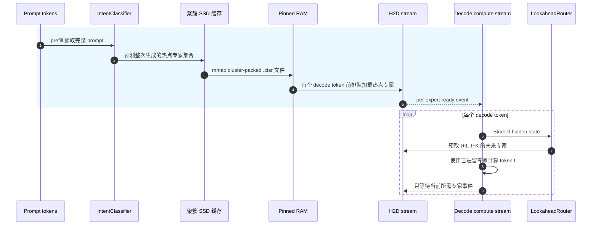
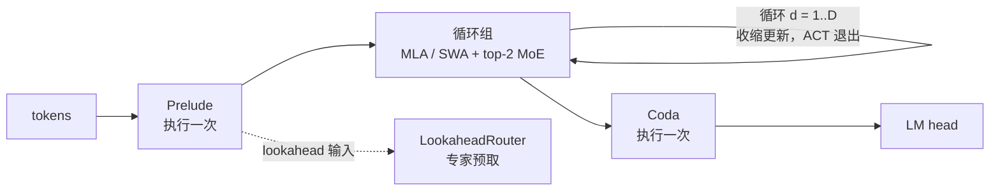
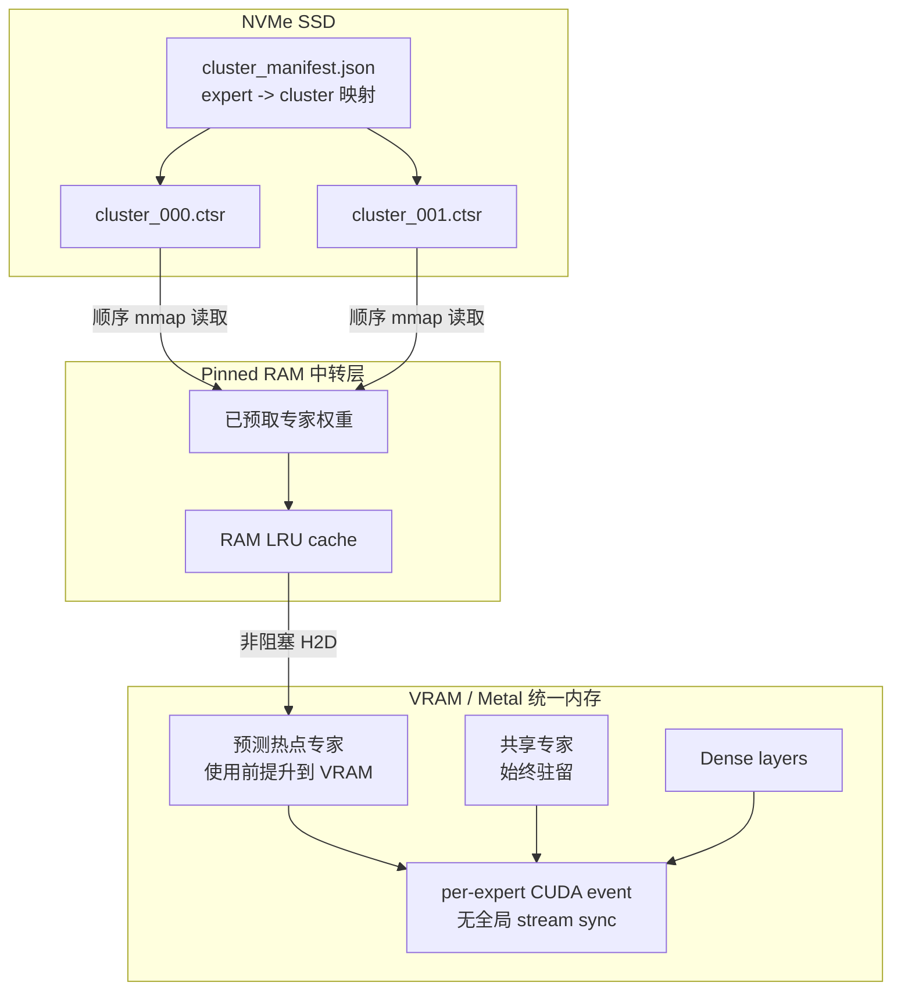
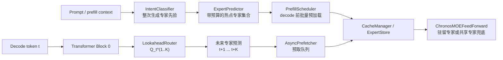
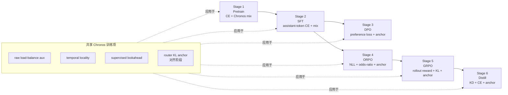
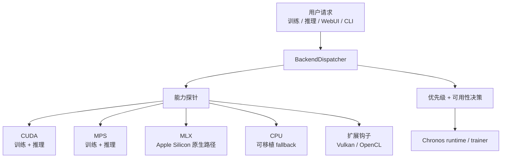
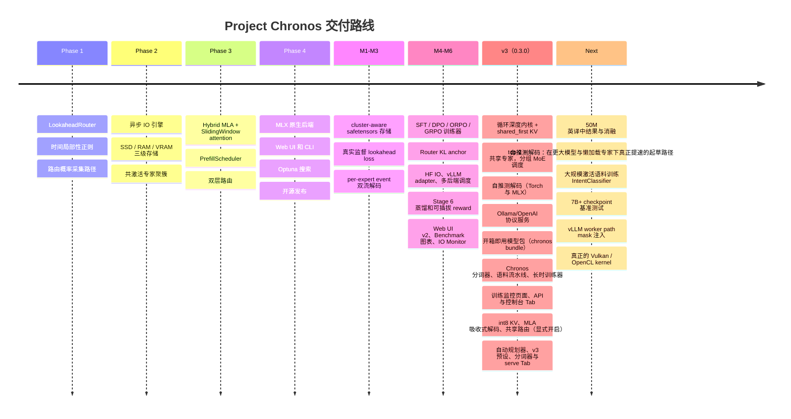
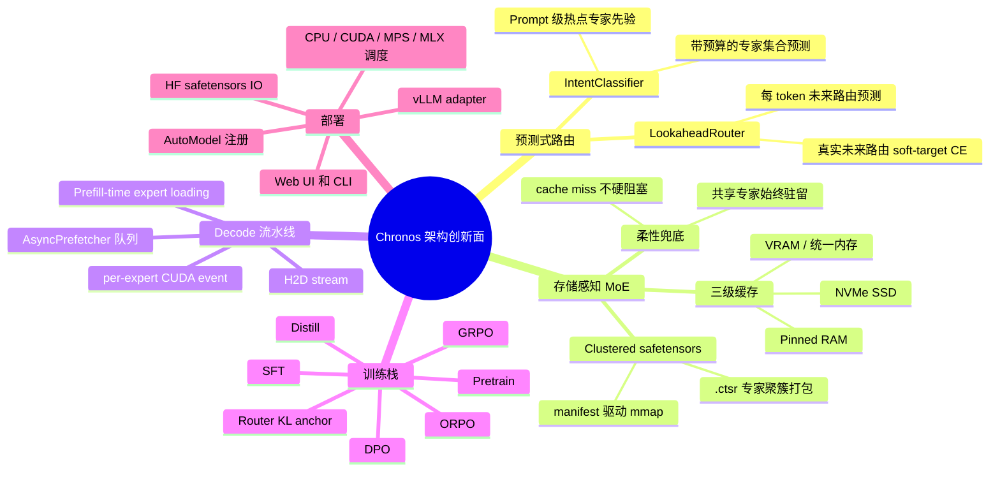

# Project Chronos (In Experimental)

**一套从架构层原生支持 SSD+DRAM 混合加载推理的 MoE 框架，配套完整的 6 阶段训练链路。**

[](https://pypi.org/project/Project_Chronos/)
[](LICENSE)
[](https://python.org)

[English](README.md)

---

## 现有方案的根本性缺陷

主流 MoE 模型（Mixtral、DeepSeek-MoE、Qwen-MoE 等）在消费级硬件上运行时，路由决策是**即时、被动、逐 token** 的——每一步 decode 才去检查所需专家是否在 VRAM 中。当 VRAM 不足时，系统在 decode 流中同步等待 SSD→RAM→VRAM 的搬运，生成速度跌至 **< 5 tokens/s**。

这不是参数调优问题，而是**架构层的根本缺陷**：这些模型设计时假设全量 VRAM 驻留，offload 是事后打的补丁。

---

## Chronos 的核心思路：把 IO 挪到 Prefill，把同步挪到事件级



两层关键改进：

1. **Prefill 时机**：`PrefillScheduler` + `IntentClassifier` 在第一个 decode token 之前批量预加载专家。
2. **事件级同步（M3）**：`promote_to_vram(blocking=False)` 在 `_h2d_stream` 上记录 `torch.cuda.Event`；compute 流通过 `current_stream.wait_event(evt)` **只等所需专家**，不再全局 `stream.synchronize()`。在 30ms 模拟 SSD 延迟下，新路径比旧路径有 **35ms+/token** 的流水线富余空间。

---

## v3 内核：循环深度 MoE（0.3.0）

v3 让少量物理层被多次复用。执行分三段：
- Prelude 执行一次。
- 每个共享循环组循环 `recurrent_depth` 次，每次做收缩式更新 `h ← h + dt·(block(h + e_loop) − h)`。
- Coda 执行一次。

50M demo 有 6 个物理层，实际执行 18 个虚拟层（prelude 1 + 4 个循环层 × 深度 4 + coda 1）。



**相对 v2 的变化**

| | v2 | v3 |
|---|---|---|
| 循环内注意力 | 只在第 0 轮执行（`first_only`） | 每轮都执行 |
| 每个循环层的 KV cache | 1 个槽位；打开"每轮注意力"开关时每轮重写（实测 prefill+decode 与 full forward 偏差 0.94） | `shared_first`：每轮重算 Q，K/V 取第 0 轮，KV 槽位数 = 物理层数 |
| 路由 | top-1（gate 拿不到 CE 梯度） | top-2 + 1 个共享专家 |
| MoE 调度 | Python 逐专家循环，含 `.item()` 同步 | 排序分组调度：MLX 用 `gather_mm`，Torch 用 `argsort` + `index_add_` |
| 提前退出 | 每步同步 host | 纯张量 ACT，结果精确且与 batch 无关；decode 可逐 token 退出，不留 KV 缺口 |
| 解码 | 普通自回归 | 循环深度自推测解码 |

`per_iteration`（每个虚拟层一个 KV 槽位）保留，用于消融对比。v2 checkpoint 自动以 `first_only` 加载，logits 与保存的 golden 张量误差在 1e-5 以内。

**自推测解码（不增加参数）**
- 同一个模型先用浅深度起草 γ 个 token，再用一次全深度批量前向校验。
- greedy 输出与全深度 greedy 逐 token 一致。
- 采样使用 rejection sampling，保持全深度的分布不变。
- 拒绝后截断 cache：MLA 截断 `c_kv`，滑窗 cache 保留 `窗口 + γ_max` 个条目。
- Torch（`chronos/runtime/speculative.py`）与 MLX（`chronos/mlx/speculative.py`、`ChronosMLXInferenceEngine.generate(speculative=True)`）使用同一套算法。
- 两个后端的测试都覆盖 greedy 一致性、拒绝采样分布，以及回滚结果与从头 prefill 一致。
- Web UI 推理 Tab 提供自推测开关，可调起草深度和 γ。
- 50M demo 在实测过的所有运行时上都结果一致，但都没有提速。实测条件：预训练 step 13,996 checkpoint，greedy，batch 1，FLORES+ dev 英→中，起草深度 1，γ 4。报告在 `reports/speculative/`。

| 运行时 | 普通 tok/s | 自推测 tok/s | 比值 | 接受率 |
|---|---|---|---|---|
| MLX GPU bf16，专家全部在内存 | 112.0 | 107.4 | 0.96× | 42 % |
| MLX GPU bf16，懒加载专家（216 页中常驻 12 页） | 43.7 | 32.0 | 0.73× | 42 % |
| Torch MPS fp32，专家全部加载 | 32.1 | 25.9 | 0.81× | 40 % |
| Torch MPS fp32，懒加载专家 | 17.0 | 14.7 | 0.86× | 40 % |

- 这个规模下，一次全深度单步的开销与一次批量校验相当。
- 懒加载时，起草和校验路由到的专家不同，自推测从 SSD 读取的专家页多出 1.4–1.6 倍。
- greedy 输出在 CPU fp32 和 Torch MPS fp32 下完全一致；GPU bf16 下，24 句中有 2 句在近似平票的位置翻转了 token。
- 因此该开关默认关闭。

**精度链路**
- 全链路使用同一个计算精度。
- FP32 只用在收益明确的位置：RMSNorm 统计量、SDPA softmax、RoPE 表、路由 softmax、LM head logits、优化器 master 权重。
- MLX↔Torch 的 bf16 互转逐位一致。
- `auto` 在 MLX GPU 和 CUDA 上选 bf16，在 CPU 和 MPS 上选 fp32（MPS 的 bf16 实测更慢，见下文）。

**v3 新增工具**

| 命令 | 作用 |
|---|---|
| `chronos tokenizer` | 自研字节回退 BPE：按文字脚本预切分，按语言平衡合并；输出 HF 兼容的 `tokenizer.json` 和 chat template |
| `chronos longrun --spec recipe.json`（别名 `run`） | 按墙钟预算训练的 MLX 任务：每个阶段 warmup + cosine，NaN 回滚，续跑逐位一致，验证 CE；任务通过继承 `LongRun`（`task_eval`）加入自己的指标 |
| `chronos serve` | 原生运行时上的 Ollama/OpenAI 协议服务（见下文） |
| `chronos monitor` | 只读训练监控页面 + JSON API（见下文） |

`chronos.model.factory.fit_config` 按总参数量和激活参数量目标搜索模型配置。

**内核与扩展。** `chronos` 包用于训练通用模型，不含任何任务特化代码。任务工具放在调用内核的扩展里。英↔中翻译 demo 就是这样一个扩展：`demos/translation`（`chronos-translate`：语料流水线、BLEU/chrF 训练、模型包，详见其 README）。它不在 `Project_Chronos` wheel 里，也不发布到 PyPI，需从仓库检出后用 `pip install -e demos/translation` 安装。

**50M 英译中 demo（进行中；`demos/translation`）**
- 模型：总参数 49.69M，激活 12.09M；36 个专家；MLA latent 128；SWA 窗口 128；自研 16k 词表。
- 训练：72 小时 MLX bf16 任务（先预训练，后 SFT），2026-11-05 启动。
- 中途实测：预训练第 13,996 步（计划约 24.7k 步）valid CE 为 2.477（第 1,656 步时为 3.012）。该 checkpoint 已打包为 `chronos-enzh-50m-pretrain-s13996`（见“模型包”）。
- FLORES+ 和 WMT22 上的 BLEU/chrF，以及各项消融（注意力模式、深度、懒加载专家预算、推测 γ），等训练结束后公布。在此之前不给出任何质量数字。

**推理与内存选项（全部默认关闭）。** 每个选项既是 config 字段，也可作为 `chronos serve` 和 Inference Tab 的覆盖项；测试在 Torch 和 MLX 上把每个选项与参考路径做对比。

| 字段 | 取值（第一个为默认） | 作用 |
|---|---|---|
| `kv_cache_dtype` | `auto`、`int8` | `int8` 把 MLA `c_kv` 与 SWA k/v 按 token、每 32 元素一组量化并带 scale；回滚和推测解码都支持 |
| `mla_decode` | `expanded`、`absorbed`、`auto` | `absorbed` 直接对 `c_kv` 打分，不展开 K/V。`auto` 只对短的缓存块做吸收，改为显式开启，因为实测 bf16 下“prefill 走 expanded、decode 走 absorbed”会偏离 full forward（logit 最大差 0.06） |
| `mla_cache_rope` | `false`、`true` | 额外缓存已加 RoPE 的 key，用内存换 decode 速度 |
| `router_scope` | `per_iteration`、`shared` | `shared` 让循环后续各轮复用第 0 轮的专家，每个 token 驻留的专家更少 |
| `draft_exit_kl_coef`、`draft_exit_depth` | `0`、`1` | 训练项：浅层出口对 detach 后的全深度 logits 做 KL，提高推测解码接受率 |
| `max_resident_experts`、`ram_budget_mb` | 不设 | 快速层和 RAM 层的硬上限；LRU 不淘汰 lookahead 预测要用的专家；预取覆盖一个虚拟层的全部循环轮次 |

Web UI 新增 Tokenizer Tab（抽取 → 训练 → 评估）和 Serve Tab（启停 `chronos serve`；API key 通过环境变量传入，不进 argv）。

---

## 三级存储架构（M1：cluster-aware safetensors）



`cluster_manifest.json` 与 `.ctsr` 文件由离线 Louvain 聚类生成；运行时一次 `safetensors.safe_open(...).mmap` 把整个簇拉进 RAM，把随机读改写成顺序读。

### 缓存未命中时的处理

即使最坏情况也不会卡顿——柔性降级（Soft Gating）：

```python
# 纯张量乘法，无 Python 分支，torch.compile 不会图断裂
output = avail[i] * expert_output + (1.0 - avail[i]) * shared_expert_output
```

共享专家常驻；在 exact lazy/offload 对比模式下，Chronos 只会同步物化当前被路由选中的缺失专家，并按 LRU 卸载低热度专家以守住 resident budget，不会静默全量加载所有专家。只有显式启用 fallback 模式时，质量才会按共享专家路径平滑降级。

---

## 双层路由 + 监督的 Lookahead（M2）



| | IntentClassifier（第一层） | LookaheadRouter（第二层） |
|---|---|---|
| **触发时机** | Prefill 阶段一次 | Decode 每个 token |
| **输入** | 完整 Prompt（最多 512 token） | Block 0 的 hidden state |
| **输出** | 整次生成的专家集合 | t+1、t+2 步的专家 ID |
| **训练目标** | 真实激活日志监督（Phase 5） | **L_lookahead — 真实路由 t+k 作为 stop-grad teacher（M2）** |
| **参数量** | ~10–15M（单独训练） | ~2M（随主模型训练） |

M2 之前 LookaheadRouter 没有任何监督——只是个未训练的 head。M2 引入：

```math
L_{\mathrm{lookahead}}
= \frac{1}{|K_{\mathrm{valid}}|}
\sum_{k \in K_{\mathrm{valid}}}
\mathbb{E}_{b,t}
\left[
  - \sum_{e=1}^{E}
  \mathrm{sg}(P_{b,t+k,e}) \log Q_{b,t,e}^{(k)}
\right]
```

让前瞻头真正学习预测未来 K 步的路由分布。

---

## 完整训练链路（Stage 1 → Stage 6）

每个阶段都是独立的 entry script，**全部继承 Chronos 损失混合器**（lookahead + temporal + balance），并在对齐阶段引入**路由 KL 锚定**防止缓存命中率被 RL/DPO 梯度毁掉。



| Stage | 脚本 | 核心损失 | Router KL 锚定 (默认 λ) |
|---|---|---|---|
| 1 Pretrain  | `train_chronos.py`         | CE + balance + temporal + lookahead | 0.0 (off) |
| 2 SFT       | `train_chronos_sft.py`     | + 上述 mix                          | 0.01 (weak) |
| 3 DPO       | `train_chronos_dpo.py`     | DPO log-σ(β·logits) + mix          | 0.10 (strong) |
| 4 ORPO      | `train_chronos_orpo.py`    | NLL + λ·OR（无 ref model）          | 0.10 |
| 5 GRPO      | `train_chronos_grpo.py`    | PG·A − β·KL（含 ToyReward / 可插 LMRewardModel）| 0.10 |
| 6 Distill   | `train_chronos_distill.py` | α·T²·KL(s‖t) + (1−α)·CE             | 0.05 |

训练精度与资源策略：

- 默认 `--dtype auto`。权重、激活、KV cache 和专家页统一使用一个计算精度。FP32 只保留在融合 kernel 内部（SDPA softmax、RMSNorm 统计量），以及 RoPE 表、路由 softmax、loss logits 和优化器的 FP32 master/moments。`auto` 的解析结果：MLX GPU 为 BF16；CUDA 为 BF16，不支持时改用 FP16 并开启 loss scaling；CPU 和 MPS 为 FP32。在 MPS 上，原生 BF16 实测比 FP32 慢：M5 Max、torch 2.10、Chronos 50M 每个训练步 0.749 s 对 0.619 s，decode 每个 token 49.1 ms 对 37.3 ms。如需把权重和 KV 内存减半，可以显式传 `--dtype bfloat16`，代价是速度。
- CPU 训练默认使用物理核心；可用 `--cpu_threads` 或 `--cpu_budget_percent` 覆盖。
- macOS 上 MPS/MLX 训练默认强制 DataLoader workers 为 `0`，避免 multiprocessing 触发 Metal command-buffer 崩溃。CPU/CUDA 仍可使用 worker 进程；高级用户可用 `CHRONOS_ALLOW_METAL_DATALOADER_WORKERS=1` 覆盖这个保护。
- MLX 原生训练会按 `log_interval` 同步 UI 日志、标量读数和图表点；Web UI Stop 会在每个 batch 边界检查并停止。
- Web UI 每阶段保存后会写出 warning-only 的 `<checkpoint>.verify.json`，检查 no-mask vs all-available MoE 等价性，并在 Apple Silicon 上对比 MLX prefill logits 与 PyTorch CPU baseline。

MLX 训练是 Apple Silicon 原生后端，不是 `torch.to("mlx")`。六阶段 MLX
trainer 在 `chronos.mlx.*` 中复刻 PyTorch 训练栈：masked CE、DPO/ORPO/GRPO/
蒸馏损失、load balance、temporal locality、lookahead soft-target 监督、
lookahead top-k 命中损失、router KL anchor。即使权重使用 BF16/FP16，路由
softmax、CE、Adam moments 等数值敏感路径仍以 FP32 计算；因此 `auto` 在
MLX GPU 上默认 BF16（MPS 实测 FP32 更快，默认 FP32）。FP16 的指数范围太小，
在小模型/小 batch/路由分布剧烈波动时更容易把 loss 推成 NaN。

Web UI 的 MLX 训练日志与 CPU/MPS 对齐：step、loss、steps/s、ETA、
checkpoint 保存事件、stop 事件、verify 结果都会同步到界面。Stop 在 batch
边界协作式生效；定期保存会写出可继续训练的 `.pth` 与同名 `.config.json`，
因此 MLX 阶段可以继续接 PyTorch、Export、Diagnose 链路。

MLX 上的内存、多模态与工具调用：

- 每个 MLX 模型在分配权重前把 MLX 缓冲区缓存上限设为 `min(内存/8, 16 GiB)`（`chronos.mlx.memory`）。配方的 `extra.mlx_cache_limit_gb` 或 `CHRONOS_MLX_CACHE_LIMIT_GB` 只能调低，不能调高。上限只约束可回收缓存，不限制权重、激活和梯度。
- 图像、音频编码器和门控交叉注意力融合在 MLX 上支持预训练和 SFT，权重与数值和 PyTorch 一致（`chronos.mlx.multimodal`）。带媒体的 DPO、ORPO、GRPO 和蒸馏仍走 PyTorch。
- 工具调用 SFT：chat 模板支持 `tools`、assistant 的 `tool_calls` 和 `tool` 结果。`chronos.data.chat_records.encode_chat` 为每个 token 标出是否计 loss（assistant 文本和调用参与学习，其余为上下文），`write_sft_records` 写出 `SFTRecords` 可读的 `.lmask` 分片。

完整 6 阶段端到端对比见 `tools/compare_minimind_chronos_v3.py`。

---

## 多后端调度（M5）



```python
from chronos.backend import BackendDispatcher
d = BackendDispatcher()
d.available()      # ['mlx', 'mps', 'cpu'] on Apple Silicon
                   # ['cuda', 'cpu']        on NVIDIA host
d.select()         # 自动选最佳；可被 CHRONOS_BACKEND 环境变量覆盖
d.describe()       # 人类可读的能力总览
```

- **一等公民（训练 + 推理）**：`cpu`、`mps`、`cuda`、`mlx`
- **推理仅 / 实验性**：`vulkan`（仅当 PyTorch `USE_VULKAN=ON` 自定义构建时存在）
- **第三方插件钩子**：`opencl`（替换 `chronos/backend/ext/opencl.py:PROBE()`）
- **Apple Silicon 策略**：推理 auto 仍优先 MLX；训练会走原生 `chronos.mlx.*` 路径，不会把 PyTorch 模型错误地 `.to("mlx")`。

诚实声明：上游 PyTorch 没有 OpenCL 后端、Vulkan 也仅在自定义构建中可用。Chronos 提供 dispatcher 接缝，使第三方插件无需改核心代码即可接入。

### MLX lazy/offload 运行时

MLX 使用 Apple 统一内存，因此 Chronos 在 MLX 上的 “VRAM/RAM” 是逻辑分层，
不是 PCIe 式物理分层。但 lazy runtime 仍严格遵守与 CUDA/MPS/CPU 一致的
offload contract：

- **Hot slots**：只保存执行预算内、已经 materialize 成 MLX live module 的专家。
- **Warm cache**：只保存有界预测缓冲，从 `.ctsr` safetensors 中按专家/簇加载；
  不允许暗中保留全量专家副本。
- **Cold storage**：checkpoint/export reader 或 per-expert cluster cache。Lazy
  模式创建 cache 后会把 live experts 替换为 placeholder；不会保留 `_saved_live`
  这种全量专家修复缓存。
- Lookahead 预测只进入 warm cache 队列，只有 ready 的专家才会 promote。真实 miss
  只同步 materialize 当前被选中的专家，不会 full-load 整个模型。
- MLX attention 会按需扩容 RoPE lookup table，因此 prompt 长度加 decode 超过
  `max_position_embeddings` 时不会在第 257/513 等 token 崩溃。

Inference compare/sweep 会报告真实 hot/warm 数量、resident hit、prediction hit、
sync SSD loads、MLX active/cache/peak memory、进程 RSS、prefill/decode 时间与
tokens/s。只有确定性 exact-lazy 输出与 full-DRAM 一致、且 fallback weight 为 0，
才应该把该 checkpoint 标记为 offload-ready。

---

## HuggingFace / vLLM 兼容（M5）

- `ChronosForCausalLM` 继承 `PreTrainedModel`，已注册 `AutoConfig` / `AutoModelForCausalLM`，无需 `trust_remote_code`：

  ```python
  from transformers import AutoModelForCausalLM
  model = AutoModelForCausalLM.from_pretrained("./out_dir")
  ```

- `chronos.model.hf_io.save_chronos_pretrained` / `load_chronos_pretrained` 输出标准 `model.safetensors` + `config.json`，并把 `cluster_manifest.json` + `.ctsr` 一起带过去；roundtrip logits 0.00e+00 偏差。

- `chronos.serving.register_chronos_with_vllm()` 在已安装 vLLM 时把 Chronos 注册到 `ModelRegistry`；未安装时打印安装提示，**不报错**。worker 侧 mask 注入 hook 见 `docs/vllm_integration.md`。

---

## 与现有方案对比

| 特性 | llama.cpp offload | vLLM offload | **Project Chronos** |
|---|---|---|---|
| 专家预测 | 无（被动） | 无（被动） | **主动预测（IntentCLF + LookaheadRouter）** |
| Lookahead 训练 | n/a | n/a | **L_lookahead 真实监督（M2）** |
| IO 时机 | Decode 期间（阻塞） | Decode 期间（阻塞） | **Prefill 期间（异步，前置）** |
| Decode 流水线 | 同步 | 同步 | **双流 + per-expert event（M3）** |
| Cache miss 行为 | 硬阻塞 | 硬阻塞 | **Soft Gating（零阻塞）** |
| 磁盘格式 | gguf | safetensors | **cluster-packed safetensors（.ctsr）** |
| 训练集成 | 事后补丁 | 事后补丁 | **6 阶段全栈 + 路由 KL 锚定** |
| 后端调度 | 编译期固定 | CUDA-only | **cpu / mps / cuda / mlx 自动 + vulkan/opencl 钩子** |
| Apple Silicon 原生 | 部分 | 无 | **完整 MLX 后端** |
| HuggingFace 兼容 | 仅 GGUF | ✓ | ✓ + 携带专家缓存 |
| vLLM 兼容 | n/a | 原生 | **可选 adapter（按需注册）** |

---

## 损失函数（完整形式）

```math
L_{\mathrm{total}} =
L_{\mathrm{base}}
+ \lambda_{\mathrm{bal}} L_{\mathrm{aux}}
+ \lambda_{\mathrm{tmp}} L_{\mathrm{temporal}}
+ \lambda_{\mathrm{LA}} L_{\mathrm{lookahead}}
+ \lambda_{\mathrm{anc}} L_{\mathrm{routerKL}}
```

```math
L_{\mathrm{aux}} = E \sum_{e=1}^{E} load_e \cdot \overline{p}_e
```

```math
L_{\mathrm{temporal}} =
\mathbb{E}_{b,t}
\left[
  \left\| P_{b,t,:} - P_{b,t-1,:} \right\|_2^2
\right]
```

```math
L_{\mathrm{routerKL}} =
D_{\mathrm{KL}}
\left(
  \pi_{\theta}^{\mathrm{router}}
  \|
  \pi_{\mathrm{ref}}^{\mathrm{router}}
\right)
```

- `L_base`：阶段相关目标（CE / DPO / ORPO / GRPO / KD）。
- `L_aux`：未缩放的 MoE load-balance 辅助项；Chronos 在 `chronos_loss_term` 中只乘一次 `lambda_bal`。
- `L_temporal`：约束相邻 token 的路由分布不要剧烈跳变，提高专家复用和缓存局部性。
- `L_lookahead`：未来真实路由分布到前瞻预测的 soft-target cross entropy。`sg(...)` 表示 stop-gradient。
- `L_routerKL`：对齐阶段锚定 stage 开始时捕获的参考路由分布，防止 RL/DPO/ORPO/GRPO 梯度破坏聚簇布局。

`λ` 全部支持 Optuna TPE 自动搜索（包括 `hidden_size` / `num_experts` / `kv_latent_dim` 等结构超参）。

---

## 安装

```bash
pip install Project_Chronos
```

或从源码：

```bash
git clone https://github.com/FonaTech/Project_Chronos
cd Project_Chronos
pip install -e ".[dev]"
```

**MLX（Apple Silicon）：**
```bash
pip install "Project_Chronos[mlx]"
```

**可选依赖组**（版本已固定）：
```bash
pip install "Project_Chronos[serve]"      # chronos serve / chronos monitor（fastapi、uvicorn）
pip install -e demos/translation          # 英↔中 demo 扩展 chronos-translate，仅限仓库检出安装（不在 PyPI）
```

**vLLM 服务（可选，仅 Linux+CUDA）：**
```bash
pip install vllm
```

> **minimind 依赖**：Project Chronos 使用 [minimind](https://github.com/jingyaogong/minimind) 作为 MoE 内核。
> 若本地未找到，首次 import 时自动克隆至 `~/.cache/chronos/minimind-master/`（需要 `git` 和网络）。
> 设置 `CHRONOS_MINIMIND_DIR=/path/to/minimind` 可改用本地副本；模型包自带 `third_party/minimind`，启动脚本会设置这个变量。
> minimind 采用 **Apache-2.0** 授权，完整归属见 [THIRD_PARTY_NOTICES.md](THIRD_PARTY_NOTICES.md)。

**环境要求**：Python 3.10+，PyTorch 2.6+

---

## 快速开始

### Web UI（11 个页面，4 种语言）

```bash
chronos-ui                       # 或：python chronos_app.py
chronos-ui --lan                 # 同时开放局域网访问（默认关闭）
chronos-ui --legacy              # 旧版 Gradio 控制台
```

FastAPI 服务加单页前端（`chronos/webui/`），默认只监听 127.0.0.1，无需登录。页面包括：模型（v3 预设、下文的自动规划器、实时参数与内存估算）、数据（扫描一个或多个数据集）、分词器（抽取 → 训练 → 评估 Chronos BPE）、训练（按顺序执行各阶段，每阶段可单独指定数据；可在每次验证时探测懒加载）、监控（只读查看任意运行目录，包括命令行启动的训练）、推理（同一提示词对比懒加载专家与全内存）、导出、服务（启停 `chronos serve`）、基准测试、自动调参、IO 指标。

- **语言。** 支持 zh-Hans、zh-Hant、en、ja，自动跟随浏览器语言，不支持的语言回退到英文。每个设置项都有悬浮说明，给出含义和推荐值（光标停留 2 秒后显示；“?” 标记 0.4 秒后显示）。
- **路径。** “浏览…”列出服务所在电脑上的文件夹。“上传…”使用系统文件管理器：在服务所在的电脑上由服务打开系统对话框，直接使用原路径；从其他设备访问时，文件上传到 `<workdir>/uploads/` 后使用该路径。数据集字段可以填多个文件或文件夹（每行一个），训练和导出校准会把它们合并成一个 JSONL 文件。
- **局域网访问**（`--lan`）。其他设备用 `CHRONOS_UI_KEY` 登录；未设置时启动时会生成并打印一个密钥。服务所在的电脑无需登录。登录后的浏览器能以服务用户的权限训练、读写文件，只应在可信网络中使用。不配 `--ssl-certfile` / `--ssl-keyfile` 或 TLS 反向代理时，密钥以明文经过 HTTP。`--max-upload-mb` 限制单个上传文件（默认 20480）；`--no-native-dialog` 关闭系统对话框（例如通过 SSH 运行时）。绑定其他地址需要 `--allow-remote` 并在环境变量中提供密钥。

### 预设与自动规划器

Config Tab 提供 5 档 v3 预设。它们都由规划器生成，存放在 `ui/presets_v3.json`，可用 `python -m ui.presets` 重新生成。参数量在 meta device 上实测，峰值内存是估算值。

| 预设 | 总参数 / 激活参数（实测） | 形状 | 内存档位 | 训练峰值（估算） |
|---|---|---|---|---|
| Chronos-v3 Tiny (smoke / CI) | 1.51M / 1.29M | E4 top-2，词表 6400，seq 128，深度 2 | none | 2.13 GB |
| Chronos-v3 50M (16k vocab) | 49.69M / 12.09M | h384，L6，E36 top-2，词表 16384，seq 512 | none | 16.4 GB（正在跑的任务实测峰值 8.72 GB） |
| Chronos-v3 200M (32 GB)（默认） | 200.72M / 28.20M | h576，E32 top-2 | balanced | 10.14 GB |
| Chronos-v3 500M (32 GB) | 499.53M / 61.59M | E48 top-3 | aggressive | 9.26 GB |
| Chronos-v3 1B (64 GB) | 1002.17M / 99.74M | E64 top-4，seq 2048 | aggressive | 18.92 GB |

旧预设名（Recommended-CN、Tiny/Small/Medium/Large）仍可加载，会映射到最接近的 v3 档位。

**自动规划器**（Config Tab →“自动规划”）

输入：
- 目标总参数量、是否开启 MoE；
- 专家数，以及“激活专家数”或“激活参数量”二选一；
- 内存节省档位：`none`、`balanced`、`aggressive`、`extreme`；
- 可选：数据集路径、内存、token 预算、词表大小、序列长度。

`chronos.model.planner.plan_training` 的处理步骤：
1. **分析数据集。** 读取分片 manifest 或抽样文件，把记录分成预训练、SFT、偏好、RL 四类，并读取分词器报告。数据里有词表大小、序列长度（p95 或上限）、token 数和分词器路径时，直接采用。
2. **搜索架构。** 找出 meta device 实测参数量最接近目标的隐藏维度、层数、专家宽度和 GQA 头数。
3. **确定学习率和 batch。** 按 DeepSeek LLM 的计算最优拟合式（η = 0.3118·C^−0.125，B = 0.2920·C^0.3271）给出，宽模型的学习率另设上限。
4. **匹配内存。** 按内存档位选择 micro-batch、梯度累积、int8 KV、路由范围、激活检查点、优化器分页和专家 RAM 预算。
5. **生成各阶段参数。** pretrain、SFT、DPO、ORPO、GRPO、distill 各有独立的学习率、batch、epoch、保存间隔，以及各自的专用项（β、温度、α）。

阶段表可以直接编辑。Train Tab 会把所选阶段那一行合并到共享参数之上；pretrain 行与共享控件保持同步。“保存方案”把 config、各阶段参数和报告写成 JSON。报告里每个数字都标注实测或估算。

### 训练监控（控制台 Tab + 独立页面/API）

`chronos longrun` 的运行目录包含以下文件：
- `run_spec.json`、`metrics.jsonl`；
- `status.json`：心跳；
- `runtime.json`：精度策略、设备、版本、代码哈希；
- `parameters.jsonl`：逐张量的权重、梯度、更新量统计，以及逐虚拟层路由；
- `samples.jsonl`、`inspections/` 和 checkpoint。

控制台的 **Training Monitor** Tab 和独立页面读取的是同一批文件，都不会占用训练设备。遥测功能上线前启动的运行同样能显示进度，其状态由 `metrics.jsonl` 和进程表推断。

```bash
chronos monitor --runs-dir runs                    # http://127.0.0.1:7870/
chronos serve --models-dir exports --monitor-runs-dir runs   # 同一页面挂在 /monitor/
```

JSON API（只读）：
- `GET /api/state?run=&history=1`
- `/api/metrics?run=&phase=&since=`
- `/api/parameters`、`/api/tensors`、`/api/tensor?name=`
- `/api/log?bytes=`、`/api/runs`

安全：
- 默认只监听 127.0.0.1，不带认证。
- 绑定其他地址时，必须同时给出 `--allow-remote` 和 `--api-key`（或设置环境变量 `CHRONOS_MONITOR_KEY`）。
- 浏览器登录一次后获得 HttpOnly、SameSite=Strict 的会话 cookie；脚本使用 `Authorization: Bearer <key>`。
- 登录失败有限流。
- 非本机访问时请加 `--ssl-certfile/--ssl-keyfile` 或使用 TLS 反向代理，否则密钥会以明文在网络上传输。

### Ollama / OpenAI 协议服务

`chronos serve` 把原生 Chronos 运行时挂在 Ollama 和 OpenAI 的 HTTP API 之后。内核不会被转换成其他架构，因此循环深度、SSD 懒加载专家与 lookahead 预取、KV 压缩、自推测解码都保持生效。

```bash
pip install "Project_Chronos[serve]"
chronos serve --models-dir ./exports --port 11435        # 11434 会和正在运行的 Ollama 冲突
OLLAMA_HOST=127.0.0.1:11435 ollama list
OLLAMA_HOST=127.0.0.1:11435 ollama run <模型名> "你好"
```

- 接口：`/api/version`、`/api/tags`、`/api/show`、`/api/ps`、`/api/pull`、`/api/generate` 和 `/api/chat`（流式 NDJSON）、`/v1/models`、`/v1/chat/completions`（SSE）。
- 模型来源：`--models-dir` 下成对的 `<name>.pth` 和 `<name>.config.json`。
- Chronos 专属参数放在请求的 `options` 里：`chronos_speculative`、`chronos_draft_depth`、`chronos_gamma`、`chronos_miss_policy`。
- stock `ollama` / llama.cpp 无法执行 Chronos 的 GGUF 文件，因为 MLA+SWA 混合层和收缩式循环没有对应的 stock 实现；请改用本服务。
- 安全：默认只监听 127.0.0.1，不带认证。绑定其他地址必须同时给出 `--allow-remote` 和 `--api-key`，客户端随后发送 `Authorization: Bearer <key>`。

### 模型包（翻译 demo 扩展）

模型包属于翻译扩展（`demos/translation`）。先构建两个 wheel（`python -m build --outdir dist .` 和 `python -m build --outdir dist demos/translation`）。`chronos-translate bundle build` 把某次运行导出的一个 checkpoint 打包成解压即用的目录。打包过程只读取运行目录。

```bash
chronos-translate bundle build --run-dir runs/enzh_50m_v1 --which best --pack \
    --wheel dist/project_chronos-0.3.1a3-py3-none-any.whl --wheel dist/chronos_translate-0.3.1a3-py3-none-any.whl
```

| 包内路径 | 内容 |
|---|---|
| `model/` | 权重 + `.config.json` 配置文件，分词器（`model/tokenizer/`） |
| `eval/` | FLORES+ dev/devtest（CC BY-SA 4.0），供 `bundle eval` / `probe` 使用 |
| `data/sft_valid/` | 该次运行的 SFT 验证分片 |
| `third_party/minimind/` | 内置 minimind（Apache-2.0），无需 git clone |
| `wheels/`、`bin/setup.sh`、`bin/chronos` | 把内核和扩展两个 wheel 离线安装到 `.venv`；启动脚本设置 `CHRONOS_BUNDLE` / `CHRONOS_MINIMIND_DIR`，并把 `bundle …` 转给 `chronos-translate` |
| `recipes/source_run_spec.json`、`recommended.json` | 产生这份权重的配方；微调档位 `smoke` / `quick` / `standard` / `full` |
| `bundle.json` | 来源信息（步数、token 数、valid CE）、实测质量探针、每个文件的 SHA-256 |

接收方的用法：

```bash
bin/setup.sh                                              # 建 venv、装 wheels、运行 `bundle check`
bin/chronos bundle translate "The weather is very nice today."
bin/chronos bundle translate --backend mlx --speculative --file examples/translate_en.txt
bin/chronos bundle eval --split devtest -n 200
bin/chronos bundle prepare-data my_pairs.jsonl --out work/data      # 会从你的数据中剔除 FLORES+
bin/chronos bundle finetune --data work/data --run-dir work/ft --tier quick --mode sft
bin/chronos bundle serve -- --port 11435
```

`--speculative` 要求 `--repetition-penalty 1.0`（此时的默认值），因为惩罚会逐位置改变目标分布。`finetune` 写出一份 `init_checkpoint` 指向包内权重的 `chronos-translate run` spec；运行目录里已有训练时会拒绝写入。用许可未知的数据（WMT19、OPUS-100）训练的模型包，`NOTICE.md` 中写明权重仅供研究使用。

### 部署导出

```bash
chronos export \
    --model_path ./out/sft_384_moe.pth \
    --output_dir ./exports/sft_384 \
    --formats fp16-safetensors q8_0-safetensors fp16-gguf q8_0-gguf
```

导出产物包含 `config.json`、`chronos_export_manifest.json`，并写入 MoE
top-k、共享 fallback expert、lookahead router、混合注意力、可选专家缓存布局等
Chronos 元数据。Chronos 原生 loader 可以从导出的 `safetensors` / `GGUF`
产物直接走懒加载专家链路。

兼容性说明：GGUF 使用 `general.architecture=chronos`。未实现 Chronos
architecture 的 stock Ollama/llama.cpp 不能正确执行该模型；Chronos 不是
LLaMA tensor layout 的简单改名。

### Stage 1：预训练

```bash
python train_chronos.py \
    --data_path ./tests/fixtures/tiny_pretrain.jsonl \
    --hidden_size 256 --num_hidden_layers 4 --num_experts 4 \
    --epochs 1 --device cpu --save_dir ./out
```

### Stage 2-5：对齐链路

```bash
python train_chronos_sft.py   --data_path ./tests/fixtures/tiny_sft.jsonl   --from_weight chronos --save_dir ./out --device cpu
python train_chronos_dpo.py   --data_path ./tests/fixtures/tiny_dpo.jsonl   --from_weight sft     --save_dir ./out --device cpu
python train_chronos_orpo.py  --data_path ./tests/fixtures/tiny_dpo.jsonl   --from_weight sft     --save_dir ./out --device cpu
python train_chronos_grpo.py  --data_path ./tests/fixtures/tiny_grpo.jsonl  --from_weight orpo    --save_dir ./out --device cpu \
    --reward toy   # 或 lm:/path/to/reward-model
```

### Stage 6：蒸馏

```bash
python train_chronos_distill.py \
    --data_path ./tests/fixtures/tiny_sft.jsonl \
    --teacher_path ./out/sft_192_moe.pth \
    --from_weight grpo --save_dir ./out --device cpu \
    --alpha 0.7 --temperature 4.0
```

### Checkpoint 与 offload 诊断

新的 `.pth` checkpoint 会同步写出同名 `*.config.json`，保存无法从权重形状反推的 MoE 拓扑字段，例如 `num_experts_per_tok`。诊断命令会检查 chat template 生成、`no_mask` vs `all_available` masked drift、全冷 shared fallback、LookaheadRouter 预测质量，以及 SSD/RAM/VRAM offload 统计。

```bash
python diagnose_checkpoint.py \
    --model_path ./out/sft_384_moe.pth \
    --config_path ./chronos_config.json \
    --sft_data ../Dataset/sft_t2t.jsonl \
    --mlx_parity \
    --device cpu

# 或使用统一 CLI：
chronos diagnose --model_path ./out/sft_384_moe.pth --config_path ./chronos_config.json
```

后端速度与 dtype sanity check：

```bash
python benchmark_training_backends.py --backends cpu mps mlx --dtypes auto bfloat16 float16 --steps 2
```

### 端到端对比（minimind vs Chronos）

```bash
python tools/compare_minimind_chronos_v3.py \
    --pretrain_steps 150 --align_steps 30 --distill_steps 30 \
    --simulated_ssd_ms 30 --device cpu \
    --output results/compare_results_v3.json
```

输出包括：每阶段 loss、HF roundtrip Δlogit、tokens/sec、激活专家比例、常驻专家字节、M3 流水线富余空间、当前主机后端列表。

### v2 循环深度与分页实测

`tools/benchmark_chronos_v2.py` 使用固定种子的可收敛 next-token 任务，对照 v1、固定循环深度 2/4、ACT adaptive，并实际执行 `sync_on_demand`、`on_demand` 和 `fallback_diagnostic` 三种专家分页路径。报告会写入 JSON，包含训练/验证 CE、PPL、next-token accuracy、prefill/decode tokens/s、KV 长度、平均循环深度、early-exit、RSS、专家驻留比例、预测 recall 和 full-resident 精确 token 对齐率。

```bash
# CPU：完整四组架构 + SSD/分页路径
python -m tools.benchmark_chronos_v2 \
    --device cpu --train_steps 60 --output results/chronos_v2_benchmark_cpu.json

# Apple Silicon MPS：功能/质量/Metal 内存快照
python -m tools.benchmark_chronos_v2 \
    --device mps --train_steps 20 --output results/chronos_v2_benchmark_mps.json
```

该基准只代表 tiny 模型的架构回归，不等同于大模型最终能力；CUDA 显存峰值、NVMe 带宽和生产级 tokens/s 必须在目标 CUDA+NVMe 机器上另行运行。

### 专家聚簇存储（最大化 SSD 顺序读）

```python
from chronos.io.cluster_layout import (
    collect_activation_log, build_cooccurrence_matrix,
    try_louvain_clustering, repack_expert_weights_safetensors,
)
log = collect_activation_log(model, calib_loader, "cpu", max_batches=50)
clusters = try_louvain_clustering(build_cooccurrence_matrix(log, num_experts))
repack_expert_weights_safetensors(model, clusters, "./expert_cache_clustered")
```

### λ + 结构超参自动搜索

```python
from chronos.tuning.chronos_auto_tuner import ChronosAutoTuner, ChronosSearchSpaceConfig

tuner = ChronosAutoTuner()
tuner.start(
    model_id="./out/chronos_256_moe.pth",
    dataset_path="./dataset/train.jsonl",
    search_space=ChronosSearchSpaceConfig(
        tune_lambda_balance=True, tune_lambda_temporal=True,
        tune_lambda_lookahead=True, tune_lookahead_steps=True,
        tune_hidden_size=True, tune_num_experts=True,
        tune_num_shared_experts=True, tune_kv_latent_dim=True,
    ),
    n_trials=20,
)
```

---

## 项目结构

```
Project_Chronos/
├── chronos/
│   ├── deps.py                    # 自动下载 minimind（若本地未找到）
│   ├── __init__.py                # 注册 AutoConfig / AutoModelForCausalLM
│   ├── model/
│   │   ├── config.py              # ChronosConfig（lookahead/temporal/anchor/storage_format、v3 字段与 v2 迁移）
│   │   ├── recurrent.py           # 循环/组嵌入、收缩步长、纯张量 ACT
│   │   ├── precision_ops.py       # 单一计算精度的 RMSNorm/SDPA/RoPE
│   │   ├── factory.py             # 按参数预算搜索配置
│   │   ├── hybrid_attention.py    # MLAAttention + SlidingWindowAttention
│   │   ├── lookahead_router.py    # 逐 token 前瞻预测器（第二层）
│   │   ├── moe_chronos.py         # ChronosMOEFeedForward + 共享专家 + Soft Gating
│   │   ├── model_chronos.py       # ChronosForCausalLM（_tied_weights_keys 已修补）
│   │   ├── temporal_loss.py       # 时间局部性 + lookahead 监督损失
│   │   └── hf_io.py               # save/load_chronos_pretrained + AutoModel 注册
│   ├── io/
│   │   ├── expert_store.py        # 三级存储 + per-expert Event + 非阻塞 promote
│   │   ├── async_prefetcher.py    # 异步预取（prefetch_only / promote_current 已分离）
│   │   ├── storage.py             # ClusterStorage：.ctsr safetensors + manifest
│   │   ├── cluster_layout.py      # 共现聚簇 + safetensors 重排
│   │   └── io_simulator.py        # CHRONOS_SIM_SSD_MS 测试钩子（M3）
│   ├── router/
│   │   ├── intent_classifier.py   # Prompt 级专家预测器（第一层，~10M 参数）
│   │   ├── expert_predictor.py    # IntentVector → ExpertSet（含预算上限）
│   │   └── prefill_scheduler.py   # 编排 prefill 阶段批量预加载
│   ├── mlx/                       # Apple Silicon 原生后端
│   │   ├── attention.py / moe.py / model.py / expert_store.py / inference.py
│   │   ├── moe_kernels.py         # 排序 gather_mm 调度（mlx >= 0.32.4）
│   │   ├── speculative.py         # MLX 自推测解码（与 Torch 对齐）
│   │   └── training/              # longrun.py、telemetry.py、recipes/
│   ├── runtime/
│   │   ├── speculative.py         # 循环深度自推测解码
│   │   ├── cache_manager.py       # prefetch_for_next_step / ensure_resident（M3）
│   │   ├── inference_engine.py    # 端到端推理引擎（重排为 H2D-compute 重叠）
│   │   └── metrics.py             # MetricsBus（IO Monitor 数据源）
│   ├── trainer/
│   │   ├── loss_mixin.py          # chronos_loss_term + router_kl_anchor + capture_reference_routing
│   │   ├── chronos_trainer.py     # Pretrain
│   │   ├── sft_trainer.py         # Stage 2
│   │   ├── dpo_trainer.py         # Stage 3
│   │   ├── orpo_trainer.py        # Stage 4（无 ref model）
│   │   ├── grpo_trainer.py        # Stage 5（含 self-contained rollout）
│   │   ├── distill_trainer.py     # Stage 6（KL/T² + α 混合）
│   │   └── reward.py              # ToyReward / LMRewardModel / build_reward_fn
│   ├── tuning/
│   │   └── chronos_auto_tuner.py  # Optuna λ + 结构超参搜索
│   ├── eval/
│   │   ├── io_profiler.py         # Phase 1 验证（前瞻准确率）
│   │   └── benchmark.py           # 端到端基准测试
│   ├── data/
│   │   ├── flexible_dataset.py    # 自动识别任意 JSONL 字段格式
│   │   └── shards.py              # 内存映射的预训练 / SFT 分片读取器
│   ├── tokenizer/                 # Chronos BPE 构建器（抽取、规范化、训练、评估）
│   ├── monitor/                   # 只读运行监控：快照、API 服务、静态页面
│   ├── webui/                     # Web UI：FastAPI 服务、字段 schema、i18n/*.json、static/ 单页前端
│   ├── workbench/                 # Web UI 任务：训练 worker、数据扫描、文件选取与合并、懒加载探针
│   ├── backend/
│   │   ├── __init__.py            # BackendDispatcher（cpu/mps/cuda/mlx）
│   │   ├── dispatcher.py          # 探针 + 优先级 + 训练能力声明
│   │   └── ext/opencl.py          # 第三方 OpenCL 插件钩子（stub）
│   ├── _backend_legacy.py         # 向后兼容 build_model() 等旧 API
│   ├── serving/
│   │   ├── ollama_server.py       # chronos serve：Ollama/OpenAI 协议层
│   │   ├── runtime.py             # 模型发现、懒加载专家、推测生成
│   │   └── vllm_adapter.py        # 可选 vLLM 注册（无 vLLM 时优雅降级）
│   └── cli.py                     # 统一 CLI
├── ui/                            # 旧版 Gradio 控制台（chronos-ui --legacy）
│   ├── i18n.py
│   ├── estimator.py               # 实时参数量/内存估算（与 Config 同步）
│   └── tabs/
│       ├── config_tab.py          # 已合并 Designer，右侧实时估算面板
│       ├── data_tab.py
│       ├── train_tab.py           # 拥有 data_path（不再属于 Config）
│       ├── monitor_tab.py         # Training Monitor（与 chronos.monitor 共用数据层）
│       ├── pipeline_tab.py        # 6 阶段，每段独立 data_path
│       ├── inference_tab.py
│       ├── benchmark_tab.py       # Markdown 表 + gr.BarPlot
│       ├── autotune_tab.py        # 持久化日志 + Apply Best → Config
│       └── iomon_tab.py           # MetricsBus 实时仪表盘
├── chronos_app.py                 # Web UI 入口
├── train_chronos.py               # Stage 1 入口
├── train_chronos_sft.py           # Stage 2 入口
├── train_chronos_dpo.py           # Stage 3 入口
├── train_chronos_orpo.py          # Stage 4 入口
├── train_chronos_grpo.py          # Stage 5 入口
├── train_chronos_distill.py       # Stage 6 入口
├── tools/
│   ├── compare_minimind_chronos.py      # v1 (M1+M2)
│   ├── compare_minimind_chronos_v2.py   # v2 (M3+M4)
│   └── compare_minimind_chronos_v3.py   # v3 (含 6 阶段 + HF roundtrip + 后端报告)
├── tests/
│   ├── test_smoke.py / test_smoke_cuda.py（后者仅 CUDA 主机执行）
│   ├── test_v3_kernel.py / test_speculative.py / test_moe_dispatch.py / test_precision_chain.py
│   ├── test_tokenizer_builder.py / test_longrun.py / test_monitor.py
│   └── fixtures/                  # tiny_pretrain / tiny_sft / tiny_dpo / tiny_grpo
├── docs/
│   └── vllm_integration.md
├── demos/
│   └── translation/               # 英↔中扩展（chronos-translate）：语料、训练、模型包；不进 wheel
├── pyproject.toml
└── README.md / README_zh.md / THIRD_PARTY_NOTICES.md
```

---

## 开发路线图





---

## 引用

```bibtex
@misc{chronos2026,
  title  = {Project Chronos: Prefill-Time Expert Loading and Dual-Layer Routing
             for Zero-Stall On-Device MoE Inference},
  author = {Fona and Project Chronos Contributors},
  year   = {2026},
  url    = {https://github.com/FonaTech/Project_Chronos}
}
```

---

## 第三方归属

Project Chronos 基于 **jingyaogong** 的 [minimind](https://github.com/jingyaogong/minimind)（Apache-2.0）构建。完整归属见 [THIRD_PARTY_NOTICES.md](THIRD_PARTY_NOTICES.md)。

---

## License

Apache 2.0 — see [LICENSE](LICENSE)
