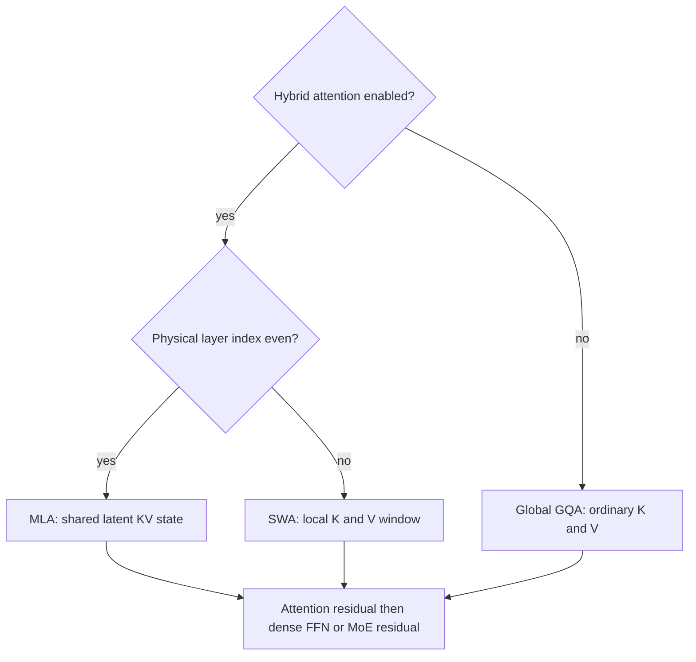
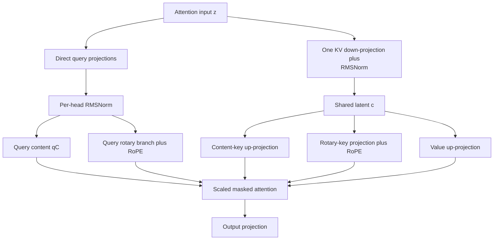
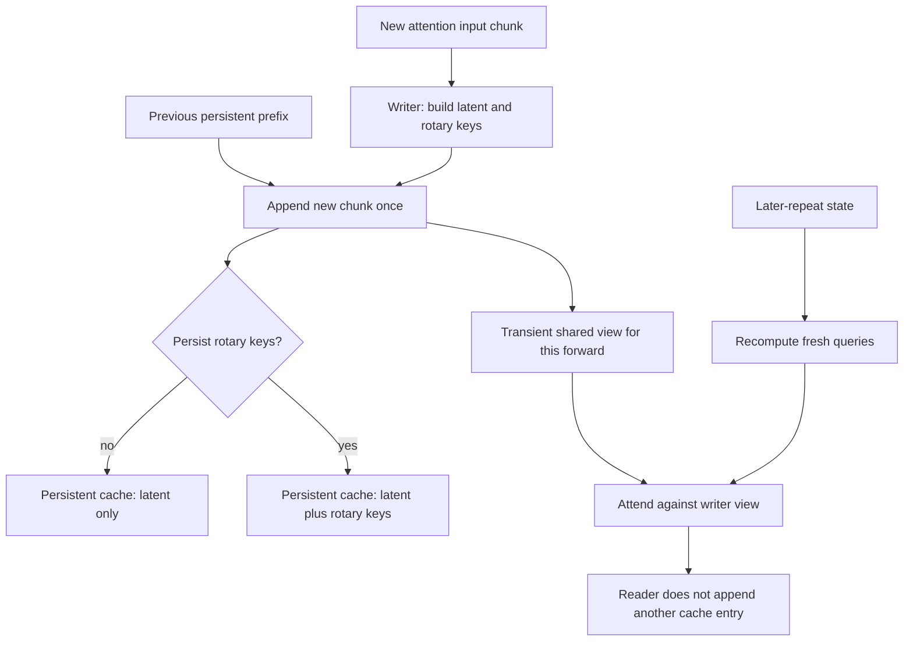
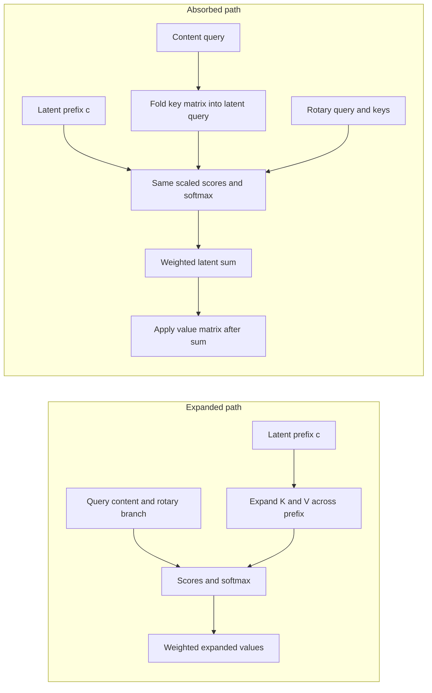
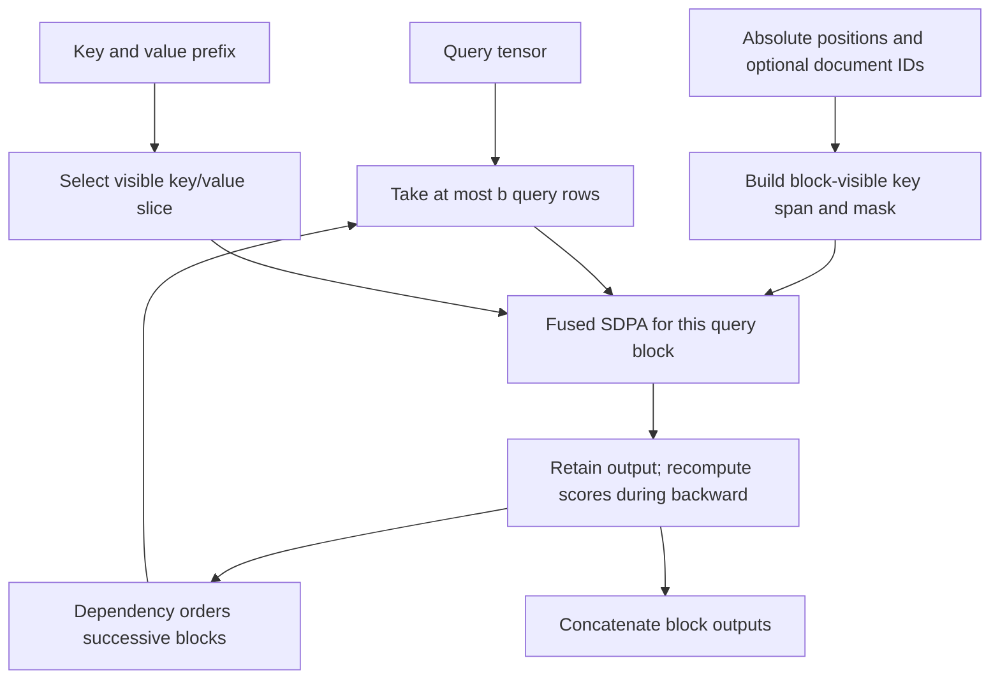
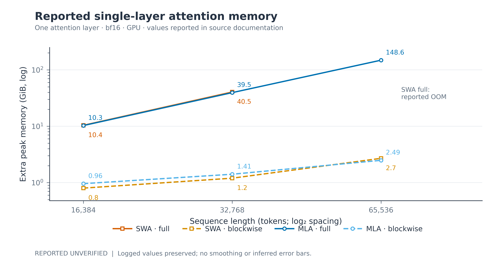

# Attention: projections, cache ownership and long-context execution

Chronos combines global compressed-cache attention with local sliding-window attention. The actual implementation compresses the key–value state through one shared latent. It uses direct query projections, and its persistent cache is smaller than its transient recurrent view in some configurations.

These distinctions determine what is stored, what is recomputed and which memory claim is meaningful. [KERNEL_ARCHITECTURE.md](KERNEL_ARCHITECTURE.md) gives block placement. [LONG_CONTEXT.md](LONG_CONTEXT.md) covers the complete training stack.

## 1. Which attention module runs?

With `use_hybrid_attention=True`, even **physical** layer indices use multi-head latent attention (MLA). Odd physical indices use sliding-window attention (SWA). Turning hybrid attention off selects global grouped-query attention (GQA). The factory is [make_attention](../chronos/model/hybrid_attention.py#L405).

*Figure A1. Attention module selection. Physical parity is evaluated before recurrent unrolling. MLA, multi-head latent attention; SWA, sliding-window attention; GQA, grouped-query attention; KV, key–value; FFN, feed-forward network; MoE, mixture of experts. Every normal block path still contains attention and an MLP.*

There are no permanently attention-free B/C block classes in this implementation. `first_only` skips attention after the first repeat of a recurrent physical block. That temporal policy is separate from the module chosen by physical parity.

### Notation and shapes

| Symbol | Meaning |
|---|---|
| $B,d$ | Batch size and hidden width. |
| $T_q,T_k$ | Query-chunk length and visible key-prefix length. |
| $H_q,H_{kv}$ | Query-head and key–value-head counts. |
| $d_h$ | Full per-head width used by attention-score scaling. |
| $d_c$ | Cached latent width, `kv_latent_dim`. |
| $d_r$ | Rotary subspace width per head. |
| $d_n=d_h-d_r$ | Non-rotary content width. |
| $m(h)$ | KV group serving query head $h$. |
| $\beta$ | Bytes per stored unquantized scalar. |
| $b,W$ | Query-block length and local attention window. |

Valid grouped-head shapes require the query heads to map consistently onto KV groups. The code does not infer the cache advantage from query-head count alone. Use the resolved configuration, including $H_{kv}$ and the rotary-cache option.

## 2. The implemented MLA map

For an attention input $z$, the normalized shared KV latent is

$$
c_t=\operatorname{RMSNorm}_{KV}(W_{DKV}z_t)\in\mathbb R^{d_c}.
\tag{A1}
$$

RMSNorm denotes root mean square normalization. The projections for a query head $h$ and KV group $m=m(h)$ are

$$
\begin{aligned}
q^C_{t,h}&=N_Q^C(W_{QC,h}z_t)\in\mathbb R^{d_n},\\
q^R_{t,h}&=\operatorname{RoPE}_t\!\left(N_Q^R(W_{QR,h}z_t)\right)\in\mathbb R^{d_r},\\
k^C_{s,m}&=W_{KC,m}c_s\in\mathbb R^{d_n},\\
k^R_{s,m}&=\operatorname{RoPE}_s(W_{KR,m}c_s)\in\mathbb R^{d_r},\\
v_{s,m}&=W_{V,m}c_s\in\mathbb R^{d_h}.
\end{aligned}
\tag{A2}
$$

RoPE means rotary position embedding. The two query normalizations act within each head fragment. K and V share $c_s$; they do not use independently cached down-projections. There is no learned query-latent down/up pair in this implementation. These definitions follow [projection construction](../chronos/model/hybrid_attention.py#L132) and [forward computation](../chronos/model/hybrid_attention.py#L181).

*Figure A2. Implementation-exact MLA projection paths. Query content and rotary fragments come directly from the hidden state. One normalized latent supplies content keys, rotary keys and values. RMSNorm, root mean square normalization; KV, key–value; RoPE, rotary position embedding. The picture is a mechanism schematic and makes no numerical rank-accuracy claim.*

The score for an allowed key position is

$$
s_{t,s,h}=\frac{(q^C_{t,h})^Tk^C_{s,m(h)}
+(q^R_{t,h})^Tk^R_{s,m(h)}}{\sqrt{d_h}}.
\tag{A3}
$$

Causal, padding and document masks define the allowed positions. At evaluation, or with attention dropout disabled, softmax and value aggregation are

$$
a_{t,s,h}=\operatorname{softmax}_{s}(s_{t,s,h}+M_{t,s}),\qquad
u_{t,h}=\sum_sa_{t,s,h}v_{s,m(h)}.
\tag{A4}
$$

Training with attention dropout applies a stochastic mask to these probabilities before value aggregation. Concatenating head outputs and applying the output projection returns the attention update, followed by configured residual dropout. The block adds its residual outside this attention module. Calling the attention output a full transformer block would omit that residual and the following MLP.

## 3. Persistent cache, transient view and actual byte accounting

The default persistent MLA entry is `(c_kv,)`. With `mla_cache_rope=True`, it becomes `(c_kv, k_rope)`. The optional keys are post-RoPE tensors of shape `[B,T_k,H_kv,d_r]`. Code: [MLA cache contract](../chronos/model/hybrid_attention.py#L165).

A recurrent `shared_first` writer additionally returns a transient compute-dtype view `(c_kv_full, k_rope_full)`. This lets later repeats reuse already projected rotary keys. It does not mean both tensors are always persisted across token steps.

*Figure A3. Persistent and transient MLA cache ownership under shared-first recurrence. The writer appends the current chunk once. Readers use fresh queries and a shared KV view. A persistent quantized representation and its transient dequantized view have different memory costs. KV, key–value; MLA, multi-head latent attention.*

For unquantized tensors, the persistent payload is

$$
\begin{aligned}
M_{\mathrm{GQA}} &= 2BT_kH_{kv}d_h\beta,\\
M_{\mathrm{MLA,latent}} &= BT_kd_c\beta,\\
M_{\mathrm{MLA,rope}} &= BT_k(d_c+H_{kv}d_r)\beta.
\end{aligned}
\tag{A5}
$$

The first factor of two counts keys and values. Head width counts scalars, not bytes. The dtype factor $\beta$ is essential. These expressions exclude tensor metadata, allocator reservations, temporary expanded K/V and attention outputs.

The latent-only ratio against an unquantized GQA baseline with the same KV-head count is

$$
\frac{M_{\mathrm{GQA}}}{M_{\mathrm{MLA,latent}}}
=\frac{2H_{kv}d_h}{d_c}.
\tag{A6}
$$

A small latent relative to $H_qd_h$ alone does not establish this ratio. Extra cached rotary keys can reduce or eliminate the payload advantage for a particular configuration.

For an analytic example, the recorded [15M arm configuration](../experiments/loop_depth_15m/results/arm_d4.json) has hidden width 160, four query heads, two KV heads, latent width 96 and rotary width 32. With head width $160/4=40$, the GQA payload is $2\times2\times40=160$ channels per token. MLA stores 96 channels with rotary caching off, or $96+2\times32=160$ with it on. These are derived channel counts, not measured peak-memory results.

With int8 caching, one byte per quantized scalar is only part of the accounting. FP32 group scales and any padding/storage metadata also contribute. Reader views are reconstructed in the compute dtype. Cache quantization therefore does not establish bitwise equality with unquantized decoding. See [KV quantization](../chronos/model/kv_quant.py) and [MLX cache handling](../chronos/mlx/attention.py#L274).

During training with `use_cache=False`, persistent inference-cache formulas do not describe total training memory. Shared views can still participate in the recurrent autograd graph. Their lifetime, retained activations and allocator state require separate accounting.

## 4. Expanded and absorbed attention

The expanded path reconstructs full content keys and values from the latent prefix. The absorbed path moves linear maps into the query and output sides. Both use the same score definition in real arithmetic.

For KV group $m$, define

$$
\widetilde q_{t,h}=W_{KC,m}^Tq^C_{t,h}\in\mathbb R^{d_c}.
\tag{A7}
$$

The content score becomes

$$
(q^C_{t,h})^TW_{KC,m}c_s
=(\widetilde q_{t,h})^Tc_s.
\tag{A8}
$$

After computing the same softmax weights, linearity gives

$$
\sum_sa_{t,s,h}W_{V,m}c_s
=W_{V,m}\left(\sum_sa_{t,s,h}c_s\right).
\tag{A9}
$$

The inner weighted sum has latent width $d_c$. It avoids materializing the expanded value prefix for that attention call.

*Figure A4. Expanded and absorbed MLA algebra. Equations A8–A9 move linear maps without changing the real-arithmetic attention definition. The rotary score remains present. Both paths retain the original scale $1/\sqrt{d_h}$; using the enlarged latent-plus-rotary width to rescale scores would change the model. MLA, multi-head latent attention.*

Code: [Torch absorbed path](../chronos/model/hybrid_attention.py#L249) and [MLX absorbed path](../chronos/mlx/attention.py#L333). Floating-point summation order and kernel support can produce numerical differences. Backend-specific tests, dtype and tolerance should accompany any exactness statement.

`mla_decode="expanded"` selects the reference path. `"absorbed"` requests absorption. `"auto"` uses backend policy to favor cached short-query inference. The current implementation checks short chunks and existing context; the MLX path also avoids absorbed training with attention dropout. These are execution policies, not additional learned parameters.

Persistent cache compression alone does not imply faster decode. An expanded implementation can still reconstruct K/V for the entire visible prefix. The absorbed path and the cache representation address different costs.

## 5. Rotary layouts and positional consistency

`rope_layout` accepts `per_head` and `legacy_sliced`. The constructor keeps `legacy_sliced` for compatibility; new planner-generated recipes can select `per_head`. The term “decoupled rotary branch” describes the separate content/rotary projections in Equation A2. It is not a third accepted `rope_layout` enum. See [configuration validation](../chronos/model/config.py#L211).

`per_head` builds a frequency table for the rotated subspace. `legacy_sliced` slices a table built for the full head width. Those operations need not define the same rotation when $d_r<d_h$. Legacy behavior is retained to preserve old checkpoint behavior; changing it is a model/configuration change, not a cosmetic cleanup.

The MLA constructor resolves the rotary width while leaving at least one content channel. Use that effective $d_r$, rather than an unchecked requested width, in Equations A2 and A5. The `per_head` table initializer requires an even rotated width. A configurable architecture therefore still requires compatible head and subspace dimensions.

Document packing adds another requirement: allowed attention positions must remain within the document, and position handling must preserve the intended relative phases. A mask alone does not validate rotary equivalence. Tests should compare packed and isolated documents under each layout, dtype and offset regime. See [RoPE cache initialization](../chronos/mlx/attention.py#L152).

## 6. SWA, absolute position and rollback

SWA projects ordinary Q/K/V, applies per-head query/key normalization and rotates the full head width. Its local window limits which previous tokens a query can attend to. See [SlidingWindowAttention](../chronos/model/hybrid_attention.py#L307).

The persistent entry is `(k, v, absolute_position)`. Keys and values can be evicted while absolute position continues increasing. Using retained cache length as the absolute position after eviction would reset RoPE phases incorrectly.

The stored length is bounded by the configured window plus optional speculative rollback slack. The current chunk's full key/value view can be longer than that persistent entry. Thus a bounded persistent decode cache does not imply that every prefill or training tensor is bounded by the window.

The recurrence policies are:

| Mode | Later repeats | Cache consequence |
|---|---|---|
| `shared_first` | Fresh queries use the writer's full KV view. | One persistent slot per physical layer. |
| `per_iteration` | Each repeat builds/uses its own context state. | Separate cache slots per repeat. |
| `first_only` | Attention is skipped after the first repeat. | Later calls keep the writer cache without attending. |

At depth one, the ordinary one-pass branch bypasses the recurrent controller. `shared_first` does not itself prove speculative decoding is exact: cache truncation, absolute position, masks and miss policy must also agree. [SPEC_DECODE.md](SPEC_DECODE.md) covers the end-to-end contract.

## 7. Query-block execution and memory scaling

The MLX long-context kernel partitions query rows. Each block calls fused scaled dot-product attention over the keys visible to that block. Python does not implement a separate streaming accumulator across key blocks.

For full causal attention, a query block beginning at absolute position $q_0$ and ending before $q_1$ reads keys from the prefix up to $q_1$. For a local window, the union of potentially visible keys starts near $q_0-W+1$. A per-query mask removes keys outside each query's exact window.

*Figure A5. Query-block attention with recomputation. SDPA, scaled dot-product attention; KV, key–value. A full-causal block still reads a growing key prefix. The diagram describes the Python scheduling and checkpointing contract; register allocation and kernel fusion are backend implementation details.*

A dense full score tensor has $O(BH_qT_qT_k)$ elements. Query blocking reduces the simultaneous score working set to roughly $O(BH_qbT_k)$ for full causal attention. Expanded K/V, outputs, masks and saved non-attention tensors remain additional costs.

For a fixed local window, the code's key union has width proportional to $W+b$. Its nominal attention work scales as $O(BH_qT_q(W+b)d_h)$. Full causal attention remains quadratic in sequence length even when its temporary score-memory peak is reduced. These bounds describe tensor/arithmetic structure, not measured total allocation or guaranteed throughput.

The [blockwise implementation](../chronos/mlx/blockwise_attention.py#L55) uses checkpointed fused attention and dependencies between successive blocks. The [latent-up-projection recompute variant](../chronos/mlx/blockwise_attention.py#L99) reconstructs expanded K/V inside each block. Without that option, expanded K/V can remain a separate prefix-sized allocation.

### 7.1 Why a configured block size may not activate the path

The [selection helper](../chronos/mlx/blockwise_attention.py#L128) requires a positive block size and a query chunk longer than one block. It disables the path for training with attention dropout. The MLA call site also distinguishes external masks from supported internal document-segment handling.

Before attributing a memory result to blocking, record:

- Effective `attention_block_size` and whether the blockwise branch actually ran.
- Query/key lengths, batch size, head counts, widths, dtype and attention dropout.
- Cache mode, persistent quantization and optional cached rotary keys.
- `mla_upproj_recompute`, activation-checkpointing policy and document-mask path.
- Peak-memory definition, allocator cache settings, warm-up and synchronization rules.

## 8. Reported results and evidence boundaries

The following one-layer MLA values are **reported in the project attention table**. The repository does not include a matching raw single-layer measurement record.

| Sequence length | Full-causal MLA | Blockwise MLA |
|---:|---:|---:|
| 16,384 | 10.3 GiB | 0.96 GiB |
| 32,768 | 39.5 GiB | 1.41 GiB |
| 65,536 | 148.6 GiB | 2.49 GiB |

*Table A1. Reported one-attention-layer peak values under the project's stated bf16/GPU conditions. These are not full-model training memory values. The original table does not provide all shape, allocator and replication settings needed for an independent benchmark. MLA, multi-head latent attention; GiB, gibibytes.*

*Figure A6. Reported one-layer memory comparison. The accompanying generated figure retains a reported/unverified label because raw single-layer records are incomplete. A reported SWA out-of-memory point is not a zero-valued measurement or a precisely established capacity lower bound. SWA, sliding-window attention; MLA, multi-head latent attention.*

The full-model real-corpus measurements have a different source and scope: [real_corpus_ab.json](../reports/long_context_20261109/real_corpus_ab.json). They combine attention blocking with chunked cross-entropy and chunked MoE execution. Their memory differences cannot be assigned to MLA blocking alone. [LONG_CONTEXT.md](LONG_CONTEXT.md) preserves those experiment conditions and the brief-run quality limitation.

A useful extension would add raw per-layer benchmark JSONs and compare expanded, absorbed and up-projection-recompute paths at matched shapes. Cache payload bytes, temporary peak bytes and latency should be reported separately. This would connect the algebraic savings to the actual backend behavior without treating one as proof of the other.
