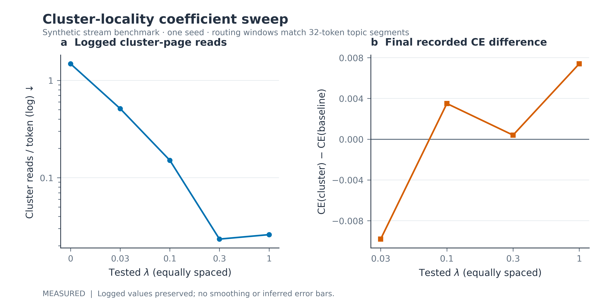
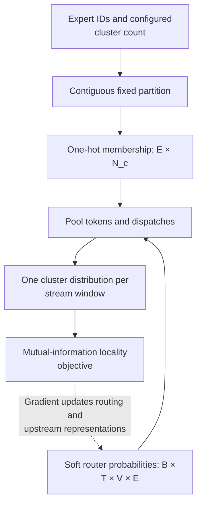
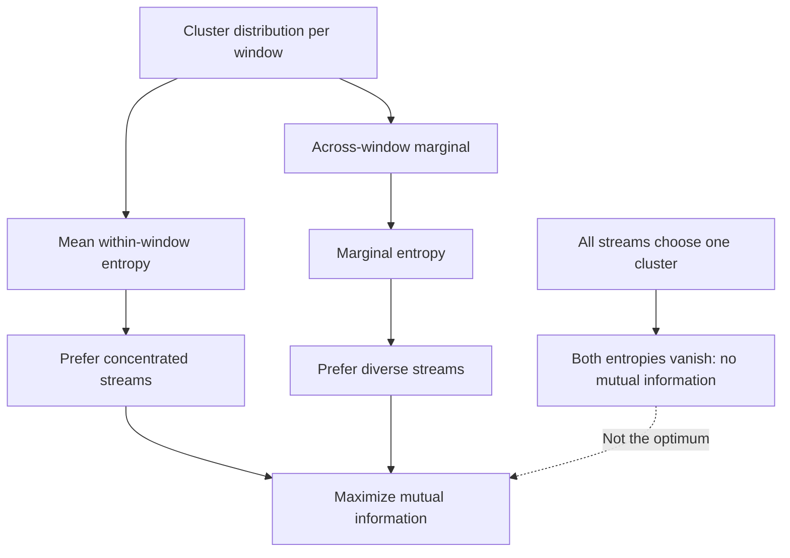
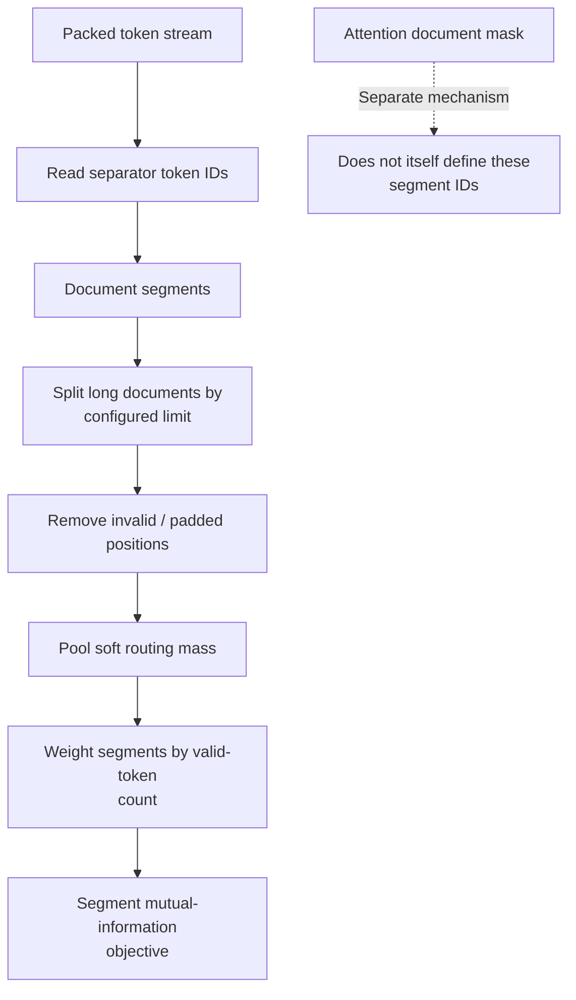
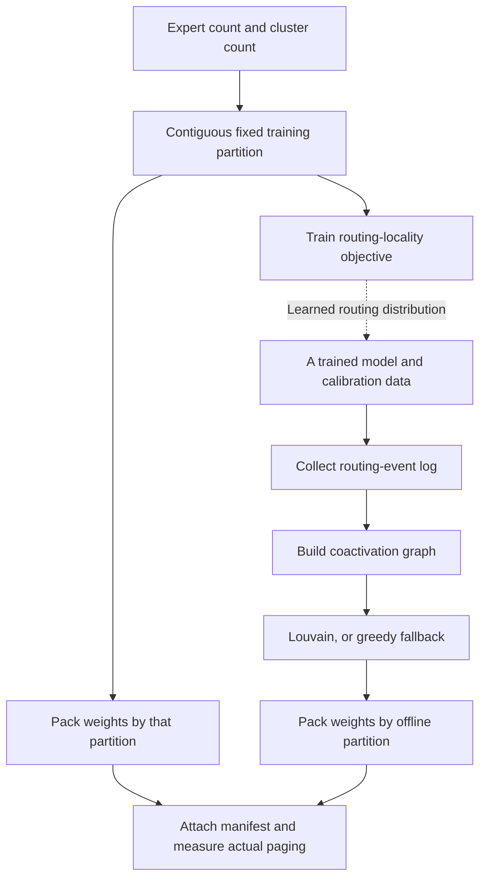

# Cluster locality: a fixed partition and learned routing

Cluster locality connects training-time routing to the expert-page working set. The implemented objective changes how token streams distribute routing probability over a **fixed expert-ID partition**. It does not move expert objects in memory, learn cluster boundaries, or directly minimize a measured SSD latency.

This distinction gives the mechanism three separate objects:

1. **Partition:** a deterministic map from expert IDs to storage groups.
2. **Routing specialization:** a learned dependence between stream content and those groups.
3. **Runtime paging:** a backend-specific policy that loads and retains expert weights.

[MOE_ROUTING.md](MOE_ROUTING.md) defines the per-token expert function. [RESIDENCY.md](RESIDENCY.md) and [LAZY_EXPERTS.md](LAZY_EXPERTS.md) specify paging. The present chapter derives the statistical objective between them.

*Recorded coefficient sweep on a synthetic stream task. CE, cross-entropy. Cluster reads are software runtime counters per generated token, not physical storage bandwidth or a universal speedup. The final-curve CE difference is distinct from the separate held-out evaluation.*

## 1. Fixed membership and the dispatch axis

Let $E$ be the routed-expert count and $N_c$ the number of clusters. Membership is

$$
 \pi:\{0,\ldots,E-1\}\longrightarrow\{0,\ldots,N_c-1\},\qquad
 M_{e,c}=\mathbf1\{\pi(e)=c\}.
$$

The current training path obtains $M$ from `training_clusters(config)`. It splits expert IDs into contiguous, near-equal groups. The cluster count is the explicit positive `cluster_locality_clusters`, or otherwise

$$
 N_c=\mathrm{clip}_{[1,E]}\left(\left\lceil\frac{E}{2k}\right\rceil\right).
$$

There is no implemented `clusters.partition_json` training field in this snapshot. A cluster manifest used by storage is a separate object. [Partition implementation](../chronos/expert_clusters.py#L28).

Every physical MoE layer has its own expert weights. Applying the same expert-ID partition across layers does not tie those weights. It aligns group labels used by the objective and by packed storage.

The trainer supplies raw soft router probabilities

$$
 Q\in\mathbb R^{B\times T\times V\times E},\qquad
 \sum_eQ_{b,t,v,e}=1,
$$

where $V$ indexes the collected dispatches, including repeated calls of recurrent layers. These are **pre-top-k softmax probabilities**, not only the selected or renormalized expert gates. [Collection and loss assembly](../chronos/trainer/loss_mixin.py#L197).

For an equal-length window $w$ with $n_w$ tokens,

$$
 p(c\mid w)=\frac{1}{n_wV}
   \sum_{t\in w}\sum_{v=1}^{V}\sum_{e=1}^{E}Q_{t,v,e}M_{e,c}.
$$

The dispatch average matters: locality is encouraged across tokens and collected layer/iteration calls, not only inside one token's selected set. [Window pooling](../chronos/model/temporal_loss.py#L70).

*Training objects. Cluster boundaries remain fixed. The learned probabilities change; the arrows do not depict expert migration.*

## 2. Deriving the mutual-information objective

Let $\alpha_w$ be the empirical weight of window $w$, with $\sum_w\alpha_w=1$. For equal unmasked windows, the implementation uses equal weights. Define the marginal

$$
 \bar p_c=\sum_w\alpha_wp(c\mid w).
$$

Entropy and conditional entropy, using natural logarithms, are

$$
 H(C)=-\sum_c\bar p_c\log\bar p_c,
 \qquad
 H(C\mid W)=-\sum_w\alpha_w\sum_cp(c\mid w)\log p(c\mid w).
$$

Their difference is mutual information:

$$
 I(W;C)=H(C)-H(C\mid W)
       =\sum_w\alpha_w\sum_cp(c\mid w)
         \log\frac{p(c\mid w)}{\bar p_c}.
$$

The second expression is the weighted mean of $D_{\mathrm{KL}}(p(C\mid w)\|\bar p)$. It is nonnegative for valid probability distributions. Since $I(W;C)\le H(C)\le\log N_c$,

$$
 L_{\mathrm{cl}}=1-\frac{I(W;C)}{\log N_c}
 =1-\frac{H(C)}{\log N_c}+\frac{H(C\mid W)}{\log N_c}
 \in[0,1],\qquad N_c>1.
$$

This last decomposition explains the two pressures:

- Reducing $H(C\mid W)$ concentrates each stream in few clusters.
- Increasing $H(C)$ preserves diversity across the batch's streams.

A single global popular cluster does not solve the objective: both entropies then vanish and $L_{\mathrm{cl}}=1$. Conversely, $L_{\mathrm{cl}}=0$ requires deterministic per-window assignments **and a uniform cluster marginal**. Deterministic assignments alone do not suffice. Finite-batch composition may make this ideal unattainable.

[Exact Torch loss](../chronos/model/temporal_loss.py#L87), [MLX counterpart](../chronos/mlx/training/trainer.py#L243).

*Why local concentration needs global diversity. The objective encourages statistical specialization, not a preassigned semantic name for each cluster.*

### Degenerate cases and numerical safeguards

| Case | Current behavior | Interpretation |
|---|---|---|
| $N_c\le1$ | Loss helper returns zero | No nontrivial cluster choice exists; avoid division by $\log1$ |
| One effective unmasked window in the fixed-window loss | $I=0$, hence $L=1$ with no useful contrastive signal | The marginal equals that window distribution |
| One segment in the segment helper | Returns zero by an explicit guard | Same absence of inter-stream information, with a different constant convention |
| Incomplete final fixed window | Torch and MLX pooling truncate to complete windows | The unpooled suffix does not shape this term |
| `cluster_locality_window=0` | Use a whole sequence row as a window | Multiple batch rows can still provide multiple streams |
| Very small probabilities | Entropy calculations clamp before logarithms | The analytic bounds describe ideal probabilities; finite precision can slightly perturb them |

The distinction between a zero loss and a constant loss of one matters when logging objectives, even when both cases provide no useful locality gradient.

## 3. Segment mode and valid-token weighting

The real field is `cluster_locality_mode="segment"`, not `segment_mode=True`. Segment IDs come from token-stream separators through `segment_ids(input_ids, chunk=window)`. Longer documents are divided into bounded parts. The code does not obtain those IDs from the attention-mask tensor. `document_masking` controls attention and is a different mechanism. [Segment construction](../chronos/expert_clusters.py#L185).

For a segment $w$ containing $n_w$ valid tokens, masked pooling is

$$
 p(c\mid w)=\frac{\sum_{t\in w}m_t\sum_v\sum_eQ_{t,v,e}M_{e,c}}
                  {V\sum_{t\in w}m_t},\qquad
 \alpha_w=\frac{\sum_{t\in w}m_t}{\sum_{w'}\sum_{t\in w'}m_t}.
$$

The objective therefore weights segments by valid-token count. Changing from fixed windows to documents changes both the statistical unit and potentially its empirical weighting; it is not merely a renamed boundary list. Padding must not become an artificial “topic.” [Segment objective](../chronos/model/temporal_loss.py#L119).

There is a backend boundary worth retaining in the documentation. MLX's fixed-window helper accepts a valid-token mask and weights windows accordingly. The Torch fixed-window helper in this snapshot does not accept that mask, whereas the Torch segment helper does. Do not claim fully identical masking behavior for every loss mode. [MLX mask path](../chronos/mlx/training/trainer.py#L269), [Torch calls](../chronos/trainer/loss_mixin.py#L211).

*Document-aligned locality. Segment formation and attention masking are related configuration choices, but have different data paths.*

## 4. Locality across recurrent iterations

The ordinary cluster objective already pools the dispatch axis. An additional optional term retains the iteration axis explicitly. For recurrent physical group $g$ and iteration $r$, let

$$
 q_{b,t,g,r,c}=\sum_eQ_{b,t,g,r,e}M_{e,c},\qquad
 \bar q_{b,t,g,c}=\frac1R\sum_rq_{b,t,g,r,c}.
$$

The implementation uses mean total variation from the iteration mean:

$$
 L_{\mathrm{iter}}
 =\mathrm{mean}_{b,t,g,r}
    \left[\frac12\sum_c|q_{b,t,g,r,c}-\bar q_{b,t,g,c}|\right],
$$

with a valid-token-weighted mean when a mask is supplied. This is **not** a fixed teacher at iteration zero. It permits different expert IDs inside the same cluster. [Iteration term](../chronos/model/temporal_loss.py#L450).

This term contributes only when the required iteration tensor is available. The Torch collector requires at least two calls and the same recorded call count for every recurrent layer. Prefix-block skipping can invalidate that shape condition; an enabled coefficient does not by itself guarantee a nonzero computed term. [Collector contract](../chronos/trainer/loss_mixin.py#L111).

## 5. What the recorded synthetic sweep establishes

The recorded sweep uses **four topics, 16 routed experts, four clusters, four experts per cluster, 32-token segments, 300 training steps and seed 7**. The model uses MLX with a tiny controlled configuration; it is not the 50M natural-language checkpoint. The benchmark recipe specifies top-2 routing and one shared expert. [Recipe](../tools/bench_cluster_locality.py#L64), [JSON settings](../reports/residency_20261107/sweep/lam_0.3_w32.json).

The table preserves three distinct measurements: final logged curve CE, held-out CE and normalized entropy. All are **measured/reported runtime records on this synthetic task**, with one seed. The entropy field is $H(C\mid W)/\log N_c$, not entropy in nats. [Metric implementation](../tools/bench_cluster_locality.py#L127).

| $\lambda_{\mathrm{cl}}$ | Final curve CE | Held-out CE | $H(C\mid W)/\log N_c$ | Cluster reads/token: window | Cluster reads/token: planned |
|---:|---:|---:|---:|---:|---:|
| 0, baseline | 1.6615 | 1.7034 | 0.4883 | 1.4818 | 1.1146 |
| 0.03 | 1.6517 | 1.7089 | 0.2782 | 0.5130 | 0.3177 |
| 0.1 | 1.6650 | 1.7129 | 0.1508 | 0.1510 | 0.1302 |
| 0.3 | 1.6619 | 1.7116 | 0.0054 | 0.0234 | 0.0234 |
| 1.0 | 1.6689 | 1.7087 | 0.0009 | 0.0260 | 0.0260 |

Sources: [0.03](../reports/residency_20261107/sweep/lam_0.03_w32.json), [0.1](../reports/residency_20261107/sweep/lam_0.1_w32.json), [0.3](../reports/residency_20261107/sweep/lam_0.3_w32.json), [1.0](../reports/residency_20261107/sweep/lam_1.0_w32.json). Each JSON contains a paired baseline; the baseline values above match across these files.

The window-policy read counter changes from 1.4818 to 0.0234 at coefficient 0.3, a derived ratio of about 63.3. This is a reduction in **cluster-load events per generated token under this benchmark**, not a claim of 63.3-fold lower wall-clock latency. The read counter is `cluster_loads/tokens`; a load event can represent different byte volumes across layouts or backends. [Decode accounting](../tools/bench_cluster_locality.py#L158).

The final curve CE and the held-out CE must not be interchanged. For example, the coefficient-0.3 final curve differs from its baseline by 0.0004, while the separate held-out CE differs by 0.0082. Both are differences calculated from the linked records. Neither establishes quality preservation on larger natural-language models or across seeds.

A larger weighted `cluster_term` is not by itself evidence that the loss “crowds out” language modeling. That conclusion needs optimization diagnostics or an ablation; the table alone supports a trade-off observed in this one-seed sweep.

## 6. Fixed training groups versus an offline coactivation layout

`training_clusters` and offline Louvain/greedy grouping are different routes. The former supplies the fixed membership matrix for this objective. The latter derives a storage partition from calibration routing events. Repartitioning storage does not inherently require retraining the model, nor does it mathematically force the original baseline read count. It changes the relation between learned routing and physical layout, which must be measured.

*Two layout routes. The diagram does not claim that offline community detection is a compulsory forward-pass stage or that its partition equals the training partition.*

The present collector unions selected expert IDs across physical MoE layers at each token, using each layer's `last_router_probs`, then flattens the sorted per-token unions. The coactivation helper's local neighborhood is a window in this flattened **event list**. It is not automatically a fixed number of original tokens once a token contributes multiple IDs. A recurrent layer's last stored distribution is also not a complete trace of all earlier iterations. [Collector](../chronos/io/cluster_layout.py#L63).

The raw count matrix is symmetrically incremented, then row-normalized. The graph builder consumes upper-triangle entries of that row-normalized matrix as undirected edge weights. Row normalization can break matrix symmetry; this implementation should not be described as a symmetrically normalized similarity metric. [Matrix construction](../chronos/io/cluster_layout.py#L132), [partitioning](../chronos/io/cluster_layout.py#L219).

Storage benefits remain backend-specific. Torch selects requested and budgeted neighboring pages before materialization. The MLX cluster loader loads/evaluates the cluster file before bounded warm-cache admission. Logical page reuse therefore does not establish an identical transient memory or I/O bound on both paths. [Torch page selection](../chronos/io/expert_store.py#L560), [MLX cluster loading](../chronos/mlx/expert_store.py#L290).

## 7. Interpreting an “expert community”

Under a fixed partition, an expert community means a routing association with an existing set of IDs. Topic purity in the synthetic benchmark measures association with known synthetic topics; it is not a measured geometric separation of expert weight vectors or a proof that natural-language domains emerge identically.

Expert parameters continue to learn through the language-model task and other available gradients. The fixed objects are their IDs and this membership map, not frozen expert weights. Locality can also influence upstream representations that produce router inputs. No physical motion or autonomous creation of experts is implemented.

Further, balanced expert use and balanced cluster use are not identical objectives. Near-equal partitions can contain different numbers of experts; a uniform expert marginal then induces cluster mass proportional to group size, whereas the mutual-information normalization favors a uniform cluster marginal at its ideal maximum. This interaction is worth checking when choosing a non-divisible partition.

The next decisive evidence would connect these stages on the **same checkpoint and workload**: routing distributions, selected-expert working set, logical cluster-load count, bytes materialized, peak resident/transient memory, latency and task quality. The existing synthetic sweep supplies part of that chain, not the entire causal argument.

## 8. Actual configuration names

| Field | Class default | Meaning |
|---|---:|---|
| `lambda_cluster_locality` | `0.0` | Compatibility default; enables this training term when positive |
| `cluster_locality_clusters` | `0` | Zero chooses $\lceil E/(2k)\rceil$ |
| `cluster_locality_window` | `32` | Window length; zero means a whole row |
| `cluster_locality_mode` | `"window"` | `"window"` or `"segment"` |
| `lambda_iteration_cluster` | `0.0` | Optional iteration spread |

[Configuration](../chronos/model/config.py#L279). The planner can select `DEFAULT_LAMBDA=0.3` for eligible MoE training plans, while old checkpoints retain their stored recipe. Thus “class default zero” is not equivalent to “all new training recipes disable locality.” [Planner choice](../chronos/model/planner.py#L566), [shared training helper](../chronos/expert_clusters.py#L142).

`inference_clusters(..., paging="auto")` uses training groups when the stored coefficient is positive and otherwise uses singleton expert pages. This is a **metadata-based decision**, not an independent inspection proving how the weights were trained. Editing a checkpoint coefficient after training does not establish learned locality. [Automatic paging](../chronos/expert_clusters.py#L79).

**Notation:** CE, cross-entropy; MoE, mixture of experts; MLP, multilayer perceptron; SSD, solid-state drive; RAM, random-access memory; KL, Kullback–Leibler divergence; $\pi$, fixed expert-ID partition; $N_c$, cluster count; $V$, collected dispatch count.
