# Kernel architecture: execution, state and storage

Chronos combines recurrent computation, sparse expert dispatch and out-of-core weight residency. These mechanisms interact through explicit tensor and cache contracts. Parameter reuse, cache reuse and weight prefetching solve different resource problems.

The diagrams are schematic. Configuration symbols describe a family of models, rather than a fixed-size checkpoint. [SYMBOLS.md](SYMBOLS.md) defines the notation and tensor axes. Implementation claims link to source; [REPRODUCIBILITY.md](REPRODUCIBILITY.md) separates measured results from conditional analysis.

## 1. The end-to-end execution contract

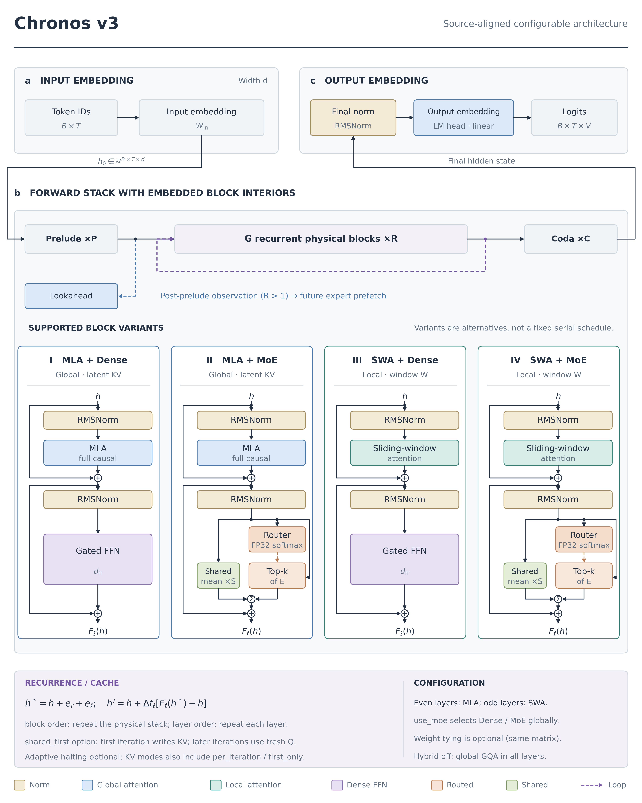

*Figure K1. Forward execution and supported block interiors. Input lookup and output vocabulary projection are separate operations. Weight tying can make their matrices identical. MLA, multi-head latent attention; SWA, sliding-window attention; MoE, mixture of experts; FFN, feed-forward network; KV, key–value. The four interior cards are configuration alternatives, not four mandatory serial layer types.*

Let the physical backbone contain $L_{\mathrm{phys}}=P+G+C$ blocks. The prelude contains $P$ blocks, the recurrent region contains $G$, and the coda contains $C$. At recurrent depth $R>1$, the prelude and coda each execute once. The recurrent region executes according to the selected loop order.

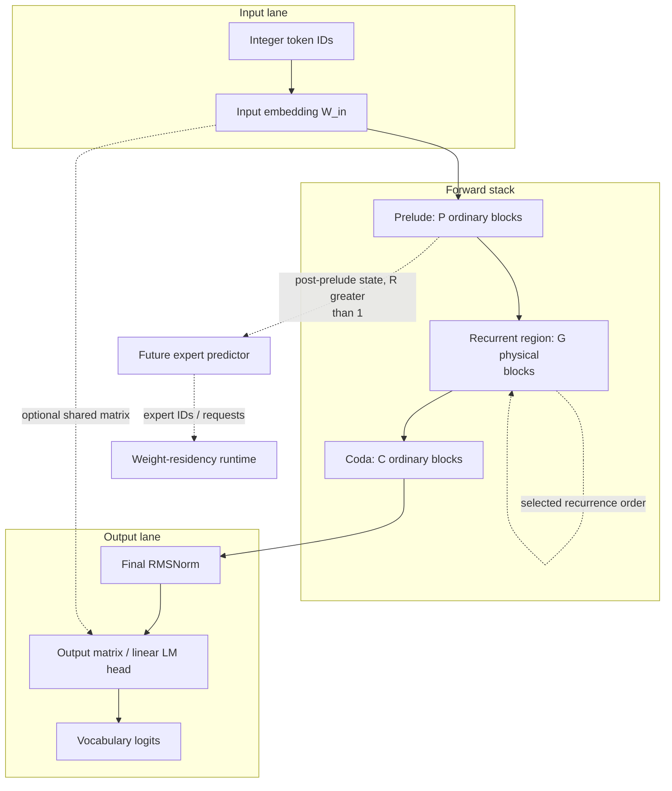
The input operation is a lookup. The output operation is a linear projection:

$$
h_{b,t}^{(0)}=W_{\mathrm{in}}[x_{b,t}],\qquad
z_{b,t}=W_{\mathrm{out}}\operatorname{RMSNorm}(h_{b,t}^{\mathrm{coda}}),
\quad W_{\mathrm{in}},W_{\mathrm{out}}\in\mathbb R^{V\times d}.
\tag{K.1}
$$

Here hidden vectors use a column-vector convention. Actual batch code applies the equivalent row-vector multiplication. If `tie_word_embeddings=True`, the two weights share parameters. Drawing two lanes does not create two independent parameter copies.

The implementation returns logits. Sampling, probability normalization and a training loss consume those logits through separate paths. An encoder–decoder output-token embedding or cross-attention stack is not part of this decoder-only graph. See [backbone construction](../chronos/model/model_chronos.py#L135) and [LM-head construction and forward](../chronos/model/model_chronos.py#L551).

### Depth one is a distinct execution path

When recurrence is disabled or configured depth is one, the model runs the ordinary physical stack. The recurrent controller becomes a no-op. Lookahead then observes the output of physical block zero. For recurrent execution, lookahead observes the post-prelude state, including the embedding state when $P=0$.

These observation points are implemented in the [forward dispatch](../chronos/model/model_chronos.py#L477). They should not be inferred from the name “layer-aware lookahead.”

## 2. Every full block contains attention and an MLP

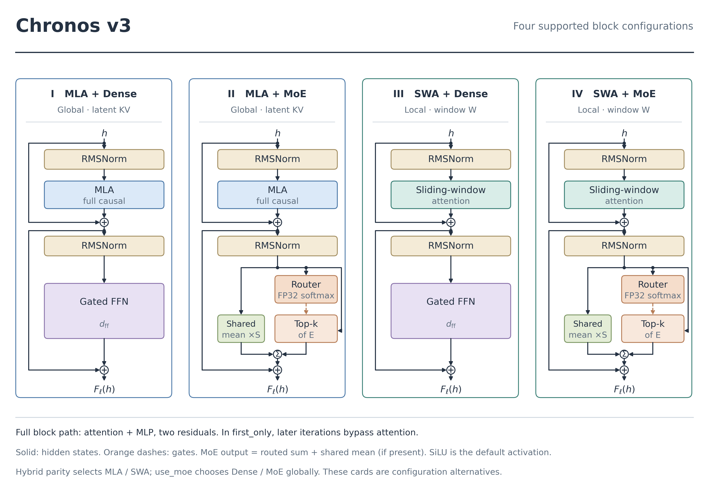

*Figure K2. Full pre-normalization residual circuits. Every card contains attention and an MLP. The attention family depends on physical layer parity; the MLP family depends on a model-wide switch. Orange dashed links carry router gates; solid links carry hidden states. Shared experts contribute their mean output. MLA, multi-head latent attention; SWA, sliding-window attention; MLP, multilayer perceptron; RMSNorm, root mean square normalization.*

For a full block $F_\ell$, define

$$
u=h+A_\ell(N_{\ell,1}(h)),\qquad
F_\ell(h)=u+M_\ell(N_{\ell,2}(u)).
\tag{K.2}
$$

The two residual additions have different input states. Attention updates $h$; the MLP updates $u$. In `first_only` recurrent reader iterations, the attention sublayer is bypassed and the MLP operates on the current recurrent state. It does not repeatedly reuse a frozen attention output as the entire hidden state.

The [block forward](../chronos/model/model_chronos.py#L48) implements these paths. No full block type consists only of MoE without an attention module.

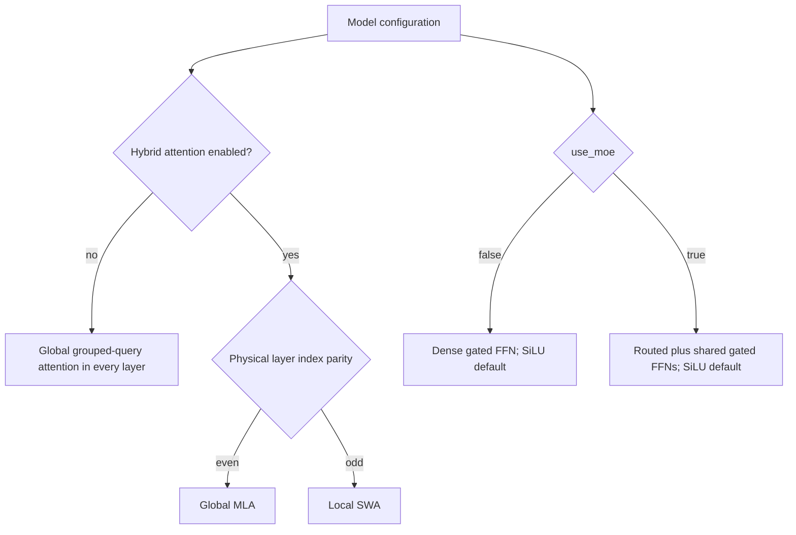

Physical parity includes the prelude offset. Recurrent group $g$ occupies physical layer $\ell=P+g$. A group with even $g$ need not use MLA when $P$ is odd. The four schematic cards therefore enumerate supported combinations; a single model does not alternate dense and MoE families through those cards. Source: [attention factory](../chronos/model/hybrid_attention.py#L405) and [MLP selection](../chronos/model/model_chronos.py#L61).

### Dense and sparse MLPs

For the default SiLU activation, a bias-free SwiGLU expert with intermediate width $m$ is

$$
E(h)=W_d\bigl[\operatorname{SiLU}(W_g h)\odot(W_u h)\bigr].
\tag{K.3}
$$

Its three matrices contain $3dm$ weights. Dense and expert intermediate widths are separate configuration fields. There is no general requirement that either equals $4d$.

For routed expert probabilities $p=\operatorname{softmax}_{\mathrm{FP32}}(W_r h)$, let $I$ be the selected top-$k$ set. The normal fully available MoE path is

$$
M(h)=\sum_{i\in I}a_iE_i(h)+\bar S(h),\qquad
\bar S(h)=\frac{1}{S_s}\sum_{j=1}^{S_s}S_j(h).
\tag{K.4}
$$

With `norm_topk_prob=True`, $a_i=p_i/\sum_{j\in I}p_j$. Otherwise the selected probabilities retain their original mass. Equation (K.4) assumes $S_s>0$; a configuration without shared experts has no shared term. See [MoE dispatch and shared averaging](../chronos/model/moe_chronos.py#L114).

The Torch selected-row path and supported MLX grouped sparse path reduce routed expert matrix work. For width $d_e$, the routed parameter pool contains $3d d_eE$ weights, while ideal selected matrix work scales with $k$. The MLX masked-dense reference path evaluates all $E$ experts before masking. Sparse dispatch is configurable and capability-dependent; see [MLX dispatch branches](../chronos/mlx/moe.py#L272). These counts exclude the router, shared experts, attention, activations and optimizer state.

## 3. Recurrence is applied around each physical block

The implemented contracted step is indexed by recurrent group and iteration. It is not a single interpolation applied after the whole recurrent stack.

$$
\begin{aligned}
h^*&=h+e_r+u_g,\\
\Phi_{r,g}(h)&=h+\alpha_g\left[F_{P+g}(h^*;\mathcal K_g^{(0)})-h\right].
\end{aligned}
\tag{K.5}
$$

The learned vectors $e_r,u_g$ encode iteration and group. The subtraction uses the unconditioned state $h$. With `shared_first`, $\mathcal K_g^{(0)}$ denotes the writer iteration's attention view. Other cache policies change that argument. The controller implements [conditioning and contraction](../chronos/model/recurrent.py#L136); the executor invokes it [for each layer call](../chronos/model/model_chronos.py#L283).

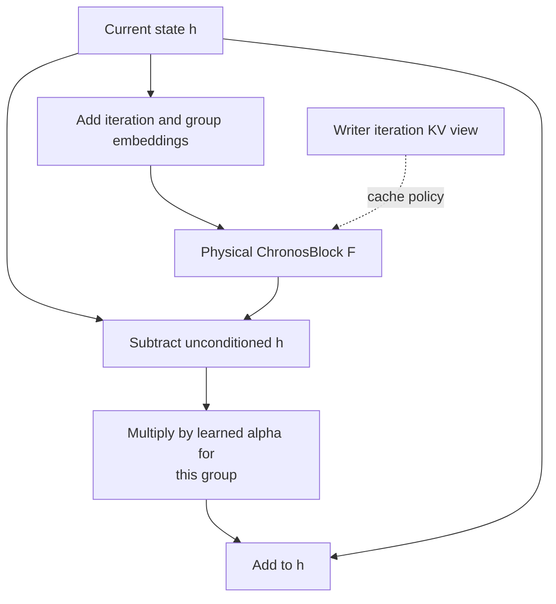
For block order, one cycle composes the $G$ contracted group maps, then repeats the cycle. Layer order repeats one group's map before advancing. Both descriptions refer to the same physical parameter blocks, with iteration-dependent conditioning.

### What the Euler interpretation establishes

If conditioning and cached context are fixed, a single group update has the explicit-Euler form for a vector field $v(h)=F(h+c;\mathcal K)-h$. In the actual network, conditioning changes with $r$ and different group maps are composed. The ODE analogy explains the role of step size; it does not establish convergence, depth invariance or an optimal horizon.

For fixed $c,\mathcal K$ and an $L_F$-Lipschitz block, the triangle inequality gives

$$
\|\Phi(x)-\Phi(y)\|
\le\bigl(|1-\alpha|+|\alpha|L_F\bigr)\|x-y\|.
\tag{K.6}
$$

A bound below one is sufficient for contraction under these assumptions. Bounding $\alpha$ alone does not certify the block's Lipschitz constant. [THEORY.md](THEORY.md) develops the derivation and its limits; [LOOP_DEPTH.md](LOOP_DEPTH.md) keeps step-matched and wall-time-matched evidence separate.

### Defaults, recipes and saved checkpoints

| Authority | What it determines | Interpretation |
|---|---|---|
| `ChronosConfig` class | Fallback values for unspecified fields | The inspected defaults include `recurrent_order="layer"` and `recurrent_dt_param="clamp"`. |
| Planner or tuning recipe | A recommendation for a requested budget | Recommendations can select block order and sigmoid parameters. |
| Saved checkpoint configuration | The effective graph and parameter interpretation after fallback resolution | A missing key inherits the class default; a recommendation does not rewrite old weights. |

This distinction matters for both inference reproducibility and interpretation of benchmark arms. See [configuration resolution](../chronos/model/config.py#L47).

## 4. Persistent KV and recurrent reader views are different states

The model distinguishes a cache retained across token forwards from the shared attention view used inside one recurrent forward.

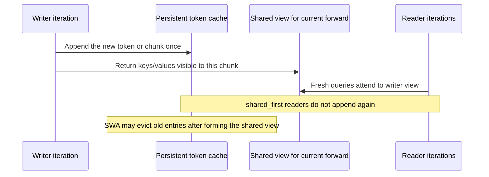

For MLA, the persistent tuple is normally `(c_kv,)`. If `mla_cache_rope=True`, it additionally stores rotated rotary keys with shape $(B,L,H_{\mathrm{kv}},d_r)$. The transient shared view can include those keys even when they are not persisted. For SWA, the shared view is formed before persistent eviction and includes the absolute sequence position. Source: [MLA cache contract](../chronos/model/hybrid_attention.py#L165) and [SWA cache contract](../chronos/model/hybrid_attention.py#L333).

### Deriving the byte counts

Let $b$ be bytes per stored element, excluding quantization metadata. An unquantized MLA persistent cache with default `mla_cache_rope=False` uses

$$
M_{\mathrm{MLA}}=bBLd_c.
\tag{K.7}
$$

With persisted rotary keys, it uses $bBL(d_c+H_{\mathrm{kv}}d_r)$. The expression $d_c+d_r$ is generally incorrect because rotary keys carry a KV-head axis. These are element counts multiplied by $b$, not dimension counts relabelled as bytes.

SWA retains keys and values. For retained length $L_w$, its unquantized payload is

$$
M_{\mathrm{SWA}}=2bBL_wH_{\mathrm{kv}}d_h,\qquad
L_w\le W+\text{cache slack}
\tag{K.8}
$$

in bounded decode. A shared prefill view can be longer than the retained cache. The implementation concatenates and slices tensors; a physical ring-buffer allocator should not be inferred. Int8 caches also require scales and metadata, so equations (K.7–K.8) are payload baselines.

## 5. Expert locality connects training to page residency

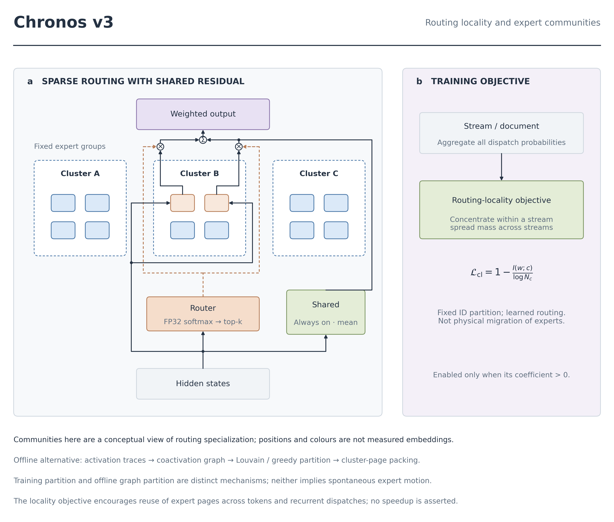

*Figure K3. Routing-locality mechanism. The shared branch and selected routed experts receive hidden states independently. The optional loss encourages within-stream cluster concentration and across-stream diversity over a fixed expert-ID partition. Node positions are illustrative, not measured high-dimensional embeddings. An offline coactivation graph supplies a separate optional layout route.*

Define expert-to-cluster membership $A_{i,c}\in\{0,1\}$. Aggregate routing probabilities over tokens and dispatches within a stream unit $w$:

$$
p(c\mid w)=\sum_i A_{i,c}\,\operatorname{mean}_{(t,v)\in w}p_{t,v,i}.
\tag{K.9}
$$

Here $v$ indexes actual dispatches, including recurrent calls. A window objective uses the mutual information

$$
I(w;c)=H(\bar p)-\mathbb E_wH(p(\cdot\mid w)),\qquad
\mathcal L_{\mathrm{cl}}=1-\frac{I(w;c)}{\log N_c}.
\tag{K.10}
$$

Low conditional entropy concentrates each stream's page demand. High marginal entropy discourages every stream from using one cluster. Segment mode uses separator-derived document segments and weights them by valid-token count when a token mask is supplied. Without a mask, all positions count. If input IDs are absent, the Torch trainer uses fixed windows. Degenerate cluster counts or insufficient stream units produce no useful locality signal. [CLUSTER_LOCALITY.md](CLUSTER_LOCALITY.md) derives the objective and the weighted segment implementation.

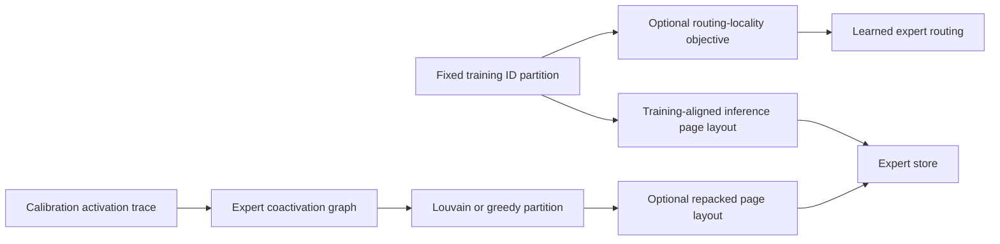

The fixed partition does not move expert weight vectors in a learned geometric embedding. Offline graph communities depend on observed coactivation rather than measured spatial distances between parameters. Neither mechanism demonstrates spontaneous expert migration. The two layout routes should not be presented as an obligatory sequential pipeline.

## 6. Storage control, weight transfer and activations

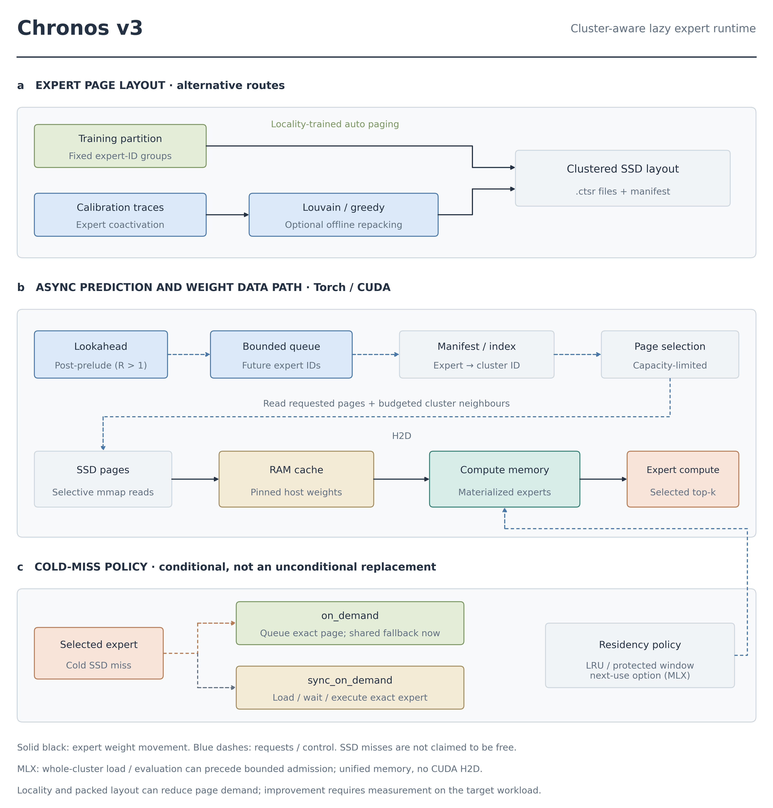

*Figure K4. Storage and runtime control. The host-to-device lane describes Torch/CUDA. MLX uses evaluated arrays in unified memory. The requested-page filtering guarantee belongs to the Torch reader; MLX can materialize a whole cluster transiently before bounded warm admission. Solid links describe weights; dashed links describe requests and policy. SSD, solid-state drive; RAM, random-access memory; H2D, host-to-device; LRU, least recently used.*

A `.ctsr` file is a safetensors-backed cluster container in the inspected implementation. `cluster_manifest.json` maps experts and clusters to files and can record layer/group ownership. See [manifest fields](../chronos/io/storage.py#L61) and [reader implementation](../chronos/io/storage.py#L169).

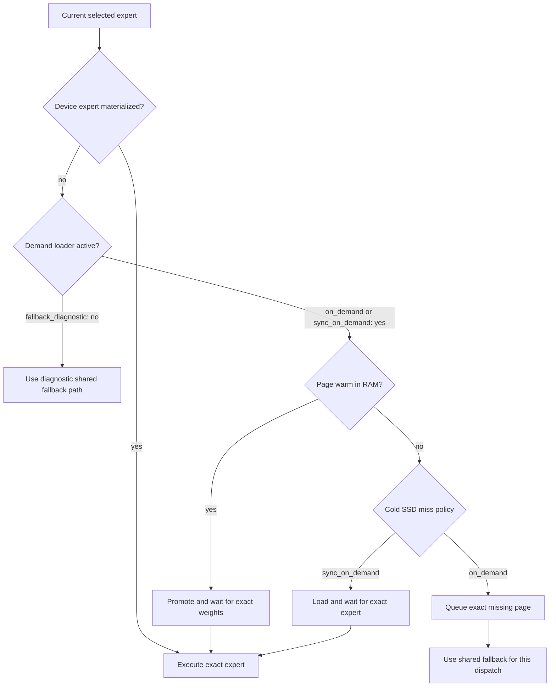

The normal shared residual remains active in all these paths when shared experts exist. Substitution for a missing routed expert is additional to that residual. Its deviation from the full-resident result depends on missing routing mass and the difference between routed and shared outputs; no measured universal quality bound is established by the presence of shared experts.

For a missed set $J\subseteq I$, the substitution error at the MoE output is

$$
\widetilde M(h)-M(h)=\sum_{i\in J}a_i\bigl[\bar S(h)-E_i(h)\bigr].
\tag{K.11}
$$

If $\|\bar S(h)-E_i(h)\|\le D(h)$ for the missed experts, then its norm is bounded by $D(h)\sum_{i\in J}|a_i|$. The code does not enforce a uniform $D(h)$ or translate this local bound into a validation-CE guarantee. [MOE_ROUTING.md](MOE_ROUTING.md) and [LAZY_EXPERTS.md](LAZY_EXPERTS.md) specify the dispatch and loading paths.

### Backend distinctions

| Operation | Torch/CUDA path | MLX path |
|---|---|---|
| Loading | Safetensors reader filters chosen layer/expert pages before `get_tensor` | Cluster loading can evaluate a whole file before admission |
| Warm weights | Host cache, pinned when the backend supports it | Evaluated MLX arrays in unified memory |
| Promotion | Materialization and H2D copies, with per-expert event waits | Bind already evaluated arrays; no separate CUDA H2D copy |
| Queue | Bounded Python FIFO; oldest queued request can be dropped | Separate MLX prefetch implementation; inspect its contracts |
| Residency | LRU and protected selected pages | LRU/window policy or optional next-use planner |

Bounded cache admission does not automatically bound transient materialization or process peak memory. Request count, expert-page count, cluster-file count and bytes read are different measurements. [RESIDENCY.md](RESIDENCY.md) defines their accounting scope.

## 7. Lookahead predicts token horizons

The lookahead head reads a backbone state and predicts expert distributions for the current and future token positions. With $K$ future horizons and optional group awareness, the output axes are

$$
(B,T,K+1,E)\quad\text{or}\quad(B,T,K+1,G,E).
\tag{K.12}
$$

The group axis indexes recurrent physical groups; the horizon axis indexes future tokens. The head is a two-linear-layer MLP with SiLU, not a separate language model that proposes tokens. Its output feeds an expert-request scheduler. Source: [Torch head](../chronos/model/lookahead_router.py#L24) and [MLX head](../chronos/mlx/model.py#L37).

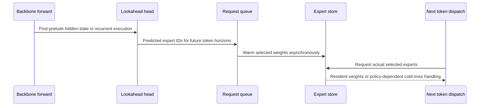

Teacher routing distributions are detached for the prediction loss. Detaching the lookahead input is a different option, with a backend-specific implementation boundary documented in [LOOKAHEAD.md](LOOKAHEAD.md). A predicted expert set does not prove that every next-token dispatch is ready.

## 8. Output precision and training paths

| Quantity | Shape | Precision/storage contract |
|---|---|---|
| Token IDs | $(B,T)$ | Integer input, backend-specific tensor type |
| Hidden state | $(B,T,d)$ | Model compute dtype; not universally bf16 |
| Torch current-router scores | $(B,T,E)$ | Softmax explicitly evaluated in FP32 |
| Lookahead probabilities | Eq. (K.12) | Torch inherits head-logit dtype; MLX explicitly uses FP32 logits |
| MLA persistent latent | $(B,L,d_c)$ | Compute dtype or configured quantized representation |
| Optional persisted MLA rotary keys | $(B,L,H_{\mathrm{kv}},d_r)$ | Separate cache component, not concatenated scalar width |
| SWA persistent K and V | Two tensors $(B,L_w,H_{\mathrm{kv}},d_h)$ | Bounded retained length; absolute position tracked separately |
| Returned LM logits | $(B,T',V)$ | Torch defaults to FP32 on loss/training paths and compute dtype for inference |
| Chunked MLX CE working logits | Row chunks by vocabulary | Used on the dedicated training-loss path; full logits remain available on other paths |

The ordinary Torch `ChronosForCausalLM.forward` materializes returned logits and applies cross-entropy when labels are supplied. Setting `ce_chunk_size` does not rewrite that forward into the MLX chunked-loss path. The vocabulary matrix also remains a $V\times d$ parameter tensor. Chunked loss reduces the temporary logits buffer; it does not remove the vocabulary dimension from the model parameters. Sources: [Torch LM forward](../chronos/model/model_chronos.py#L565), [head precision helper](../chronos/model/precision_ops.py#L131), and [LONG_CONTEXT.md](LONG_CONTEXT.md).

## 9. Evidence and completion criteria

The implementation supports the mechanisms above. Their benefits require workload-specific measurement. A complete experimental argument needs all three checks:

1. **Execution:** the selected configuration follows the expected tensor, cache and page transitions.
2. **Equivalence or approximation:** compare logits or generated tokens under the relevant exactness assumptions and miss policy.
3. **Resource benefit:** record prefill, decode, materialization, bytes/counters, peak memory and output quality under matched conditions.

The existing records establish selected small-model results, not an unconditional performance or quality guarantee for the entire architecture family. The [reproducibility chapter](REPRODUCIBILITY.md) gives the measurement ledger and missing controls. The [theory chapter](THEORY.md) states which mathematical conclusions require additional assumptions.
