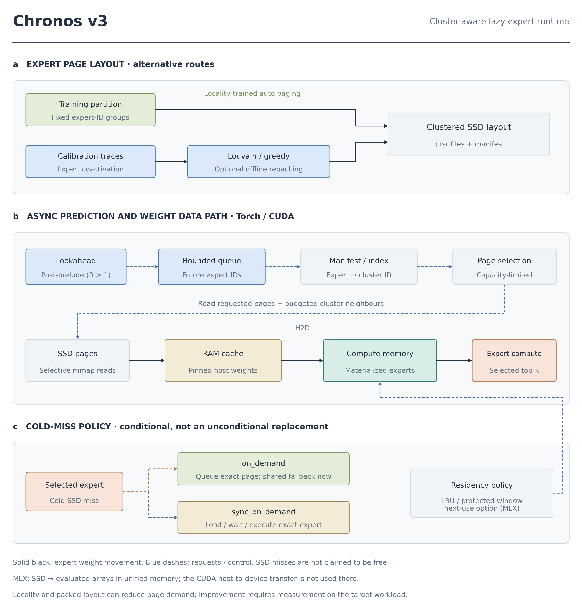
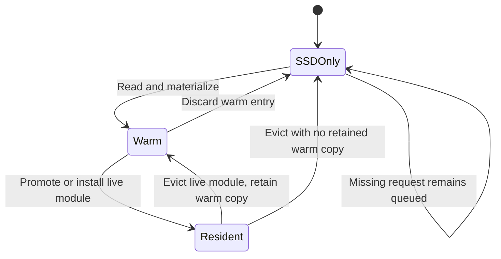
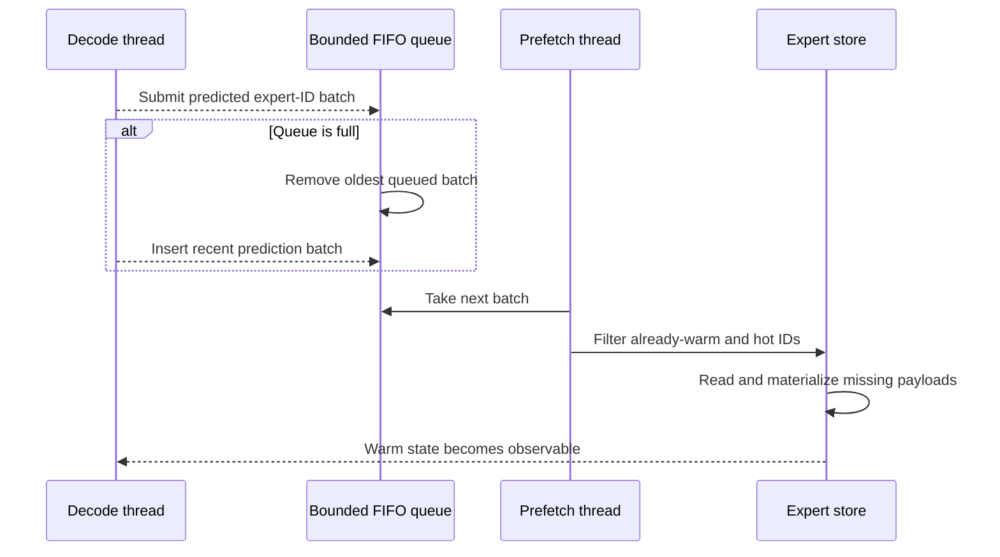
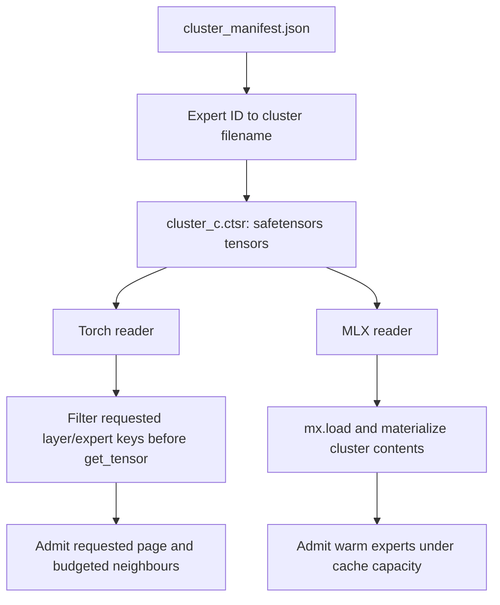
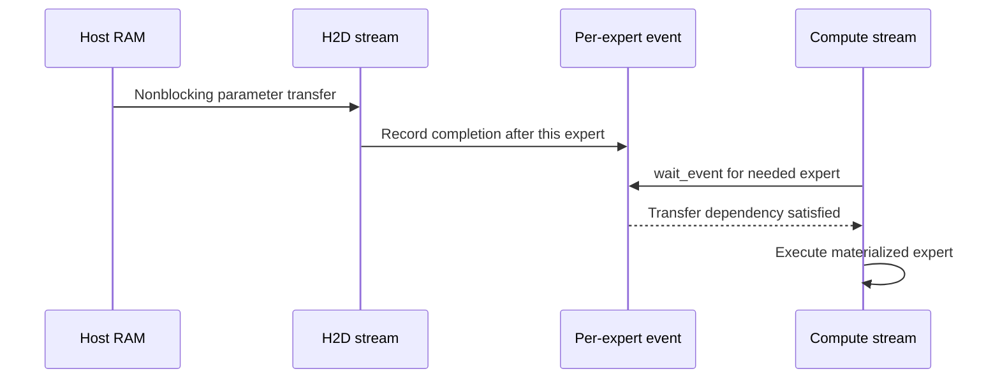

# Lazy expert execution: storage, materialization and correctness

The lazy runtime keeps routed-expert weights outside the live model until they are needed. Its central contract is simple: an unloaded placeholder must never execute. The runtime either materializes the selected expert or applies an explicitly approximate fallback policy.

The source contains two implementations with different loading granularity. Torch can select layer/expert tensors before materialization. MLX currently materializes a cluster file before retaining a bounded set of warm experts. A bounded retained cache therefore does not imply the same transient memory peak on both backends.

*Figure 1. Expert storage, prediction and execution paths. The host-to-device path applies to Torch/CUDA. MLX uses evaluated arrays in unified memory. The cluster-file format is shared, but the current readers have different materialization granularity. SSD, solid-state drive; RAM, random-access memory; H2D, host-to-device; MLX, Apple's array framework.*

## 1. What is a page?

A logical page is the unit counted by the expert cache. It need not equal one file or one operating-system page.

| Backend / mode | Cache key and payload | Consequence |
|---|---|---|
| Torch, `layer_aware_cache=True` | A key identifies a physical layer, recurrent group and expert. The payload contains one physical layer's expert parameters. | The same expert ID at another layer is a different payload. |
| Torch, legacy aggregate mode | One expert ID holds that expert's parameters across all MoE layers. | A promotion may materialize several physical layers. |
| MLX current store | One expert ID holds its parameters across all MoE layers. | Hot/warm capacities count aggregate expert IDs, not pages per layer. |

The key construction and expansion rules are in [Torch `ExpertStore`](../chronos/io/expert_store.py#L216). MLX states its aggregate-page convention in [the store constructor](../chronos/mlx/expert_store.py#L94).

For a bias-free SwiGLU expert with hidden width $d$ and intermediate width $d_e$, the three matrices contain

$$
N_{\mathrm{expert}}=dd_e+dd_e+d_ed=3dd_e
\tag{1}
$$

parameters. If each stored parameter occupies $b_w$ bytes, a uniform layer-specific page has size

$$
p_{\mathrm{layer}}=3dd_e b_w.
\tag{2}
$$

An aggregate page across $L_{\mathrm{MoE}}$ identical-width layers has size $L_{\mathrm{MoE}}p_{\mathrm{layer}}$. These expressions exclude tensor metadata, allocator alignment, quantization metadata and transient conversions. The MLX store uses this aggregate estimate when converting byte budgets to expert counts. [Implementation](../chronos/mlx/expert_store.py#L100)

## 2. Residency states are logical, not exclusive physical locations

SSD retains the immutable inference weights even when RAM or device copies exist. Eviction discards a live copy; it does not normally write trained weights back to disk.

*Figure 2. Logical residency states for immutable expert payloads. A page may move between states several times during one forward when capacity is smaller than the working set. SSD remains the persistent backing store throughout.*

Torch replaces evicted experts with `LazyExpertPlaceholder` modules. Before discarding device parameters, it waits for relevant transfer events and records their use on the compute stream. It deliberately avoids a device-to-host write-back because the persisted weights are unchanged. [Eviction path](../chronos/io/expert_store.py#L737)

## 3. The Torch queue is bounded FIFO

`AsyncPrefetcher` owns a `queue.Queue`, not a deadline-priority queue. Each entry is a batch of expert IDs. `CacheManager` sets its capacity to

$$
Q_{\mathrm{batches}}=\max\left(1,\;2d\right).
\tag{3}
$$

Here $d$ denotes the `prefetch_depth` configuration value.

The default `prefetch_depth=2` therefore gives four request batches through this manager. The standalone prefetcher constructor has its own default of eight batches. Neither value means a fixed number of outstanding SSD system calls. [Manager construction](../chronos/runtime/cache_manager.py#L35), [queue implementation](../chronos/io/async_prefetcher.py#L47)

*Figure 3. The implemented Torch prefetch control flow. Queue overflow replaces the oldest queued request batch. This operation does not cancel an SSD read already running in the worker.*

A caller can wait for an expert with a timeout, but that polling deadline does not interrupt the underlying storage operation. Foreground and background loads share a load lock. The documentation therefore makes no guarantee that all I/O completes before the next token. [Submission and polling](../chronos/io/async_prefetcher.py#L84), [serialized loading](../chronos/io/expert_store.py#L525)

## 4. Cluster file and tensor materialization

A `.ctsr` file is a **safetensors container with a Chronos extension**, not a custom `CTSR` binary stream. The sidecar is `cluster_manifest.json`. It records cluster filenames, member expert IDs, the expert-to-cluster map, model dimensions and optional layer-to-group metadata. Tensor keys use the form `l{layer}_e{expert}__{parameter_name}`. [Format and manifest](../chronos/io/storage.py#L38)

The manifest validator checks layer/expert dimensions and expert-map coverage. The schema has no model-hash or partition-hash fields. Safetensors manages tensor offsets internally.

*Figure 4. Backend-specific materialization granularity. A file-level cluster is a layout object; a retained cache page is a residency object. These units must remain distinct when interpreting memory and read counters.*

### Torch: select before `get_tensor`

The store builds a candidate set containing the requested expert and as many cluster neighbours as the dynamic RAM capacity permits. It places the requested page last in the admission order so neighbouring pages cannot evict it before promotion. The storage reader filters tensor keys **before** calling `get_tensor`. [Candidate selection](../chronos/io/expert_store.py#L560), [tensor filtering](../chronos/io/storage.py#L169)

The OS may still fault or read storage blocks beyond an individual tensor. A software page counter is not a measurement of physical SSD bytes. Sequential packing can improve locality, but it does not prove one syscall, one physical read or zero-copy execution on the accelerator.

### MLX: evaluate in the loading thread

`mx.load(..., format="safetensors")` creates arrays for the cluster. The current reader collects and evaluates its layer states before admission to the warm cache. `mx.eval()` is important here: the loaded arrays must be materialized in the creating thread's stream before another thread consumes them. It is not documented as an asynchronous `pread` completion notification. [Loading and materialization](../chronos/mlx/expert_store.py#L45), [cluster read](../chronos/mlx/expert_store.py#L290)

MLX's hot and warm tiers are residency bookkeeping over unified memory. Promotion installs or materializes the arrays; it does not issue a CUDA H2D copy. A cluster larger than the warm capacity can still produce a transient materialization peak before eviction. [MLX promotion](../chronos/mlx/expert_store.py#L525)

## 5. CUDA transfer ordering

Torch creates one dedicated H2D stream for the store when running on CUDA. It does not create one stream per MoE layer. Host tensors are pinned only on this CUDA path; CPU/MPS avoid that operation. [Stream creation](../chronos/io/expert_store.py#L143), [pinning](../chronos/io/expert_store.py#L618)

*Figure 5. Per-expert CUDA dependencies. Waiting on a necessary event lets unrelated transfers remain in flight. It permits overlap; it does not guarantee complete overlap on every workload.*

The transfer method can return after issuing copies. `CacheManager.ensure_resident` then makes the compute stream wait for the required expert events. Calling a live module before that dependency is satisfied would violate the loading contract. [Promotion and events](../chronos/io/expert_store.py#L633), [manager wait](../chronos/runtime/cache_manager.py#L117)

For a predicted page, define lead time $L=t_{\mathrm{need}}-t_{\mathrm{submit}}$ and load latency

$$
T_{\mathrm{load}}=T_{\mathrm{queue}}+T_{\mathrm{storage}}+
T_{\mathrm{materialize}}+T_{\mathrm{H2D}}.
\tag{4}
$$

In an idealized model without contention or eviction, the uncovered stall is

$$
T_{\mathrm{stall}}=\max(0,T_{\mathrm{load}}-L).
\tag{5}
$$

Equation (5) explains why prediction helps only when it is timely and the page survives until use. Queueing, shared bandwidth and incorrect predictions can erase that benefit. MLX omits a separate H2D copy term but still pays storage and materialization costs.

## 6. Exact loading and approximate fallback

The Torch inference API supports three policy strings. Their behavior concerns **demand loading**, independently of background prediction.

| Policy | Already hot or warm | Cold SSD request | Correctness scope |
|---|---|---|---|
| `on_demand` | Promote if necessary and execute the real expert. | Queue the exact missing page; substitute shared output for this call. | Approximate on cold misses. |
| `sync_on_demand` | Execute the real expert after dependencies are satisfied. | Load and wait for the real expert; raise if it cannot be loaded. | Preserves the intended expert computation, subject to ordinary numerical effects. |
| `fallback_diagnostic` | Use available experts. | No demand-loader hook; use shared fallback for unavailable selections. | Diagnostic approximation. |

The distinction follows [the installed runtime hooks](../chronos/runtime/inference_engine.py#L121) and [the MoE execution branch](../chronos/model/moe_chronos.py#L312). The MLX engine installs `sync_on_demand` hooks; these Torch policy names should not be presented as an interchangeable MLX generation argument. [MLX hooks](../chronos/mlx/inference.py#L87)

Let $S(h)$ be the mean shared output, $I$ the selected experts, $M\subseteq I$ the missing subset, and $w_i$ the already computed routing weights. The exact and fallback outputs are

$$
y=S(h)+\sum_{i\in I}w_iE_i(h),
\qquad
\widetilde y=S(h)+\sum_{i\in I\setminus M}w_iE_i(h)
+\sum_{i\in M}w_iS(h).
\tag{6}
$$

Thus

$$
\widetilde y-y=\sum_{i\in M}w_i\,[S(h)-E_i(h)].
\tag{7}
$$

The code neither zeros missing terms nor renormalizes the surviving experts after the miss. It keeps the always-on shared residual and substitutes shared output inside each missing weighted term. If no shared expert exists, the substitute is zero. Equation (7) also shows why low miss count alone is insufficient: the missing routing mass and the expert/shared discrepancy both matter. A bound such as $\|\widetilde y-y\|\leq\sum_{i\in M}w_i\|S-E_i\|$ is a mathematical consequence, not a measured quality guarantee.

## 7. Budgets, observability and remaining work

`max_resident_experts` counts cache pages. `ram_budget_mb` is converted using $2^{20}$ bytes and rounded to at least one page:

$$
K_{\mathrm{RAM}}=\max\left(1,\left\lfloor
\frac{B\cdot 2^{20}}{p_{\mathrm{page}}}
\right\rfloor\right).
\tag{8}
$$

Here $B$ denotes the `ram_budget_mb` value in megabytes and $p_{\mathrm{page}}$ is the on-disk page size in bytes.

A requested budget smaller than one page cannot create a sub-page cache. These hard counts coexist with backend safety heuristics and dynamic pressure handling. They are not a bound on the entire process, KV cache, activations or transient cluster materialization. [Budget conversion](../chronos/io/expert_store.py#L31)

The MLX allocator cache limit, `min(physical RAM / 8, 16 GiB)`, bounds reclaimable Metal buffer cache. It is **not** the resident-expert budget. Live arrays remain active memory. [Allocator limit](../chronos/mlx/memory.py#L1)

For a reproducible trace, record request IDs, backend/page unit, selected routing mass, load policy, warm/hot transitions and queue drops. Store and runtime statistics are exposed through the counters documented in [RESIDENCY.md](RESIDENCY.md). Per-step request tracing requires additional instrumentation.
