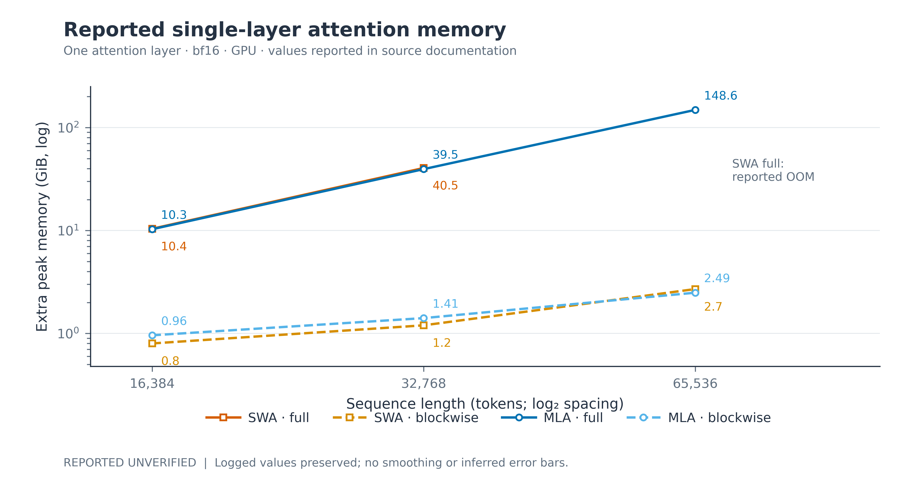
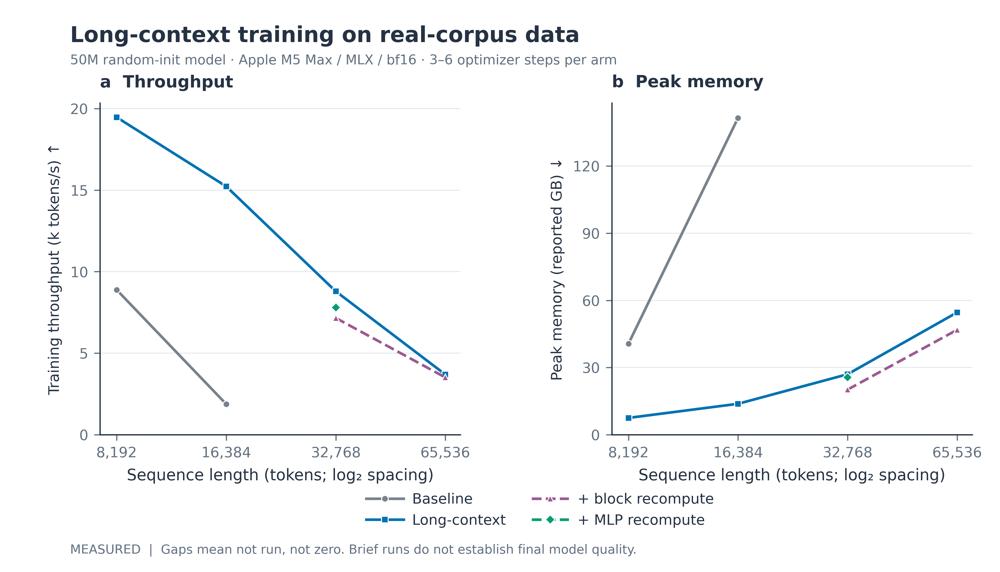
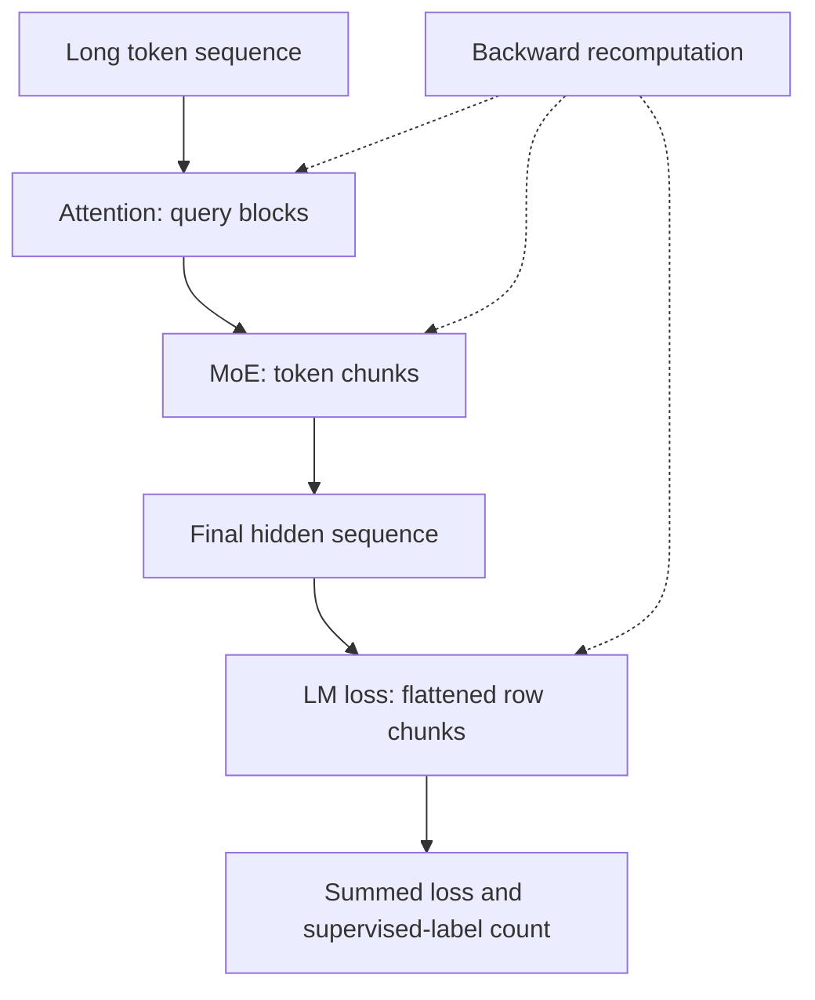
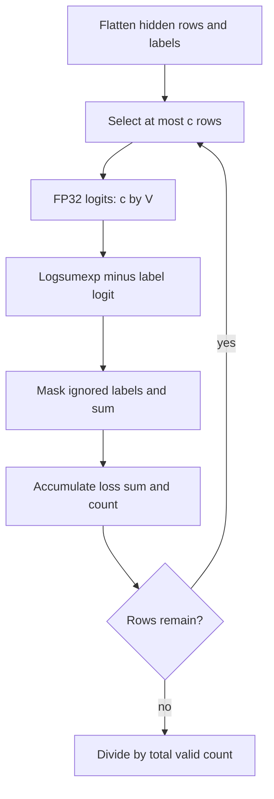
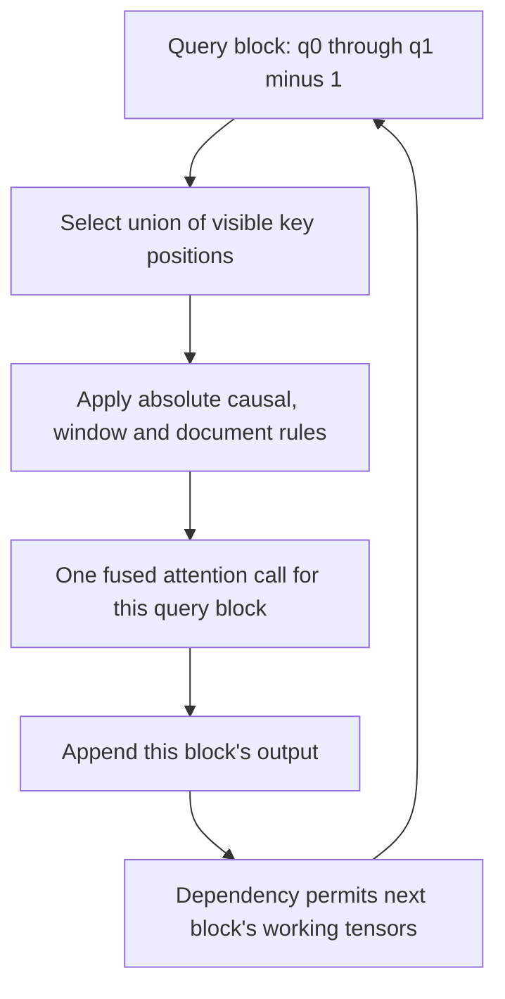
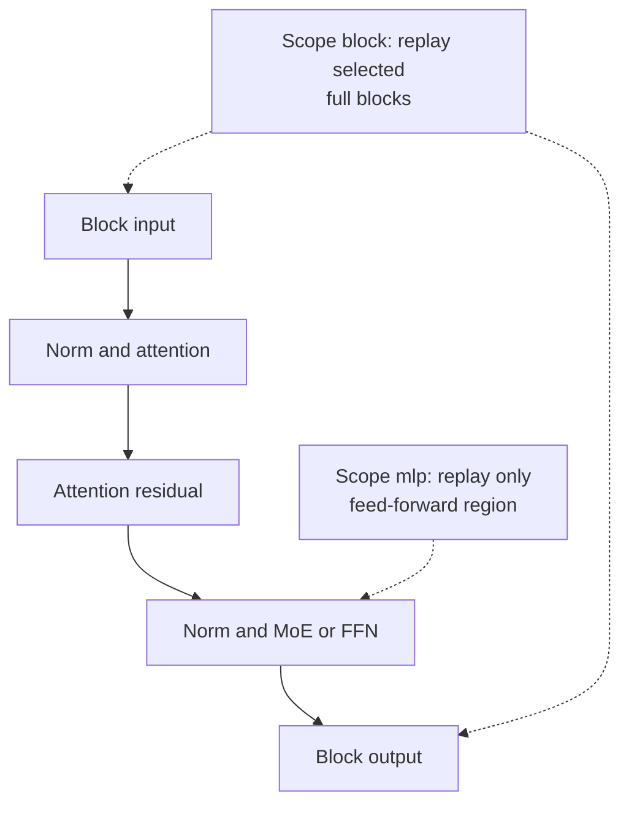

# Long context: bounded working tensors and measured trade-offs

Long sequences stress several different allocations: attention scores, expanded keys and values, expert intermediates, and vocabulary logits. Chronos addresses these allocations separately. Query blocking, chunked cross-entropy and chunked expert dispatch reduce working tensors; activation recomputation trades additional backward computation for fewer saved intermediates.

These mechanisms concern training and multi-token prefill. A bounded sliding-window decode cache is a separate property. It does not, by itself, bound the attention score tensors created while training a long sequence.

*Figure 1. Reported single-layer attention-memory comparison. Raw single-layer SWA records are absent, so this panel is labelled reported/unverified. MLA values come from the documentation table; a raw layer-level benchmark log is not available. An unmeasured or reported out-of-memory cell is not a numerical lower bound. SWA, sliding-window attention; MLA, multi-head latent attention.*

*Figure 2. Recorded short-run training on real English–Chinese corpus shards, using the production 50M configuration from random initialization. The JSON records Apple M5 Max, 128 GB, MLX 0.32.4 and bfloat16. Each arm uses the same seed and data order, with three to six optimizer steps and six fixed validation windows. These measurements test implementation behavior; they do not establish final trained-model quality. CE, cross-entropy; MLX, Apple's array framework.*

## 1. Separate the memory terms

A useful accounting identity is

$$
M_{\mathrm{peak}}=M_{\mathrm{parameters}}+M_{\mathrm{optimizer}}
+M_{\mathrm{saved}}+M_{\mathrm{working}}+M_{\mathrm{runtime}}.
\tag{1}
$$

The terms need not peak at the same instant, so summing their individual maxima would overestimate the true peak. Equation (1) instead describes the live allocations at the instant of peak usage. The long-context options mostly target saved and working activations. They do not remove parameters, optimizer states or the final hidden-state sequence.

*Figure 3. The three chunking boundaries target different tensors. Their sizes are independent configuration values. Backward recomputation rebuilds intermediate tensors instead of retaining every chunk's internal activations.*

## 2. Chunked cross-entropy, derived from the full loss

Let $N$ be the number of flattened supervised positions before ignoring labels, $V$ the vocabulary size, $h_n\in\mathbb R^d$ a hidden row, and $W\in\mathbb R^{V\times d}$ the output projection. For label $y_n$, the per-row negative log-likelihood is

$$
\ell_n=\log\sum_{v=1}^{V}\exp\big((Wh_n)_v\big)-(Wh_n)_{y_n}.
\tag{2}
$$

Let $m_n$ be one for a valid label and zero for `ignore_index`. Partition the rows into chunks $I_j$. The global mean is exactly

$$
\mathcal L=
\frac{\sum_j\sum_{n\in I_j}m_n\ell_n}
{\max(1,\sum_j\sum_{n\in I_j}m_n)}.
\tag{3}
$$

Equation (3) explains why the implementation accumulates **loss sums and valid-label counts**. Averaging chunk means would give unequal weights to a short final chunk or chunks with different numbers of ignored labels. The shifted language-model helper aligns `hidden[:, :-1]` with `labels[:, 1:]`. [Chunk sum and mean](../chronos/mlx/chunked_ce.py#L18), [causal shift](../chronos/mlx/chunked_ce.py#L56)

*Figure 4. Chunked CE preserves the global reduction while bounding the temporary logit matrix. The implementation serializes chunk dependencies and checkpoints each chunk for backward recomputation. CE, cross-entropy; FP32, 32-bit floating point.*

With FP32 logits, the full temporary buffer contains $4NV$ bytes. For a chunk of at most $c$ **flattened rows**, its corresponding buffer is bounded by

$$
M_{\mathrm{logits,chunk}}\leq4cV\ \mathrm{bytes},
\qquad M_{\mathrm{logits,full}}=4NV\ \mathrm{bytes}.
\tag{4}
$$

There is no extra batch factor in $c$: the helper already flattens batch and sequence dimensions. As an arithmetic example, $c=1024$ and $V=32768$ give 134,217,728 bytes, or 128 MiB. A single 65,536-row matrix at the same vocabulary gives 8 GiB. These are tensor-size calculations, not measured process peaks.

The source casts both hidden rows and head weights to FP32 for this loss. It explicitly links later chunks to the accumulated sum, preventing several chunks' logits from becoming live concurrently. The model-level default `ce_chunk_size=0` disables chunking; the helper's own default of 4096 is a different interface. [Serialization](../chronos/mlx/chunked_ce.py#L29), [configuration default](../chronos/model/config.py#L125)

Chunked CE avoids full vocabulary logits in the selected training-loss path. Other forwards, including ordinary inference logits, can still materialize vocabulary-shaped outputs. It is therefore incorrect to describe the loss as the only place the model ever creates a vocabulary tensor.

## 3. Query-block attention: same mask, smaller working set

For a query at absolute position $q$, causal attention permits key positions $k\leq q$. SWA adds $k>q-W$, where $W$ is the window. Optional document masking adds equality of document IDs:

$$
A_{qk}=\mathbf 1\{k\leq q\}
\mathbf 1\{k>q-W\}\mathbf 1\{\mathrm{doc}(q)=\mathrm{doc}(k)\}.
\tag{5}
$$

The window and document factors are omitted when disabled. Chronos blocks **queries**, then invokes the fused scaled-dot-product attention kernel over each block's visible key span. It does not implement a separate online softmax over independently normalized key chunks. [Mask construction](../chronos/mlx/blockwise_attention.py#L25), [fused call](../chronos/mlx/blockwise_attention.py#L48)

For a query block spanning absolute positions $[q_0,q_1)$ with $q_1-q_0\leq c$, the SWA reader selects

$$
k_0=\max(0,q_0-W+1),\qquad k_1=\min(T,q_1).
\tag{6}
$$

The block's union of visible keys can therefore contain up to $W+c-1$ positions, even though each individual query sees at most $W$ keys. The per-query mask inside that span preserves the original attention rule. For full causal attention, $k_0=0$. [Block bounds](../chronos/mlx/blockwise_attention.py#L55)

*Figure 5. Query blocking keeps the original key set for each query. The visible union is larger than a single SWA window when a block contains several queries. Outputs agree with the reference mask up to floating-point execution differences. SWA, sliding-window attention.*

For batch $B$, query heads $H_q$ and head width $d_h$, the leading full-causal attention work remains $O(BH_qT^2d_h)$. Query blocking changes the score working-set scale from $O(BH_qT^2)$ to approximately $O(BH_qcT)$, with additional masks, Q/K/V, outputs and backward state. It does not make global attention linear-time.

For the implemented SWA block span, a corresponding work estimate is

$$
O\left(\frac{T}{c}\,BH_q\,c(W+c)d_h\right)
=O\left(BH_qT(W+c)d_h\right).
\tag{7}
$$

Its score working set is approximately $O(BH_qc(W+c))$. This explains why a larger block can improve one global MLA layer yet hurt a mixed model's SWA layers. These are implementation-level complexity estimates; fused kernels and allocator behavior determine measured peaks. The source serializes output dependencies and checkpoints attention blocks. [Dependencies](../chronos/mlx/blockwise_attention.py#L76)

The blockwise path is selected only for multi-row inputs longer than the configured block. Training with attention dropout falls back to the ordinary path. `attention_block_size=0` also disables this path. [Selection conditions](../chronos/mlx/blockwise_attention.py#L128)

## 4. Latent reconstruction and decode cache are different savings

MLA stores a content latent $c^{KV}$ and a decoupled rotary key. The optional `mla_upproj_recompute` blockwise path retains those inputs and reconstructs expanded keys and values inside each attention block. This reduces retained expanded K/V tensors, at the cost of repeated up-projection work. The rotary keys passed to that helper are already rotated; they are not simply absent from storage. [Latent reconstruction](../chronos/mlx/blockwise_attention.py#L83)

For one cache slot, scalar width $b$ bytes, $H_{kv}$ key/value heads, content latent width $d_c$ and rotary width $d_r$, the unquantized MLA payload is approximately

$$
M_{\mathrm{MLA,cache}}=BT(d_c+H_{kv}d_r)b.
\tag{8}
$$

A conventional SWA decode cache is approximately $B\min(T,W)H_{kv}(d_k+d_v)b$ per slot, before metadata and speculative slack. These are inference-cache payload estimates. They do not describe all training activations. Slot multiplicity also depends on the recurrent attention mode; see [ATTENTION.md](ATTENTION.md).

Position encoding must be configured independently. The kernel configuration defaults to `rope_theta=1e6` and exposes `inference_rope_scaling`; the scaling helper supports explicit policies. The source does not implement a `long_context` master switch or an automatic `rope_theta_scaled=100000` setting. A memory-efficient execution path does not itself establish extrapolation quality at unseen positions. [RoPE configuration](../chronos/model/kernel.py#L67), [scaling implementation](../chronos/model/kernel.py#L85)

## 5. Recompute scope and sparse expert chunks

Activation checkpointing saves the inputs to a computation region and rebuilds internal activations during backward. It leaves the mathematical operation unchanged when recomputation uses the same stochastic and side-effect semantics. Finite-precision execution order can still differ.

*Figure 6. The two MLX recomputation scopes. Whole-block recomputation can reclaim attention and feed-forward saved state. MLP scope retains attention state and targets the feed-forward region only. MLP, multilayer perceptron; MoE, mixture of experts; FFN, feed-forward network.*

`activation_checkpointing=True` enables the outer recomputation mechanism during training without incoming cache. `recompute_scope="block"` applies `recompute_policy` to selected blocks; its policies are `all`, `mla`, `swa` and `alternate`. MLX also supports `recompute_scope="mlp"` for only the feed-forward region. These are fields, rather than separate `recompute_block` and `recompute_mlp` booleans. [Scope implementation](../chronos/mlx/model.py#L126), [block selection](../chronos/mlx/model.py#L238)

Sparse expert dispatch can also chunk flattened tokens with `moe_chunk_tokens`. In the MLX training path, each dispatch chunk is checkpointed, reducing the lifetime of gate/up activations of approximate shape $[ck,d_e]$, where $k$ is routed top-$k$ and $d_e$ expert intermediate width. Router outputs and final sequence tensors still exist outside this working set. [MoE chunking](../chronos/mlx/moe.py#L130)

## 6. What the recorded experiment establishes

Table 1 transcribes the `real_corpus` entries of [the recorded JSON](../reports/long_context_20261109/real_corpus_ab.json). The `long` arm sets `attention_block_size=1024`, `ce_chunk_size=1024` and `moe_chunk_tokens=8192`. Its entries are measured short-run results, with the conditions stated in Figure 2.

| Arm | Sequence tokens | Tokens/s | Reported peak GB | Validation CE |
|---|---:|---:|---:|---:|
| base | 8,192 | 8,884 | 40.64 | 8.4561 |
| long | 8,192 | 19,466 | 7.51 | 8.4585 |
| base | 16,384 | 1,877 | 141.50 | 8.7118 |
| long | 16,384 | 15,226 | 13.81 | 8.7121 |
| long | 32,768 | 8,792 | 27.01 | 8.8754 |
| long + block recompute | 32,768 | 7,158 | 20.16 | 8.8757 |
| long + MLP recompute | 32,768 | 7,794 | 25.64 | 8.8756 |
| long | 65,536 | 3,690 | 54.64 | 9.0575 |
| long + block recompute | 65,536 | 3,512 | 46.85 | 9.0575 |

*Table 1. Measured throughput, reported peak-memory field and validation CE. The memory column retains the JSON field's `peak_gb` unit label; its byte-conversion convention is unspecified. Baseline arms at 32,768 and 65,536 are absent, rather than recorded zeros or demonstrated out-of-memory events. CE, cross-entropy; MLP, multilayer perceptron.*

At 8,192 and 16,384 tokens, the recorded peak ratios are $40.64/7.51\approx5.41$ and $141.50/13.81\approx10.25$. The matching throughput ratios are approximately 2.19 and 8.11. These changes compare the combined long configuration against the baseline; they do not isolate each mechanism's causal contribution.

At 32,768 tokens, block recomputation reduces the reported peak by about 25.36% while reducing tokens/s by 18.59%. MLP recomputation reduces the peak by 5.07% while reducing tokens/s by 11.35%. At 65,536 tokens, block recomputation reduces the peak by 14.26% and tokens/s by 4.82%.

The CE differences between matched arms are small in this short run. There are no repeated-run error bars or established noise-floor measurements. These observations therefore do not prove equal final quality or unchanged learning dynamics. The growth from 7.51 to 54.64 reported GB over an eightfold context increase is compatible with roughly linear aggregate memory; it does not establish a sublinear asymptotic law.

The same JSON also records synthetic full-model and single-MLA-layer block sweeps. Those scopes should remain separate: a block size favored by one layer need not optimize the mixed stack. The recorded MLA up-projection recompute arm gives little full-model peak reduction in that synthetic setting, so its usefulness should be measured rather than assumed.

## 7. Actual configuration and open evidence

| Field | Model default | Role |
|---|---|---|
| `attention_block_size` | 0 | Query-block size; zero disables the blockwise path. |
| `ce_chunk_size` | 0 | Flattened rows per training-loss chunk; zero keeps full logits. |
| `moe_chunk_tokens` | 0 | MLX training expert-dispatch chunk size. |
| `activation_checkpointing` | false | Enable outer activation recomputation. |
| `recompute_scope` | `block` | Full block or MLX feed-forward-only scope. |
| `recompute_policy` | `all` | Block-selection rule for block scope. |
| `mla_upproj_recompute` | false | Rebuild expanded MLA K/V inside blockwise attention. |
| `document_masking` | false | Restrict attention to matching packed-document IDs. |

The defaults and accepted choices are in [ChronosConfig](../chronos/model/config.py#L125). These independent fields should be set explicitly in a benchmark manifest. There is no implemented master flag that silently enables all of them.

The release has no measured full-training length-curriculum curve and no recorded 128k or 256k arm in the cited experiment. It also lacks the original SWA layer-level raw memory log. Further claims require repeated end-to-end measurements, gradient/loss parity checks, documented peak-memory APIs, long-context task evaluation and a trained checkpoint with its exact position-encoding configuration.
