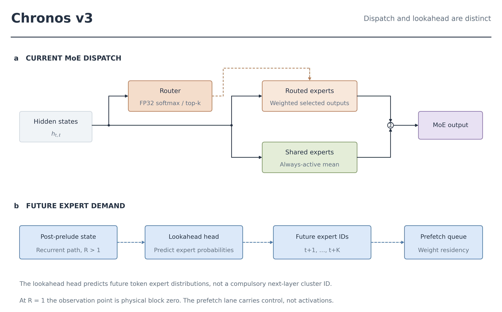
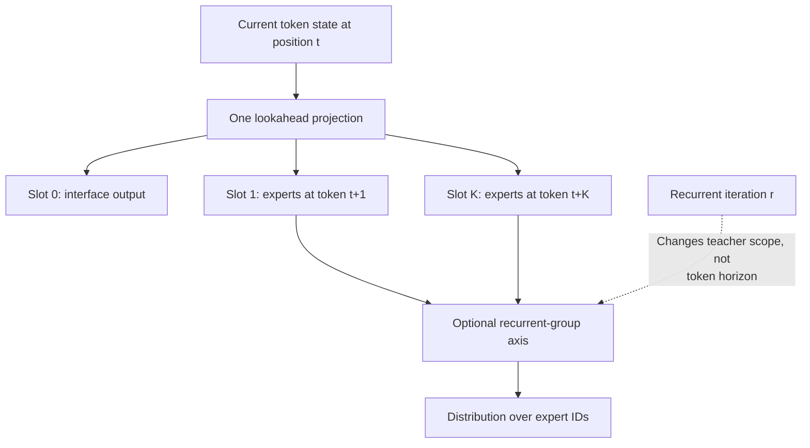
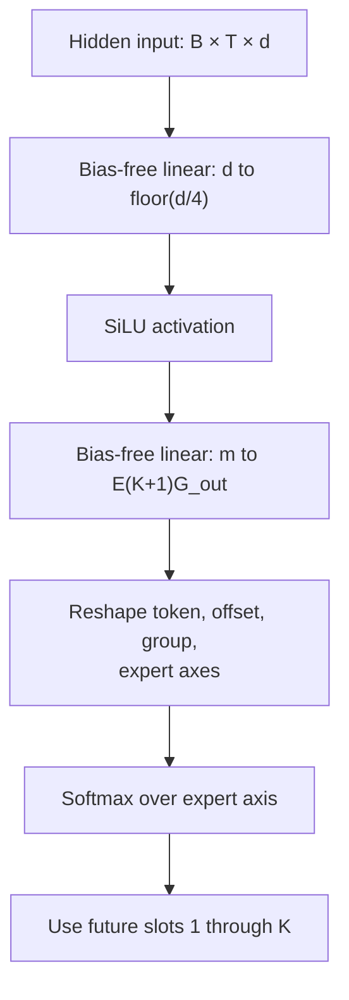
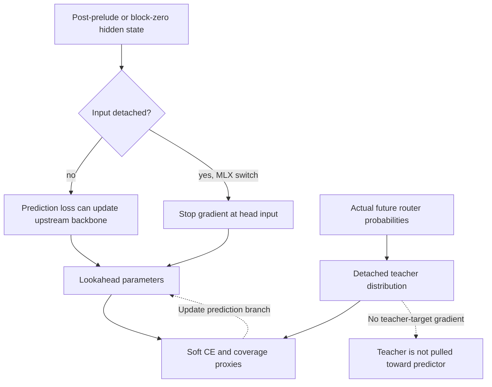
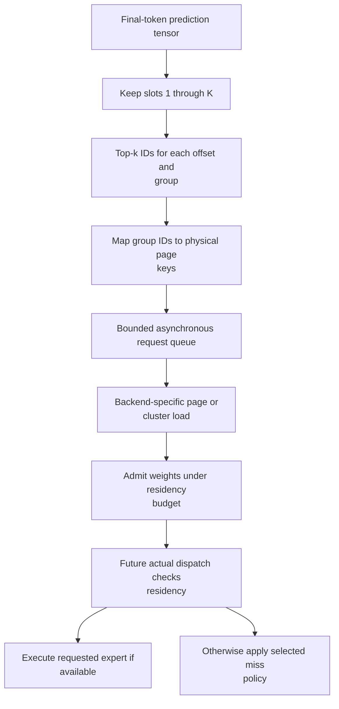

# Lookahead prediction: token horizons, group heads and prefetch

The lookahead head forecasts future **expert-routing distributions**. It does not predict the future token identity and is not a draft decoder. Its output guides expert-weight residency rather than entering the language-model readout directly.

That architectural separation does not make prediction errors harmless. A wrong prediction can waste I/O, displace useful weights or cause a later miss. Under a shared-fallback policy, changed residency can also change the model output. During training, lookahead losses can affect the backbone unless their input is detached.

*Current computation and future prediction use separate paths. MoE, mixture of experts; FP32, 32-bit floating point. Dashed future-request edges carry control, not a contribution added to the current token's activation output.*

## 1. Three axes that must not be conflated

Use $t$ for token position, $\delta$ for future token offset, $g$ for a recurrent physical group and $r$ for recurrent iteration. The future horizon is

$$
 \delta\in\{1,\ldots,K\},\qquad K=\texttt{lookahead\_steps}.
$$

The head additionally emits slot zero. Its output is

$$
 Q\in\mathbb R^{B\times T\times(K+1)\times E}
$$

when `layer_aware_lookahead=False`, or

$$
 Q\in\mathbb R^{B\times T\times(K+1)\times G\times E}
$$

when that flag is true. Softmax is over the final expert axis. Group $g$ is aligned to physical layer $P+g$ in the layer-aware teacher path. It does not mean a separate head for every prelude and coda layer. [Head implementation](../chronos/model/lookahead_router.py#L22), [teacher alignment](../chronos/trainer/loss_mixin.py#L140).

| Axis | Meaning | What it is not |
|---|---|---|
| $t$ | Current input-token position | Recurrent depth |
| $\delta$ | Future-token offset | Next physical layer |
| $g$ | Recurrent physical group | A new parameter block at every iteration |
| $r$ | Repeated call of a recurrent layer | Future token position |
| $e$ | Expert ID within a physical MoE layer | A global expert network shared by all layers |

Future supervision and prefetch use slots $1$ through $K$. Slot zero is emitted by the projection for the interface contract; the future supervision loops do not make it a separately validated current-routing classifier.

*Prediction axes. Token horizon, physical group and recurrent iteration have different meanings even when their numeric sizes happen to coincide.*

## 2. Actual head architecture and parameter count

Let $d$ be backbone width and $m=\max(1,\lfloor d/4\rfloor)$. The current head is

$$
 u=\operatorname{SiLU}(W_1h),\qquad z=W_2u,\qquad Q=\operatorname{softmax}_E(\operatorname{reshape}(z)),
$$

with bias-free matrices

$$
 W_1\in\mathbb R^{m\times d},\qquad
 W_2\in\mathbb R^{E(K+1)G_{\mathrm{out}}\times m},\qquad
 G_{\mathrm{out}}=\begin{cases}G,&\text{layer-aware},\\1,&\text{otherwise}.\end{cases}
$$

It uses **SiLU**, not a SwiGLU body, and one projection that is reshaped into offset/group slices. There is no current `lookahead.hidden=256` setting or collection of separately instantiated per-layer output modules. [Torch head](../chronos/model/lookahead_router.py#L31), [MLX head](../chronos/mlx/model.py#L37).

The exact matrix parameter count is

$$
 P_{\mathrm{LA}}=dm+mE(K+1)G_{\mathrm{out}}.
$$

For the explicitly named bundled translation configuration, $d=384$, $m=96$, $E=36$, $K=2$ and $G_{\mathrm{out}}=4$. The derived count is

$$
 P_{\mathrm{LA}}=384\times96+96\times36\times3\times4=78\,336.
$$

These are configuration/algebraic counts, not measured latency or a claim that every 50M recipe has this shape. The matrix FMA count per input token has the same leading expression; SiLU, softmax, tensor handling and scheduling add work. [Named configuration](../demos/translation/models/chronos-enzh-50m-sft/config.json).

*The implemented lightweight prediction head. Its hidden width follows the backbone rather than a separate fixed-width knob.*

### Observation point and precision boundaries

For active recurrent execution, the logical input is the state after the prelude, before recurrent refinement. For the depth-one ordinary path, it is the state after physical block zero. Torch computes the head from the saved post-prelude state after the recurrent helper returns; MLX evaluates it at that observation point before entering the recurrent portion. Do not confuse the source state with an identical backend scheduling order. [Torch calls](../chronos/model/model_chronos.py#L480), [MLX calls](../chronos/mlx/model.py#L248).

The MoE dispatch router explicitly uses FP32 softmax on both backends. The **lookahead head** currently differs: MLX casts its projected logits to FP32, while Torch applies softmax without an explicit cast in this head. Torch therefore inherits the projected logits' dtype. These operations should not be documented as unconditional FP32 parity. [Torch softmax](../chronos/model/lookahead_router.py#L47), [MLX cast](../chronos/mlx/model.py#L60).

## 3. Teacher construction and gradient ownership

The teacher is a **soft future routing distribution**, not just hard expert IDs. It is detached before lookahead supervision. For each physical layer, the current modes are:

- `lookahead_teacher_scope="first"`: use the first recorded dispatch distribution.
- `lookahead_teacher_scope="iterations"`: average the recorded distributions across that physical layer's iterations.

The accepted string is `"iterations"`, not `"all"`. Averaging probabilities across recurrent calls is not taking a union of their hard selected IDs. The separate future-union objective below concerns **token offsets**. [Scope validation](../chronos/model/config.py#L301), [teacher sources](../chronos/trainer/loss_mixin.py#L101).

When predictions lack a group axis, teacher probabilities are averaged across physical layers. With a group axis, the trainer selects physical recurrent layers $P$ through $P+G-1$. In either case, the teacher is stop-gradient. Denote that aligned distribution by $\operatorname{sg}(P_{b,t,g,e})$.

Input detachment is a different decision:

$$
 h_{\mathrm{LA}}=\begin{cases}\operatorname{sg}(h),&\text{input detach enabled},\\h,&\text{otherwise}.\end{cases}
$$

`lookahead_input_detach` defaults to false. MLX applies the switch at the head call. In the reviewed Torch call sites, the flag is not consulted: changing it alone does not create a stopped-gradient input there. This is an implementation-parity boundary, not a feature that documentation can assume works identically. [Config](../chronos/model/config.py#L166), [MLX switch](../chronos/mlx/model.py#L269), [Torch call](../chronos/model/model_chronos.py#L492).

*Gradient ownership. Teacher detachment prevents target feedback. Input detachment prevents a different path through the prediction input. They are not substitutes.*

## 4. Deriving the three prediction losses

### 4.1 Soft-target cross-entropy

For valid future offset $\delta$, align prediction at $t$ with routing at $t+\delta$:

$$
 \ell_{b,t,g}^{(\delta)}
 =-\sum_e\operatorname{sg}(P_{b,t+\delta,g,e})\log Q_{b,t,\delta,g,e}.
$$

The loss averages valid token/group examples within each offset, then averages available offsets:

$$
 L_{\mathrm{LA}}=\frac1{|\mathcal D|}\sum_{\delta\in\mathcal D}
            \operatorname{mean}_{b,t,g:\,t+\delta<T}\ell_{b,t,g}^{(\delta)}.
$$

Offsets with no valid pair are skipped. Expanding cross-entropy gives

$$
 \ell=H(P)+D_{\mathrm{KL}}(P\|Q).
$$

Because $P$ is detached, its entropy is constant with respect to the prediction branch. Minimizing this term therefore fits the teacher distribution without encouraging the teacher to chase its own prediction. For a prediction logit vector, the local derivative is $Q-P$. [Torch loss](../chronos/model/temporal_loss.py#L259), [MLX masked loss](../chronos/mlx/training/trainer.py#L415).

The displayed formula assumes unmasked pairs. Document boundaries and valid-token masks determine which pairs may enter the mean on the relevant trainer path. Their switches must be recorded with a packed-document experiment; a temporal offset crossing unrelated documents is not a valid continuation target.

### 4.2 Probability mass on the future top-k set

Let $I_{b,t+\delta,g}$ be the teacher's future top-k set. The auxiliary hit-mass proxy is

$$
 M_{b,t,g}^{(\delta)}=\sum_{e\in I_{b,t+\delta,g}}Q_{b,t,\delta,g,e},\qquad
 L_{\mathrm{hit}}=\operatorname{mean}\left[-\log\frac{M^{(\delta)}}{k}\right].
$$

The division by $k$ is a constant for the selected setting. It gives a uniform predictor the same reference loss $\log E$ across top-k choices. It does not alter the derivative with respect to $Q$. A prediction can place most of its mass on only part of the teacher set, so this is a differentiable **coverage proxy**, not a theorem guaranteeing exact top-k recall. [Hit-mass implementation](../chronos/model/temporal_loss.py#L316).

### 4.3 A union across future token offsets

For a horizon of $K$ future tokens, define the target union

$$
 U_{b,t,g,e}=\max_{1\le\delta\le K}\mathbf1\{e\in I_{b,t+\delta,g}\},\qquad
 \widehat Q_{b,t,g,e}=\max_{1\le\delta\le K}Q_{b,t,\delta,g,e}.
$$

The implemented proxy is

$$
 L_{\mathrm{union}}=\operatorname{mean}\left[
   -\log\frac{\sum_eU_e\widehat Q_e}{\sum_eU_e}\right].
$$

The maximum across offsets is **not** a normalized categorical distribution or a probabilistic union formula. It summarizes each expert's largest forecast probability over the prefetch window. This term rewards coverage of distinct future needs, while soft cross-entropy preserves offset-specific structure. [Union implementation](../chronos/model/temporal_loss.py#L362).

The trainer combines the available terms as

$$
 L_{\mathrm{prediction}}
 =\lambda_{\mathrm{LA}}L_{\mathrm{LA}}
 +\lambda_{\mathrm{hit}}L_{\mathrm{hit}}
 +\lambda_{\mathrm{union}}L_{\mathrm{union}}.
$$

It adds them only when prediction/teacher tensors and future offsets are available. [Assembly](../chronos/trainer/loss_mixin.py#L231).

## 5. From probabilities to bounded runtime requests

The runtime does not use every prediction for every prefix position. The Torch scheduler selects the final token row, removes slot zero and takes top `num_experts_per_tok` predictions per future offset. With group-aware caching it maps group IDs to physical-layer page keys. It submits earlier offsets before later ones and deduplicates IDs. [Scheduler](../chronos/io/async_prefetcher.py#L211).

For one sample and one group, before page-layout expansion, the union of $K$ top-k lists contains at most $\min(E,Kk)$ expert IDs. This is a derived candidate-set bound, not a bound on loaded bytes. Multiple samples, physical-layer mapping, cluster neighbors and backend load granularity change the actual request volume.

*Prediction-to-residency path. KV, key–value. None of these requests writes an attention KV entry or directly supplies a language-model activation.*

A queue slot can contain a list of expert IDs; queue depth is not automatically a per-token byte or expert cap. The scheduler currently derives its selected count from `num_experts_per_tok`; there is no `lookahead.top_k` or `prefetch.budget_per_token=8` field in this code path. [Queue construction](../chronos/runtime/cache_manager.py#L35).

Inference mode removes autograd bookkeeping, not the need to compute or hold prediction tensors. Prefill output has a $BT(K+1)G_{\mathrm{out}}E$ probability footprint before downstream slicing. The actual memory lifetime depends on backend evaluation and caller behavior.

## 6. What failures mean

| Prediction/runtime event | Possible consequence | What cannot be concluded automatically |
|---|---|---|
| A needed expert was not predicted | Miss, demand load or fallback | Miss rate is not identical to head prediction error |
| An unused expert was predicted | Extra loading, cache occupancy or eviction | One prediction does not always equal one physical read |
| Correct cluster, wrong expert | Potential neighbor reuse | Not guaranteed if the requested neighbor was not admitted or was evicted |
| Exact miss policy waits for expert | More latency on a cold miss | Not a zero-cost miss |
| Approximate fallback handles a miss | Shared output substitutes for the routed contribution | Not guaranteed output equivalence to full residency |

Torch's clustered path selects requested/budgeted pages before materialization. MLX's cluster path loads/evaluates the cluster before bounded admission. Thus “one correct cluster prediction covers every member” is not a backend-independent guarantee. [Torch](../chronos/io/expert_store.py#L560), [MLX](../chronos/mlx/expert_store.py#L290).

Likewise, the residency benchmark is not a clean head-on/head-off ablation. Its LRU and planned modes change eviction policy; LRU can still receive predictive prefetches. The observed miss-rate difference cannot be attributed solely to the lookahead network. Selection misses also depend on cache budget, evictions, cluster layout, scheduling and warm/cold state.

## 7. Evidence, defaults and open measurements

The named CPU/float32, 16-prompt benchmark reports selection miss rates 0.2175 for plain LRU and 0.1394 for planned residency. These are **measured downstream runtime counters on the stated checkpoint/workload**, not standalone forecast accuracy. [Benchmark JSON](../reports/residency_20261107/bench_residency_50m_s13996_flores16_cpu.json).

The 15M, one-seed iteration-cluster agreement summarized in the changelog is a separate experiment. The synthetic topic-cluster purity of 0.999 at locality coefficient 0.3 is another metric on another tiny model. They should not be combined into a single end-to-end accuracy claim. [Loop report summary](../CHANGELOG.md), [synthetic record](../reports/residency_20261107/sweep/lam_0.3_w32.json).

| Actual configuration field | Class default | Role |
|---|---:|---|
| `lookahead_steps` | `2` | Number $K$ of future-token offsets |
| `layer_aware_lookahead` | `False` | Add recurrent physical-group output axis |
| `layer_aware_cache` | `False` | Interpret group-aware page predictions |
| `lambda_lookahead` | `0.1` | Soft-target CE coefficient |
| `lambda_lookahead_topk` | `0.15` | Top-k target-mass coefficient |
| `lambda_lookahead_union` | `0.05` | Future-union coefficient |
| `lookahead_teacher_scope` | `"first"` | `"first"` or `"iterations"` |
| `lookahead_input_detach` | `False` | Optional input stop-gradient; observed backend boundary above |
| `num_experts_per_tok` | `1` | Scheduler's per-offset selected count, before recipe override |
| `prefetch_depth` | `2` | Queue-related setting, not future horizon $K$ |

Sources: [head-related defaults](../chronos/model/config.py#L201), [loss defaults](../chronos/model/config.py#L271), [teacher/input policies](../chronos/model/config.py#L166), [base top-k](../chronos/model/kernel.py#L75). Stored checkpoints and planner recipes may override these values.

The standalone `prefetch_depth.json` benchmark is not present in the repository. Useful next measurements are offset/group-specific top-k recall, predicted-page precision, bytes loaded per useful expert, queue delay, and task quality under each miss policy. A matched head-off/head-on test with the same eviction policy and cache budget is needed to isolate the predictor's contribution. These are proposed measurements, not results already obtained.

**Notation:** MoE, mixture of experts; MLP, multilayer perceptron; CE, cross-entropy; KL, Kullback–Leibler divergence; KV, key–value; FMA, fused multiply-add; FP32, 32-bit floating point; LRU, least recently used; $P$, prelude block count; $G$, recurrent physical-group count; $K$, future token horizon; $R$, recurrent depth.
