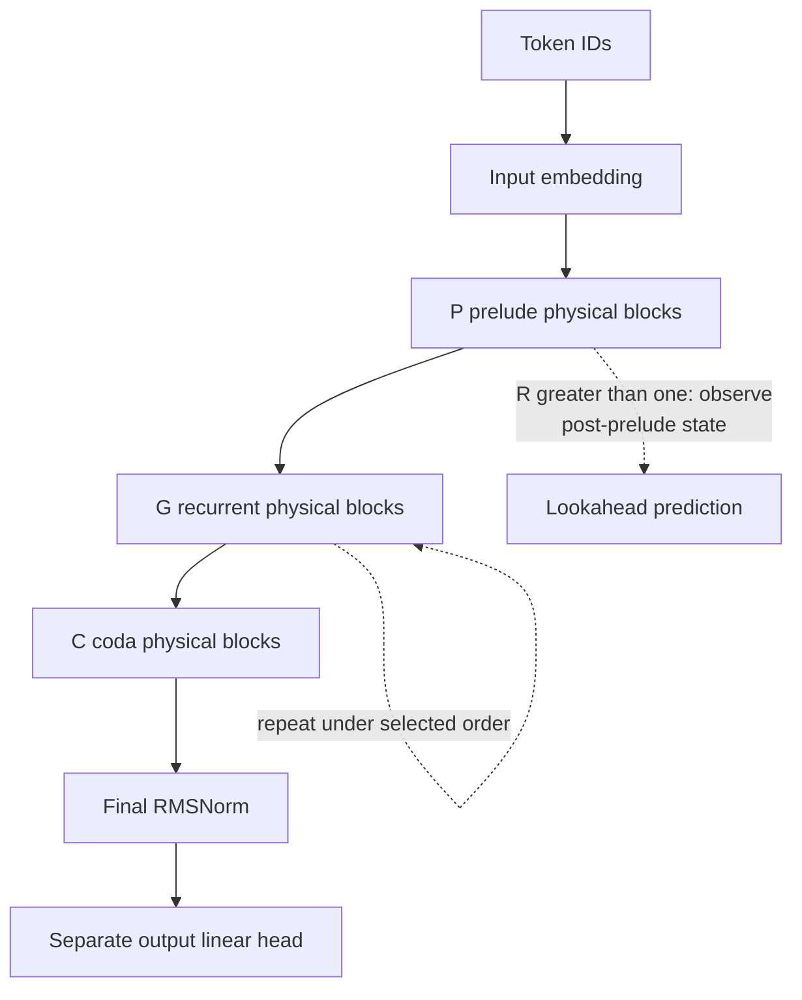
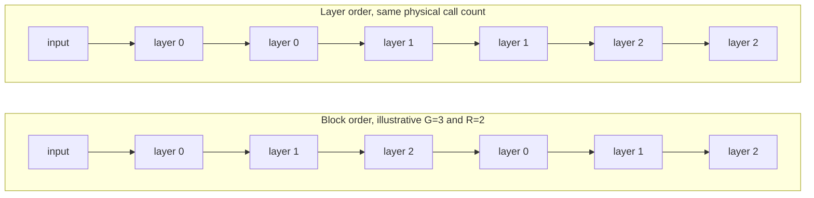
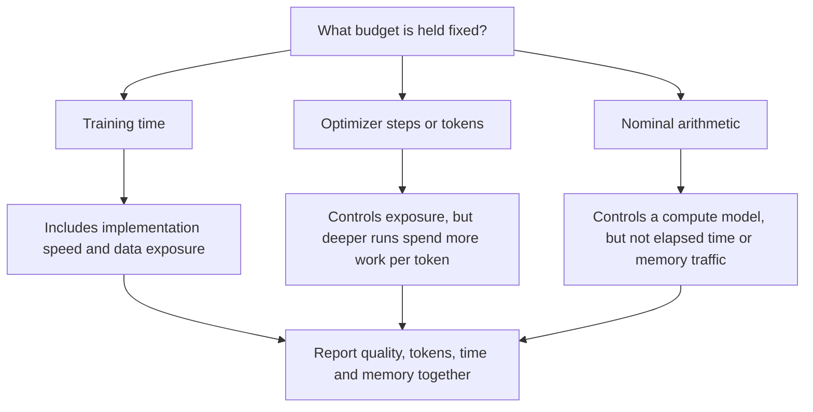
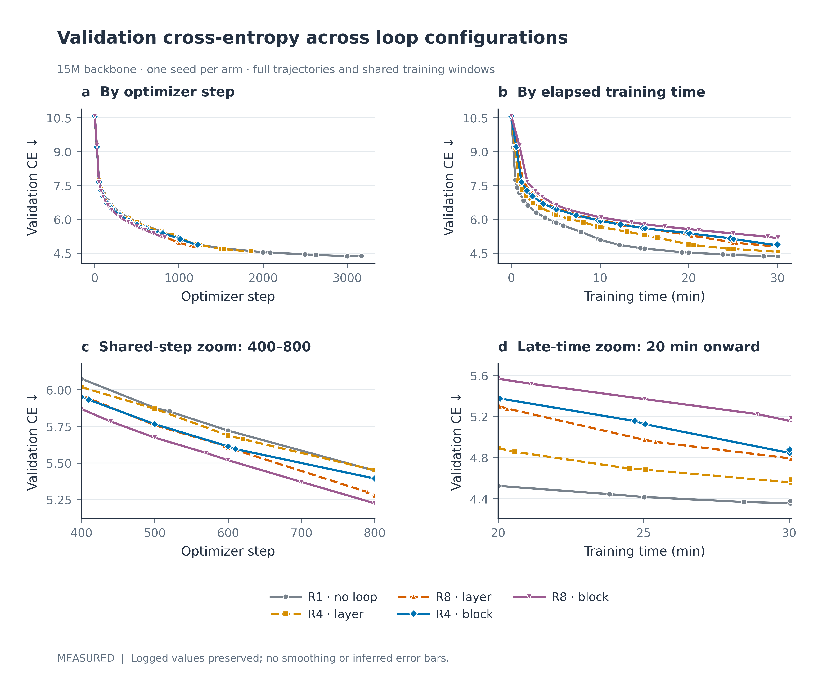
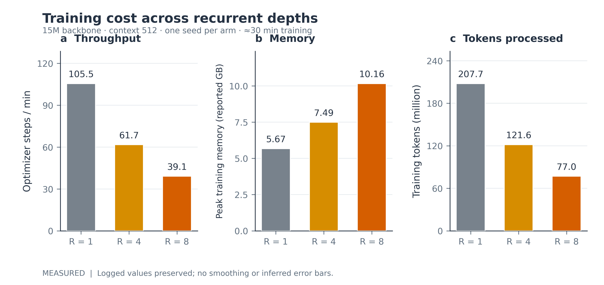
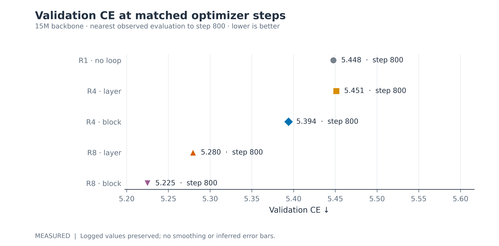
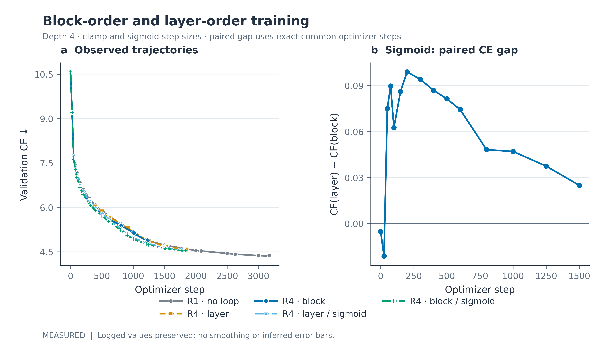
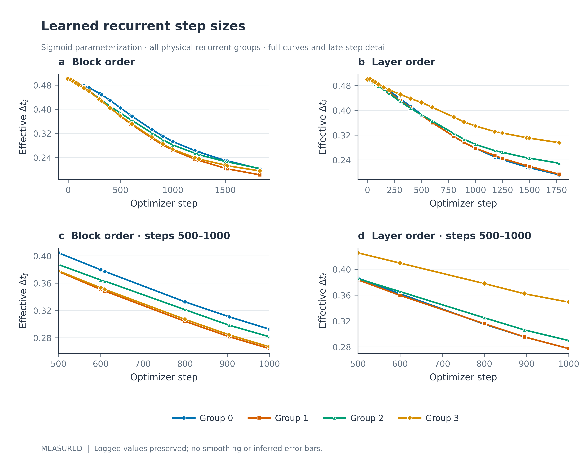
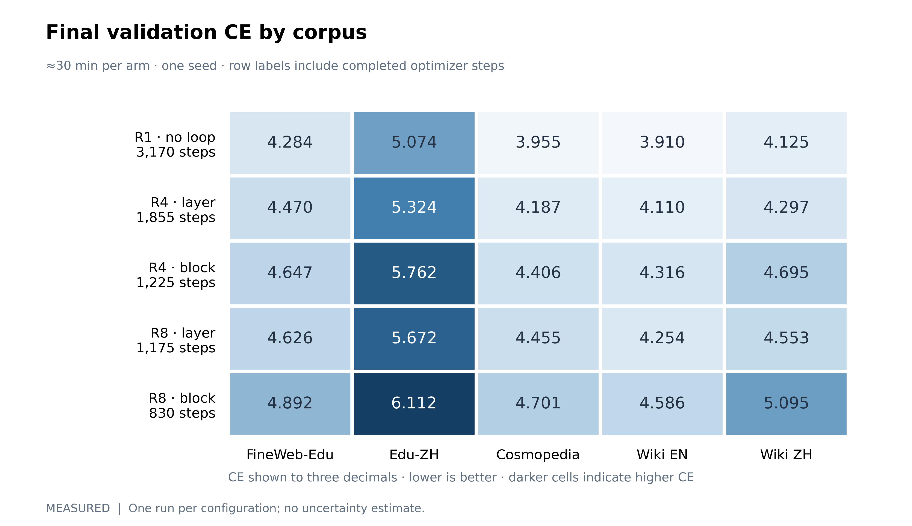
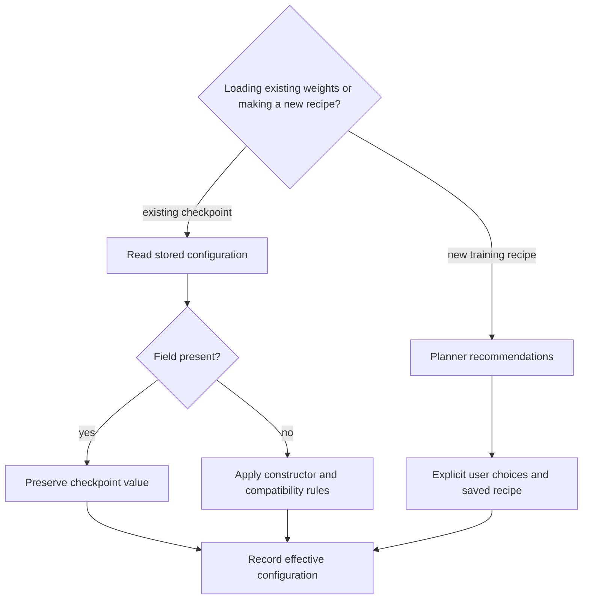

# Recurrent depth: execution, evidence and experiment design

Recurrent depth changes how often physical blocks execute. It does not create an independent copy of their weights at each repeat. The recorded experiments compare several consequences of that reuse, but they do not identify one universally best depth or order.

This chapter uses the repository's 15M experiment JSONs as measurement records. [THEORY.md](THEORY.md) derives the conditioned update and its mathematical limits. [KERNEL_ARCHITECTURE.md](KERNEL_ARCHITECTURE.md) defines the complete module graph.

## 1. Physical blocks, virtual calls and the depth-one boundary

Let $P$, $G$ and $C$ be the numbers of prelude, recurrent and coda physical blocks. Let $R$ be recurrent depth. An enabled recurrent execution without halting or later-group reduction performs

$$
N_{\mathrm{calls}}=P+RG+C.
\tag{L1}
$$

The physical parameter blocks remain $P+G+C$. Depth embeddings add a smaller $R\times d$ parameter table, so total parameter count is not exactly invariant across depths. The recorded totals are 14,979,853 for `d1`, 14,980,333 for depth four, and 14,980,973 for depth eight. These values are the respective JSON `params.total` fields.

*Figure L1. Physical partitions in the recurrent forward path. Prelude and coda execute outside the recurrent repeat. RMSNorm, root mean square normalization. The full-depth call count is Equation L1; early exit and later-group reduction change it. The schematic does not fix a model size.*

Every ordinary block contains attention and an MLP residual sublayer. With hybrid attention enabled, physical parity selects multi-head latent attention (MLA) or sliding-window attention (SWA). `use_moe` selects the model-wide MLP family. The letters used in older loop illustrations identify physical positions; they do not define attention-free B/C block types. See [ChronosBlock](../chronos/model/model_chronos.py#L55) and [make_attention](../chronos/model/hybrid_attention.py#L405).

At configured $R=1$, the model uses the ordinary one-pass branch. It does not apply depth conditioning or the contracted recurrent update. Lookahead observes physical block zero on that branch. A shallow draft override inside an already recurrent model is a separate execution case. Code: [depth-one bypass](../chronos/model/model_chronos.py#L479).

## 2. Block order and layer order

Block order repeats the complete recurrent body before starting the next repeat. Layer order repeats one physical block before advancing. For the illustrative choice $G=3$, $R=2$:

*Figure L2. Recurrent execution order. Repeated labels reuse the same physical parameter block. Equal nominal call counts do not imply equal hidden states, routing decisions or measured runtime. The illustrated group count and depth are examples, not benchmark parameters.*

Each call applies its own group step size:

$$
\Phi_{r,g}(h)=h+\alpha_g
\left[F_{P+g}(h+e_r+u_g;\mathcal K_g)-h\right].
\tag{L2}
$$

The controller does not apply one global $\alpha$ after an entire multi-layer body. In block order, the state passes through the composed group maps within each repeat. In layer order, one group map is repeated before the next group starts. The [executor](../chronos/model/model_chronos.py#L353) implements those two loop nests.

Operator order can matter because the maps generally do not commute. [THEORY.md](THEORY.md#3-why-loop-order-changes-the-computation) gives the small-step expansion. This mechanism alone does not predict which order achieves lower validation loss.

### 2.1 Attention execution and cache ownership

| Attention mode | Writer behavior | Later-repeat behavior | Important boundary |
|---|---|---|---|
| `shared_first` | First repeat builds the physical layer's KV view. | Fresh queries attend to that same view. | Readers do not append duplicate KV entries. |
| `per_iteration` | Each repeat owns its cache slot. | Attention recomputes against that repeat's state/cache. | Cached physical early exit cannot leave missing slots. |
| `first_only` | First repeat runs attention. | Later repeats skip attention and refine through the MLP path. | This is a temporal bypass, not an attention-free physical layer type. |

KV means key–value. The cases follow [run_layer](../chronos/model/model_chronos.py#L282). MLA and SWA store different cache payloads; [ATTENTION.md](ATTENTION.md) distinguishes persistent cache from transient shared views.

The full-depth formula in Equation L1 also assumes `recurrent_later_groups=0`, no adaptive exit and no sampled lower depth. `recurrent_later_topk` changes expert work without removing block calls. Cache mode and routing policy can change arithmetic within a nominal block call.

## 3. What the experiment records contain

All listed arms record `seed=1234`, context 512, and `tokens_per_step=65536`. They use the same declared pretraining configuration family, with no finetuning or reinforcement-learning stage. The project describes the measurements as bf16 MLX runs on Apple M5 Max. The arm JSONs do not themselves capture a complete executable environment or source revision.

There are three different evaluation records:

| JSON field | Comparison supported | What should not be assumed |
|---|---|---|
| `evals[*].valid_ce` with `step` | Exact shared-step trajectories. | It is not interchangeable with `final.valid_ce_64`. |
| `evals[*].valid_ce` with `train_wall_s` | Recorded training-time trajectories. | The logged clock is not independently verified end-to-end wall time. |
| `final.valid_ce_64` | Final recorded comparison near the assigned time budget. | The suffix alone does not document the evaluator's batch/sequence definition. |
| `final.per_source_ce` | Final corpus-specific records at each arm's stopping point. | Different stopping steps do not become step-matched by sharing a time budget. |

CE means cross-entropy. The source generator and exact holdout selection should accompany a publishable benchmark. The existing JSON records suffice to reproduce the displayed numbers, but not every detail of the evaluation protocol.

### 3.1 The selected arms

| Arm | $R$ | Order | Step-size evidence | Source |
|---|---:|---|---|---|
| `d1` | 1 | ordinary one-pass path | Controller bypassed. | [arm_d1.json](../experiments/loop_depth_15m/results/arm_d1.json) |
| `d4` | 4 | layer | Legacy clamp arm; no raw dt trajectory in `evals`. | [arm_d4.json](../experiments/loop_depth_15m/results/arm_d4.json) |
| `d8` | 8 | layer | Legacy clamp arm; no raw dt trajectory in `evals`. | [arm_d8.json](../experiments/loop_depth_15m/results/arm_d8.json) |
| `b4` | 4 | block | Recorded raw dt starts at 0.25 and is learned. | [arm_b4.json](../experiments/loop_depth_15m/results_b/arm_b4.json) |
| `b8` | 8 | block | Recorded raw dt starts at 0.25 and is learned. | [arm_b8.json](../experiments/loop_depth_15m/results_b/arm_b8.json) |
| `d4sig` | 4 | layer | Sigmoid; initialization 0.5; range [0.05, 1]. | [arm_d4sig.json](../experiments/loop_depth_15m/results_m/arm_d4sig.json) |
| `b4sig` | 4 | block | Sigmoid; initialization 0.5; range [0.05, 1]. | [arm_b4sig.json](../experiments/loop_depth_15m/results_k/arm_b4sig.json) |

The `b4` and `b8` files do **not** describe fixed $\alpha=1$ experiments. Their raw step parameters move during training. Separately named fixed-step arms should be compared under their own IDs and configuration records.

## 4. Time budget, tokens and nominal compute are different comparisons

*Figure L3. Budget definitions for depth comparisons. A lower loss at equal optimizer step is not automatically a lower loss at equal computation. Hardware throughput and cache behavior affect the time-matched comparison. The diagram defines comparison scope; it contains no measured result.*

### 4.1 Final recorded results near the time budget

| Arm | Final step | `train_wall_s` | Tokens (M) | `final.valid_ce_64` | Reported `peak_gb` | Steps/min |
|---|---:|---:|---:|---:|---:|---:|
| `d1` | 3,170 | 1,802.6 | 207.7 | 4.379 | 5.67 | 105.5 |
| `d4` | 1,855 | 1,804.6 | 121.6 | 4.586 | 7.49 | 61.7 |
| `d8` | 1,175 | 1,803.8 | 77.0 | 4.825 | 10.16 | 39.1 |
| `b4` | 1,225 | 1,801.0 | 80.3 | 4.878 | 7.43 | 40.8 |
| `b8` | 830 | 1,803.8 | 54.4 | 5.187 | 10.35 | 27.6 |
| `d4sig` | 1,775 | 1,800.0 | 116.3 | 4.572 | 7.49 | 59.2 |
| `b4sig` | 1,830 | 1,803.0 | 119.9 | 4.542 | 7.43 | 61.0 |

*Table L1. Measured values from each linked arm's `final` field, rounded for display. Steps/min is `final.step / (final.train_wall_s / 60)`. Tokens are divided by one million. `peak_gb` retains the source field's unit label; its allocator and unit-conversion definition require the measurement generator. No uncertainty estimate is available from these single-seed arms.*

`d1` has the lowest final recorded CE among these seven arms at approximately equal training time. The deeper arms process fewer tokens. This result does not show that recurrent depth cannot improve quality with a longer budget or a different optimization recipe.

*Figure L4. Recorded validation CE against optimizer step and logged training time for `d1`, `d4`, `d8`, `b4` and `b8`. The lower panels show shared-step and late-time detail. Markers are recorded evaluations; connecting lines do not add observations. CE, cross-entropy. Each arm has one seed; final 64-field values in Table L1 are a separate evaluation record.*

*Figure L5. Recorded throughput, peak-memory field and processed tokens for the layer-order depth comparison. Throughput is steps per logged training minute. CE curves and these cost metrics describe the same selected arms, but do not by themselves isolate the cause of memory growth.*

### 4.2 Exact shared-step results

Every selected arm has an evaluation at step 800. Its recorded `evals.valid_ce` values are:

| Arm | Step | Recorded `valid_ce` |
|---|---:|---:|
| `d1` | 800 | 5.448 |
| `d4` | 800 | 5.451 |
| `d8` | 800 | 5.280 |
| `b4` | 800 | 5.394 |
| `b8` | 800 | 5.225 |
| `d4sig` | 800 | 5.281 |
| `b4sig` | 800 | 5.233 |

*Table L2. Measured validation cross-entropy at the exact observed step 800, from the linked arm JSONs. Each optimizer step records the same tokens-per-step setting. Recurrent arms still execute more nominal work per token than the depth-one arm.*

The final-time pair `b4=4.878` and `d4=4.586` compares 1,225 with 1,855 steps. It is not a step-matched gap. At step 800, the corresponding recorded trajectory values are 5.394 and 5.451.

*Figure L6. A plotted subset of the exact step-800 comparison: `d1`, `d4`, `b4`, `d8` and `b8`. The displayed scale is intentionally zoomed and uses points. CE, cross-entropy. The sigmoid arms are listed in Table L2 and are not part of this five-arm image.*

For the sigmoid pair, the signed difference `b4sig − d4sig` is positive at steps 0 and 25. It is negative at the recorded common steps from 50 through 1,500. The values include −0.0989 at step 200 and −0.0250 at step 1,500. This is a trajectory-specific observation, not a sign guarantee over all initialization or training conditions.

*Figure L7. Recorded order-comparison trajectories and an exact common-step sigmoid gap. The image plots `CE(layer) − CE(block)`, so its sign is opposite to the `b4sig − d4sig` convention in the preceding paragraph. A positive plotted gap means lower block-order CE. CE, cross-entropy. Common-step pairing does not control all possible differences in code revision or optimization state.*

## 5. Step-size trajectories and what they establish

The effective sigmoid step is

$$
\alpha_g=\alpha_{\min}+(\alpha_{\max}-\alpha_{\min})\sigma(\theta_g).
\tag{L3}
$$

The raw values in the JSON `dt` arrays are $\theta_g$, not effective step sizes. Converting the final arrays with the recorded [0.05, 1] bounds gives:

| Arm and final step | Group 0 | Group 1 | Group 2 | Group 3 |
|---|---:|---:|---:|---:|
| `b4sig`, 1,830 | 0.2023 | 0.1824 | 0.2033 | 0.1954 |
| `d4sig`, 1,775 | 0.1916 | 0.1935 | 0.2289 | 0.2954 |

*Table L3. Effective learned steps derived from each arm's final recorded raw `evals.dt` array. The transformation is Equation L3, with bounds from that arm's `config`. Values are derived from measured training records; they are not a new training run.*

For `b4`, final raw values are `[0.0491, 0.0464, 0.0471, 0.0781]`. With a clamp floor of 0.05, the effective values become `[0.05, 0.05, 0.05, 0.0781]`. For `b8`, all four final raw values lie below 0.05. This supports concern about clamp dead regions. It does not show that these arms held their steps fixed at one.

*Figure L8. Effective per-group steps for `b4sig` and `d4sig`, computed from raw logits with each arm's configured sigmoid bounds. Full trajectories and the 500–1,000-step interval are shown. The group index identifies a physical recurrent block. No boundary-constrained convergence or between-seed behavior is established by these two runs.*

## 6. Corpus-specific outcomes and language claims

The per-corpus differences do not share one universal ordering. At the final stopping points, `b4sig − d4sig` is:

| Corpus | CE difference |
|---|---:|
| Cosmopedia (`cosmo`) | −0.0572 |
| Edu-ZH (`edu_zh`) | −0.0317 |
| FineWeb-Edu (`fw_edu`) | −0.0382 |
| Wiki EN (`wiki_en`) | −0.0537 |
| Wiki ZH (`wiki_zh`) | +0.0230 |

*Table L4. Differences derived from `final.per_source_ce` in the two linked sigmoid-arm JSONs. Negative values favor block order. The arms stop at different optimizer steps under approximately equal training time. CE, cross-entropy.*

*Figure L9. Final recorded per-corpus CE for the five non-sigmoid reference arms. Each row includes that arm's final optimizer step. Cell colors share one scale and the values are printed explicitly. CE, cross-entropy. Absolute CE across different corpora is affected by text distribution and tokenization, so the table is not a controlled tokenizer-language ablation.*

Higher CE on a Chinese corpus alone does not establish that the tokenizer favors English. A tokenizer analysis would require matched data conditions, tokenization fertility and a normalized measure such as bits per byte. Task-level language quality should also be measured independently of token-level CE.

## 7. Defaults, recommendations and saved checkpoints

*Figure L10. Configuration provenance. A new planner recommendation does not retroactively change the architecture of stored weights. Effective configuration should be serialized for every benchmark. This is a configuration-flow schematic.*

The [constructor](../chronos/model/config.py#L48) defaults to clamp steps, an initialization of 0.25 and layer order. The [planner](../chronos/model/planner.py#L585) chooses block order and sigmoid parameterization for a newly planned recurrent model. The [bundled 50M checkpoint configuration](../demos/translation/models/chronos-enzh-50m-sft/config.json) sets depth four but omits the order and step-parameterization fields. Those omissions resolve to the constructor's compatibility behavior; they do not prove the checkpoint was trained with the new planner recipe.

`recurrent_later_topk=0` means no later-repeat reduction. It preserves the configured full top-k; zero does not mean zero experts. The [changelog](../CHANGELOG.md#L9) reports that reducing later repeats to one expert worsened CE from 4.543 to 4.600 at similar recorded throughput. That finding uses its own experiment context. It should not be relabelled as the effect of setting the option to zero.

Other planner claims about later groups and iteration-locality coefficients should link their exact arm IDs and records. A condensed changelog summary is not a substitute for identifying the measurement used by a recommendation.

## 8. Memory accounting and a stronger evaluation protocol

Parameter reuse avoids duplicating full block weights for each repeat. It does not eliminate retained activations or temporary dispatch state. A useful accounting model is

$$
M_{\mathrm{peak}}=M_{\mathrm{static}}+M_{\mathrm{activations}}(R,T)
+M_{\mathrm{KV}}(\mathrm{mode},T)+M_{\mathrm{dispatch}}+M_{\mathrm{allocator}}.
\tag{L4}
$$

This is an inventory, not a measured decomposition. The existing peak values cannot assign all additional memory to attention activations. Profiling should separately record live tensors, cached state, optimizer state, reserved allocator memory and paging buffers.

A replication protocol should freeze and save the following before comparing orders:

1. Source revision, package versions, device, dtype, kernel switches and allocator settings.
2. Data-shard hashes, tokenizer hash, data ordering and validation-window identifiers.
3. Resolved architecture, raw/effective step sizes, optimizer, learning-rate schedule and initialization seed.
4. Time, token and nominal-compute budgets, with evaluation and compilation overhead reported separately.
5. Per-seed outcomes at exact shared steps and final budgets, followed by an uncertainty summary across independent runs.
6. Lazy-serving quality parity, page demand and wait time under the same checkpoint and miss policy.

The recorded seven-arm set has one seed per configuration and no recorded depth-six point. It cannot estimate between-seed noise or establish a large-model scaling result. Future work should add controlled replications and a larger-model depth/order comparison before exporting a universal default claim.
