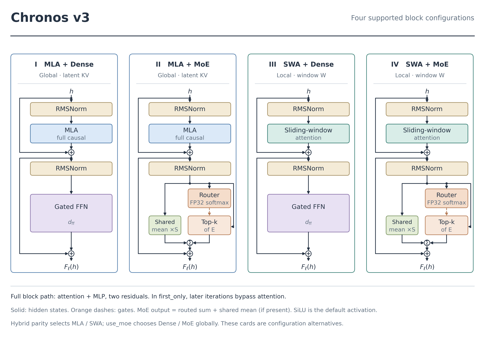
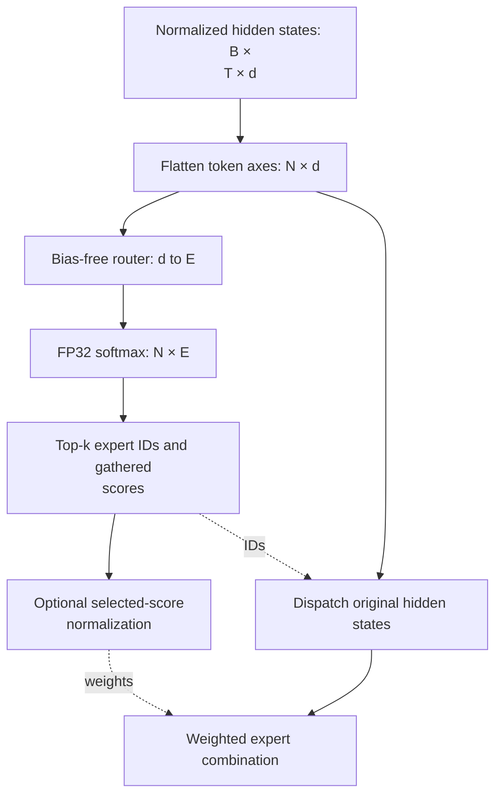
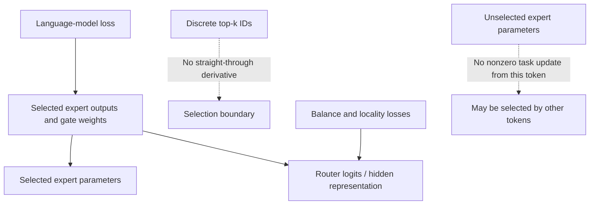
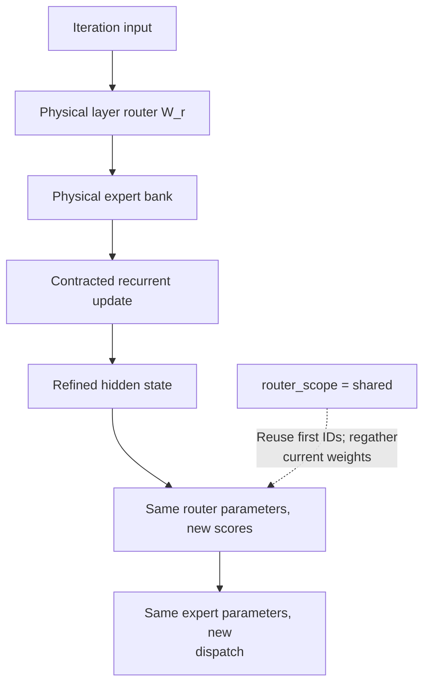
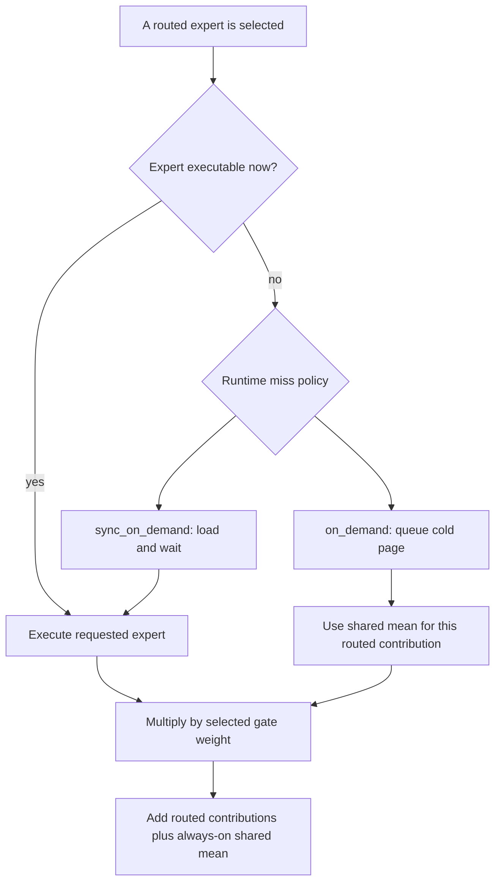

# MoE routing: computation, gradients and runtime substitution

Chronos uses a gated expert MLP inside an ordinary pre-normalization residual block. Routing chooses expert computation; expert residency chooses whether the requested computation is available. These decisions are related, but they are not interchangeable. This chapter specifies the full-resident function first, then the training objective, recurrence and cold-miss path.

The implementation reference is [`ChronosMOEFeedForward`](../chronos/model/moe_chronos.py#L36), with an MLX counterpart in [`ChronosMLXMOE`](../chronos/mlx/moe.py#L46). Every full `ChronosBlock` also contains attention. “MoE” does not mean an attention-free physical block; see [KERNEL_ARCHITECTURE.md](KERNEL_ARCHITECTURE.md).

*Supported block configurations. MLA, multi-head latent attention; SWA, sliding-window attention; MoE, mixture of experts; RMSNorm, root mean square normalization. Routed and shared experts are parallel branches inside the MLP sublayer. The cards are configuration alternatives, not a compulsory four-stage sequence.*

## 1. Tensor contract and router

Let $B$ be batch size, $T$ sequence length, $d$ hidden width, $E$ routed-expert count, $k$ selected-expert count, $S$ shared-expert count and $d_e$ expert intermediate width. Here $S\equiv S_s$ is a local abbreviation for the global shared-expert count. The normalized MLP input is

$$
X\in\mathbb R^{B\times T\times d},\qquad N=BT.
$$

The code flattens the first two axes to $X_f\in\mathbb R^{N\times d}$. For one column-vector input $h\in\mathbb R^d$,

$$
z=W_rh,\quad W_r\in\mathbb R^{E\times d},\qquad
 g_i=\frac{\exp z_i}{\sum_{j=1}^{E}\exp z_j}.
$$

The router linear layer has **no bias**. Both Torch and MLX cast the router scores to FP32 before softmax; this is a numerical policy, not evidence of a measured latency benefit. Torch uses `torch.topk`; MLX uses `argpartition` and gathers the selected scores. The separate sorting of dispatch rows groups tokens by expert; it should not be confused with the top-k selection algorithm. [Torch selection](../chronos/model/moe_chronos.py#L138), [MLX selection](../chronos/mlx/moe.py#L233).

Write $I(h)=\mathrm{TopK}(g,k)$. If `norm_topk_prob=True`,

$$
 a_i=\frac{g_i}{\sum_{j\in I}g_j+\epsilon},\quad i\in I,
 \qquad \sum_{i\in I}a_i\simeq1.
$$

If this flag is false, $a_i=g_i$ and the selected mass need not equal one. The flag is therefore part of the mathematical definition, not only a numerical convenience.

*Router tensor path. Dashed edges carry selection or weights; experts consume hidden states directly. FP32, 32-bit floating point.*

## 2. Expert function and shared mean

With the default `hidden_act="silu"`, an expert is a SwiGLU map:

$$
 E_i(h)=W_{d,i}\left[\mathrm{SiLU}(W_{g,i}h)
                 \odot W_{u,i}h\right],
$$

where $W_g,W_u\in\mathbb R^{d_e\times d}$ and $W_d\in\mathbb R^{d\times d_e}$. All three projections are bias-free. A different configured activation changes the gated FFN activation; it is not necessarily SwiGLU. [Native expert](../chronos/model/kernel.py#L216).

The normal full-resident output is

$$
 r(h)=\sum_{i\in I(h)}a_iE_i(h),\qquad
 s(h)=\frac1S\sum_{j=1}^{S}S_j(h),\qquad
 y(h)=r(h)+s(h).
$$

The implementation takes the **mean** of shared experts, not their sum. This branch runs during normal training and full-resident inference as well as during offloaded inference. When no shared expert is configured, the corresponding contribution is omitted. [Shared mean and standard path](../chronos/model/moe_chronos.py#L117).

For the bias-free matrices above, the per-layer parameter count is the algebraic count

$$
 P_{\mathrm{MoE}}=dE+3dd_e(E+S).
$$

A sparse token dispatch performs approximately $3dd_e(k+S)$ matrix FMAs, plus router, activation, normalization and dispatch work. Under a convention of two arithmetic operations per FMA, the corresponding matrix FLOPs are approximately $6dd_e(k+S)$. These are operation counts, **not measured execution times**. In particular, MLX's masked-dense reference path can evaluate every expert before masking; the sparse active-set count does not describe that path's realized cost. [Sparse and reference branches](../chronos/mlx/moe.py#L272).

### A named configuration is not a library default

The bundled translation checkpoint has $d=384$, $E=36$, $k=2$, $S=1$ and $d_e=160$. These are configuration values from [`config.json`](../demos/translation/models/chronos-enzh-50m-sft/config.json), not a universal “50M default” and not a performance measurement. Library defaults and planner-selected recipes are listed separately below.

## 3. Which gradients exist?

Top-k indices are discrete; Chronos does not apply a straight-through estimator to them. Within a region where the selected set is unchanged, selected expert parameters receive the token's task gradient. Unselected expert parameters do not receive a nonzero task gradient from that token. Auxiliary terms can still change the router and upstream representation.

Selected-score normalization has an important consequence. Ignoring the small denominator safeguard,

$$
 a_i=\frac{e^{z_i}}{\sum_{j\in I}e^{z_j}},\qquad
 \frac{\partial r}{\partial z_j}
 =\begin{cases}a_j(E_j-r),&j\in I,\\0,&j\notin I.\end{cases}
$$

The full-softmax denominator cancels. Without selected-score normalization,

$$
 \frac{\partial r}{\partial z_j}
 =g_j\left[\mathbf 1_{j\in I}E_j-r\right],
$$

so even an unselected **router logit** can have a task gradient through the denominator. This does not mean the corresponding unselected expert network ran. The distinction is between expert parameters, router parameters and discrete IDs.

*Gradient roles. An unselected expert and an unselected router logit are different objects. This diagram describes the task/auxiliary routes, not a claim that every term is active in every recipe.*

## 4. Load balancing and the actual loss assembly

For $N$ token rows in one dispatch, define

$$
 f_i=\frac1N\sum_{n=1}^{N}\mathbf1\{i\in I_n\},\qquad
 P_i=\frac1N\sum_{n=1}^{N}g_{n,i},\qquad
 L_{\mathrm{bal}}=E\sum_{i=1}^{E}f_iP_i.
$$

Here $\sum_i f_i=k$, while $\sum_iP_i=1$. Uniform selection and uniform importance therefore give $L_{\mathrm{bal}}=k$, **not one**, under this normalization. This reference value is not a general lower-bound theorem. The Torch implementation averages one-hot selections over token rows, retains the selected-position axis and sums that axis in the loss. [Dispatch loss](../chronos/model/moe_chronos.py#L230), [MLX counterpart](../chronos/mlx/training/trainer.py#L366).

Repeated calls of one recurrent MoE average their raw balance terms. The Torch trainer sums raw terms across physical MoE layers, then multiplies by `lambda_balance`. It does not multiply the already scaled `router_aux_loss_coef` again. [Raw iteration mean](../chronos/model/moe_chronos.py#L111), [trainer assembly](../chronos/trainer/loss_mixin.py#L178).

The implemented regularized objective is usefully written as a sum of **conditional** terms:

$$
\begin{aligned}
 L={}&L_{\mathrm{LM}}+\lambda_{\mathrm{bal}}L_{\mathrm{bal}}
 +\lambda_{\mathrm{temp}}L_{\mathrm{temp}}
 +\lambda_{\mathrm{rloc}}L_{\mathrm{rloc}}
 +\lambda_{\mathrm{cl}}L_{\mathrm{cl}}\\
 &+\lambda_{\mathrm{iter}}L_{\mathrm{iter}}
 +\lambda_{\mathrm{LA}}L_{\mathrm{LA}}
 +\lambda_{\mathrm{hit}}L_{\mathrm{hit}}
 +\lambda_{\mathrm{union}}L_{\mathrm{union}}
 +\text{configured recurrent/alignment terms}.
\end{aligned}
$$

A term contributes only when its coefficient is positive and the required tensors exist. The table lists the implemented objectives and configuration fields. [Torch assembly](../chronos/trainer/loss_mixin.py#L197), [MLX assembly](../chronos/mlx/training/trainer.py#L675).

[CLUSTER_LOCALITY.md](CLUSTER_LOCALITY.md) derives the partition objective. [LOOKAHEAD.md](LOOKAHEAD.md) derives the three prediction losses. Their roles differ from global expert-load balancing: uniform global use does not ensure a small per-stream working set.

## 5. Recurrent reuse and later-iteration controls

One physical layer owns one router and one bank of experts. The same parameter objects are reused when that layer reappears in the recurrent loop. Different physical layers normally own different parameter objects. Re-scoring a router at each iteration does **not** create a new router matrix. [Physical-layer reuse](../chronos/model/model_chronos.py#L282).

*Recurrent parameter reuse. Boxes represent calls of shared physical modules. They are not new parameter copies.*

- `recurrent_later_topk=0` means **keep the full configured top-k**, not “disable routing.” A positive value reduces later-iteration top-k, capped by the first iteration's `num_experts_per_tok`.
- `recurrent_later_groups=0` means use all recurrent physical layers. A positive value executes a prefix of the recurrent block after its first iteration. It skips whole block calls, not only MoE sublayers. It requires block order and a depth-independent KV mode.
- `router_scope="per_iteration"` reselects IDs. With `"shared"`, later calls reuse the first selected IDs, gather current weights, and, when a smaller top-k is requested, retain the best of that first set.
- `lambda_iteration_cluster` penalizes differences from the **mean cluster-mass distribution across iterations**. It is not specifically a distance to iteration zero. See the derivation in [CLUSTER_LOCALITY.md](CLUSTER_LOCALITY.md).

These meanings are enforced by [configuration validation](../chronos/model/config.py#L81), [executor](../chronos/model/model_chronos.py#L277) and [MoE selection](../chronos/model/moe_chronos.py#L155). The KV cache stores attention state, not expert weights. An iteration can reuse KV while requesting a different expert-page set.

## 6. Missing routed experts: the shared branch is still present

Let $A_i\in\{0,1\}$ indicate whether the selected expert can actually execute now. In a fallback-capable path, define

$$
 \widetilde E_i(h)=A_iE_i(h)+(1-A_i)s(h),\qquad
 y_{\mathrm{fallback}}=s(h)+\sum_{i\in I}a_i\widetilde E_i(h).
$$

Writing $m=\sum_{i\in I}(1-A_i)a_i$ gives

$$
 y_{\mathrm{fallback}}=(1+m)s(h)+\sum_{i\in I:A_i=1}a_iE_i(h).
$$

The shared residual is not removed when it also substitutes for missing routed mass. Training-time miss simulation, controlled by `fallback_mask_prob`, exposes the model to this form. Strict `sync_on_demand` instead loads the exact expert or raises on failure. Expert computation follows the model/store dtype; it is not unconditionally forced to bf16. [Fallback implementation](../chronos/model/moe_chronos.py#L303).

*Conditional substitution. SSD, solid-state drive. Shared fallback avoids waiting for that cold page on this path; it does not prove zero latency or bounded model-quality error.*

The output perturbation relative to exact routed computation is

$$
 y_{\mathrm{fallback}}-y_{\mathrm{exact}}
 =\sum_{i\in I:A_i=0}a_i\,[s(h)-E_i(h)].
$$

Consequently,

$$
 \|y_{\mathrm{fallback}}-y_{\mathrm{exact}}\|
 \le\sum_{i\in I:A_i=0}a_i\|s(h)-E_i(h)\|.
$$

This algebraic inequality is useful for interpreting missing routing mass. It is **not a numerical quality guarantee**: no bound on the expert discrepancies is established here. A wrong prefetch can therefore affect output quality under fallback, even though the lookahead head is not directly added to logits.

## 7. Configuration reference and evidence boundary

The following are **class defaults in this source snapshot**, not a promise that every preset or stored checkpoint uses them.

| Actual field | Class default | Meaning |
|---|---:|---|
| `num_experts` | 4 | Routed experts per physical MoE layer |
| `num_experts_per_tok` | 1 | First/default selected count |
| `num_shared_experts` | 1 | Always-active shared experts |
| `moe_intermediate_size` | dense intermediate width | Expert width $d_e$ |
| `norm_topk_prob` | `True` | Normalize selected gates |
| `lambda_balance` | `5e-4` | Trainer weight on raw balance term |
| `router_aux_loss_coef` | `5e-4` | Legacy scaled auxiliary exposure; not applied twice |
| `fallback_mask_prob` | `0.08` | Optional training miss simulation probability |
| `router_scope` | `"per_iteration"` | ID-selection policy across repeated calls |
| `recurrent_later_topk` | `0` | Zero retains full top-k |
| `recurrent_later_groups` | `0` | Zero retains all recurrent blocks |
| `lambda_iteration_cluster` | `0` | Iteration cluster-spread weight |

Sources: [base fields](../chronos/model/kernel.py#L75), [Chronos fields](../chronos/model/config.py#L201), [later-iteration controls](../chronos/model/config.py#L81), [runtime/training controls](../chronos/model/config.py#L297). Planner and preset choices must be reported with the selected recipe, rather than substituted into this table.

Routing evaluations should report expert-load statistics, entropy, task, seed and dispatch timing. The repository does not include `moe_balance.json` or `router_entropy.json`, so no standalone before/after trajectory is reported here. Generalization to larger models and different serving workloads requires additional measurements.

**Notation:** MoE, mixture of experts; MLP, multilayer perceptron; FFN, feed-forward network; SwiGLU, swish gated linear unit; FMA, fused multiply-add; FLOP, floating-point operation; KV, key–value; FP32, 32-bit floating point; bf16, bfloat16; CE, cross-entropy.
