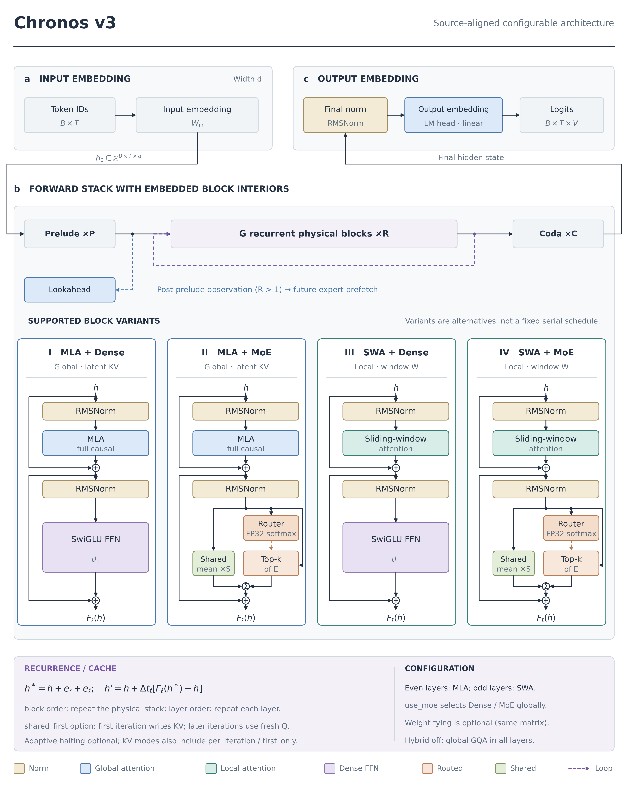
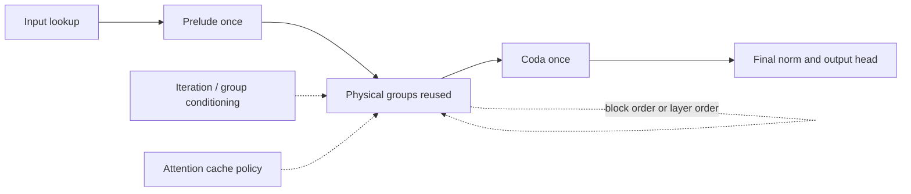
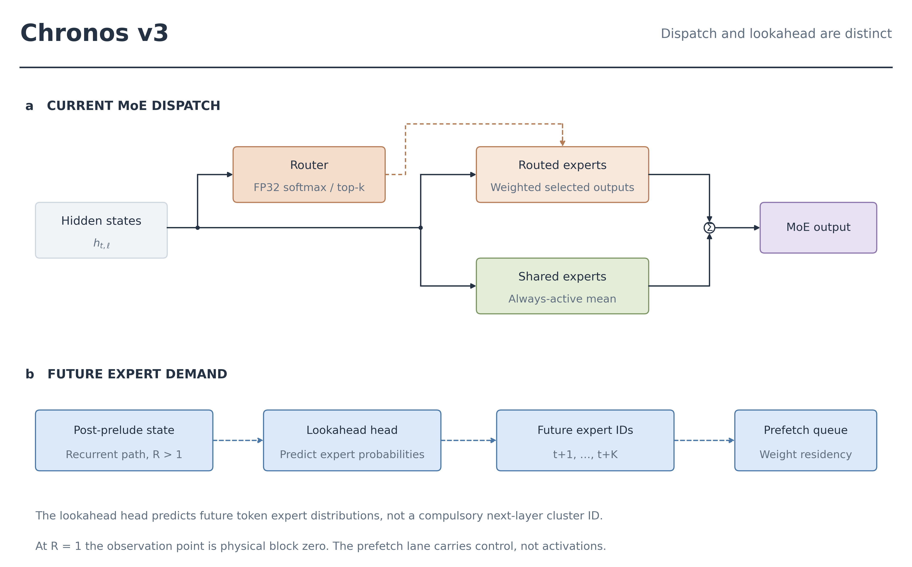
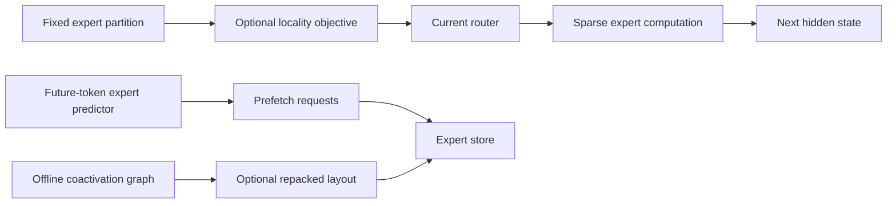
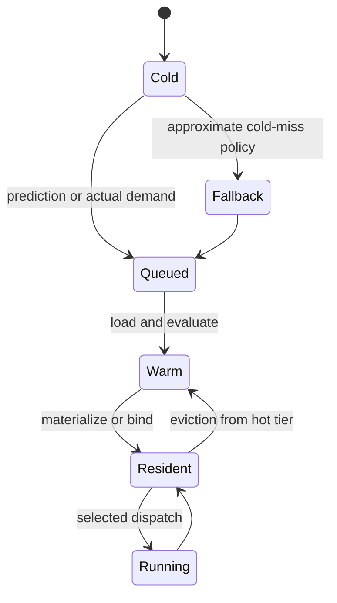

# Chronos: a map of computation, routing and residency

Chronos is a decoder-only transformer with recurrent-depth execution and optional sparse expert MLPs. A separate runtime manages out-of-core expert weights. The model graph, learned routing and storage policy have distinct contracts.

*Figure O1. The input lookup, physical stack and output vocabulary projection. The supported block cards combine attention and MLP families. Their order is not a fixed sequence of four special layer types. MLA, multi-head latent attention; SWA, sliding-window attention; MLP, multilayer perceptron.*

## 1. Computation: reuse parameters, track state

The backbone contains prelude blocks, recurrent physical groups and coda blocks. Repeated execution shares each physical block's parameters while evolving hidden states.

The actual group update conditions the input on iteration and group embeddings:

$$
h^*=h+e_r+u_g,\qquad
h'=h+\alpha_g\bigl[F_{P+g}(h^*;\mathcal K)-h\bigr].
$$

The full block $F$ includes attention and an MLP with two internal residual additions. The outer interpolation is a separate controller operation. A small step size can damp an update; it does not by itself prove contraction or convergence.

Class defaults, planner recommendations and saved checkpoint fields are separate authorities. In the inspected class, omitted loop-order and step-parameterization keys resolve to layer order and clamp. A planner can recommend other settings. [KERNEL_ARCHITECTURE.md](KERNEL_ARCHITECTURE.md) gives the complete graph; [LOOP_DEPTH.md](LOOP_DEPTH.md) separates resource-matched measurements.

## 2. Routing: sparse computation and a shared mean

With `use_moe=True`, every physical block uses a routed-plus-shared MLP. Attention still alternates MLA and SWA by physical parity when hybrid attention is enabled. It is not the MoE family that appears only in every other block.

For selected experts $I(h)$, the normal available-expert output is

$$
M(h)=\sum_{i\in I(h)}a_iE_i(h)+\frac1{S_s}\sum_{j=1}^{S_s}S_j(h),
$$

when shared experts exist. A router scores experts; it does not supply the experts' hidden-state inputs. An optional shared-ID routing scope can reuse selected IDs across recurrent calls while re-evaluating their scores.

*Figure O2. Current expert dispatch and future expert-demand prediction. Lookahead predicts token horizons from a backbone observation state. Its requests affect weight residency, not the current activation sum. MoE, mixture of experts; FP32, 32-bit floating point.*

Locality training shapes routing over a fixed expert-ID partition. The mutual-information objective encourages concentration within a stream and diversity across streams. Offline coactivation-graph clustering is a separate optional way to construct a storage partition.

[MOE_ROUTING.md](MOE_ROUTING.md), [CLUSTER_LOCALITY.md](CLUSTER_LOCALITY.md) and [LOOKAHEAD.md](LOOKAHEAD.md) derive these mechanisms and describe their gradient paths.

## 3. Residency: separate exact loading from fallback

Expert weight files, loaded arrays and materialized expert modules occupy different residency states. Torch/CUDA can use host caching and device promotion. MLX uses unified memory and has a different materialization path.

A cold `on_demand` miss queues the exact requested expert and uses shared fallback for the current dispatch. `sync_on_demand` waits for the selected expert. Their quality and equivalence claims therefore differ.

A bounded resident cache does not prove a bounded transient load peak. A cluster-load counter does not determine physical SSD traffic. [LAZY_EXPERTS.md](LAZY_EXPERTS.md) gives state transitions; [RESIDENCY.md](RESIDENCY.md) gives counter definitions and policy evidence.

## 4. Theory, evidence and correctness

The theory chapters explain sufficient conditions and resource scaling. The measurement chapters report particular checkpoints and workloads. The distinction is central to interpreting results.

| Question | Chapter |
|---|---|
| What executes, and which tensors cross each boundary? | [Kernel architecture](KERNEL_ARCHITECTURE.md) |
| What do the symbols and axes mean? | [Symbols and units](SYMBOLS.md) |
| Which stability and information arguments can be derived? | [Theory](THEORY.md) |
| How are compressed/global and local attention implemented? | [Attention](ATTENTION.md) |
| When can draft/verify preserve the target distribution? | [Self-speculative decoding](SPEC_DECODE.md) |
| Which long-context paths save temporary memory? | [Long-context execution](LONG_CONTEXT.md) |
| What do existing records establish, and what remains unmeasured? | [Reproducibility](REPRODUCIBILITY.md) |

The inspected implementation supports these mechanisms. Their utility for a new model size, corpus or machine needs matched measurement. No benchmark number is transferred from a synthetic locality task to a real checkpoint without the corresponding experiment.

