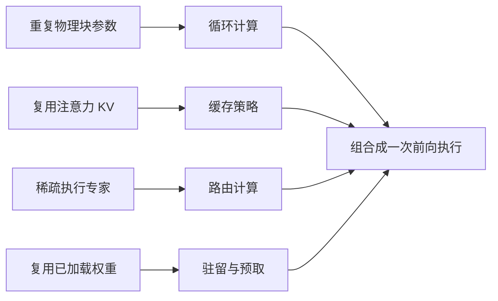
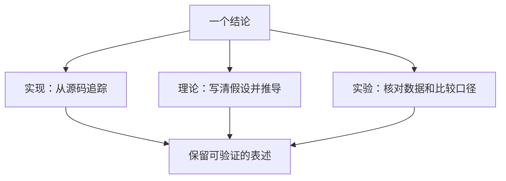

# 中文阅读导引：先把四种“复用”分清

本导引介绍 Chronos 的核心机制与阅读路线。详细公式、配置条件和实验来源见对应英文专题章节。

## 1. 四个机制解决不同问题

| 机制 | 复用或减少的对象 | 需要单独检查的条件 |
|---|---|---|
| 循环深度 | 重复调用同一物理块的参数 | 状态仍会变化；步长约束不等于收敛证明 |
| shared_first | 循环内部复用 writer 形成的注意力 KV 视图 | 后续查询仍重新计算；持久缓存与当前 forward 的临时视图不同 |
| 稀疏专家 | 支持稀疏派发时，仅计算选中的路由专家 | 全部专家参数仍需存储；MLX masked-dense 参考路径会先计算全部路由专家；存在共享专家时，其分支始终执行并取均值 |
| 专家驻留 | 复用已加载的专家权重 | 受缓存预算、预测误差、缺页策略和后端加载行为影响 |

建议先读 [OVERVIEW](OVERVIEW.md) 和 [KERNEL_ARCHITECTURE](KERNEL_ARCHITECTURE.md)，再用 [SYMBOLS](SYMBOLS.md) 核对张量轴。不要把“未来 token”轴误读为“下一层”轴，也不要把循环迭代当成新的物理参数层。

## 2. 理论推导要带成立条件

文档区分三种内容：代码正在执行的机制、在特定假设下成立的数学结论，以及已有实验记录支持的结果。

例如，更新可以写成

$$
h'=h+\alpha_g\left[F_{P+g}(h+e_r+u_g;\mathcal K)-h\right].
$$

这里的减法使用未加条件向量的 $h$。$F$ 已包含块内部的残差加法。外层收缩步与内部残差不是同一个操作。[THEORY](THEORY.md) 推导稳定性界和层次顺序差异，并说明为何有限步长本身不能保证整个模型收敛。

## 3. 专家“聚落”是路由与页面组织

训练侧的分区是固定的专家 ID 分组。局部性目标改变路由概率，使同一流更集中、不同流保持多样性。离线共激活图聚类则是另一条可选布局路径。

这些机制不表示专家权重向量在高维空间里自行移动。示意图中的位置与颜色也不是 t-SNE 或 UMAP 实测数据。深入阅读 [MOE_ROUTING](MOE_ROUTING.md)、[CLUSTER_LOCALITY](CLUSTER_LOCALITY.md) 和 [LOOKAHEAD](LOOKAHEAD.md)。

## 4. 缺页策略影响正确性与质量

`on_demand` 的冷缺页可能在当前派发中使用 shared fallback。`sync_on_demand` 则等待准确专家加载。前者需要测量近似误差；后者仍需验证缓存和执行数值是否与全驻留路径一致。

Torch 可以在读取前筛选页。当前 MLX 聚落路径可能先物化整簇再做受限缓存准入。因此，缓存容量上限不自动等于进程瞬时内存上限。具体条件见 [LAZY_EXPERTS](LAZY_EXPERTS.md) 与 [RESIDENCY](RESIDENCY.md)。

## 5. 读实验时先问“固定了什么”

相同步数、相同训练时间、相同 token 数与相同计算预算，不是同一比较。单个提示词速度的平均值，也不等于总 token 数除以总时长。

Residency 基准中的 `verify_ready_rate` 是 planner 参考集合的热驻留比例，不是草稿 token 接受率。没有 planner 时的零值应视为未记录。相关图区分了这些口径，详见 [SPEC_DECODE](SPEC_DECODE.md) 与 [REPRODUCIBILITY](REPRODUCIBILITY.md)。

## 6. 图和公式的阅读方式

Markdown 正文包含 Mermaid 源码与数学公式。流程图的 SVG 副本位于 `assets/mermaid/`。矢量图可单独打开并放大；定量图的读数以原尺寸图片、矢量文件和对应 JSON 为准。

已有证据仍有边界：部分实验只有单一种子，部分长上下文测试只有少量训练步骤，若干单层内存数据缺原始测量记录。文档把这些列为需要补充的验证，不将它们改写为新结论。

