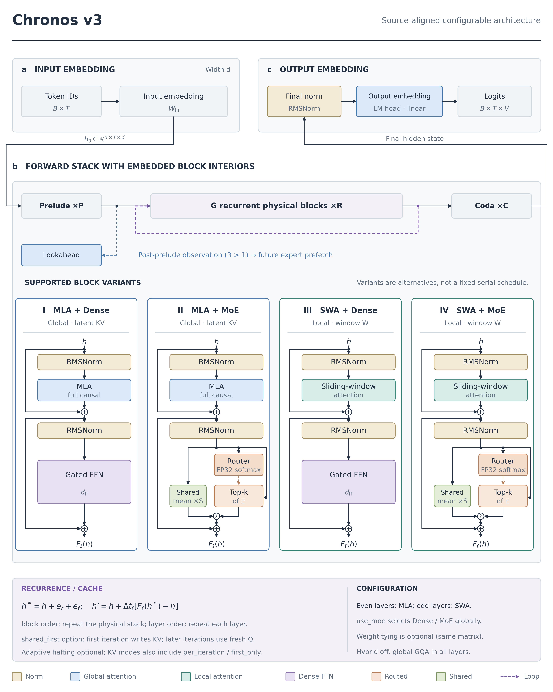
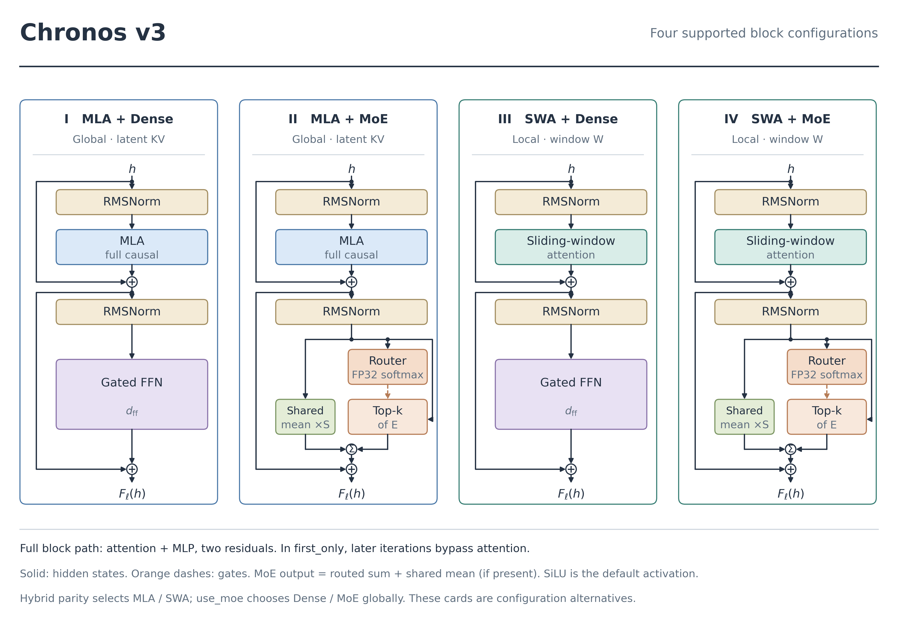
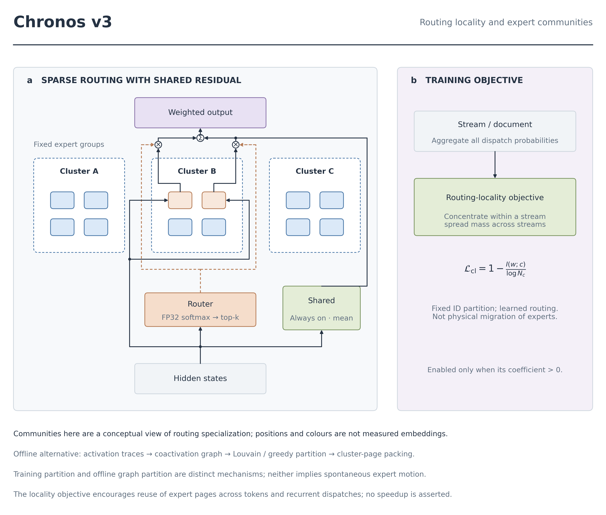
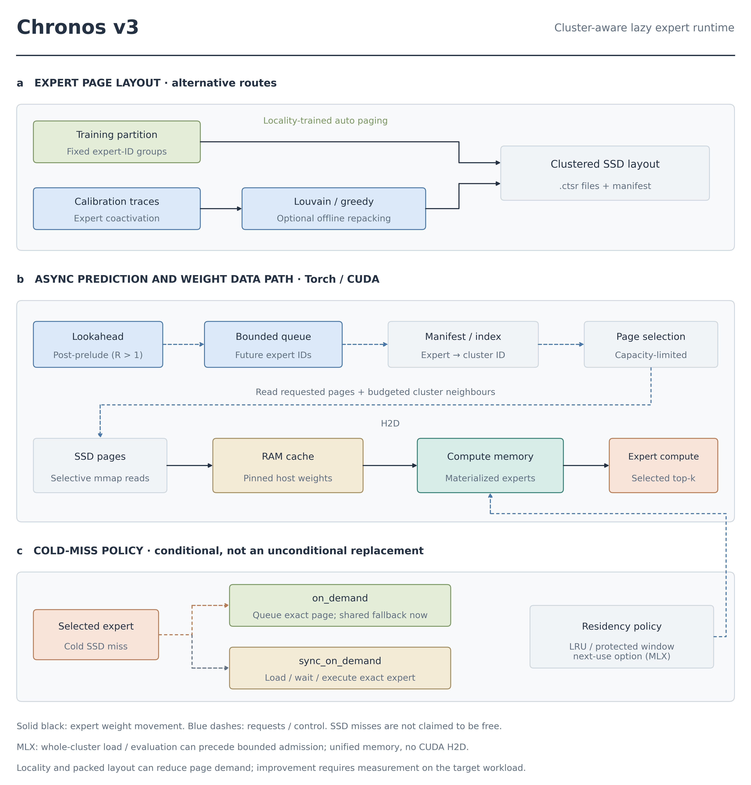
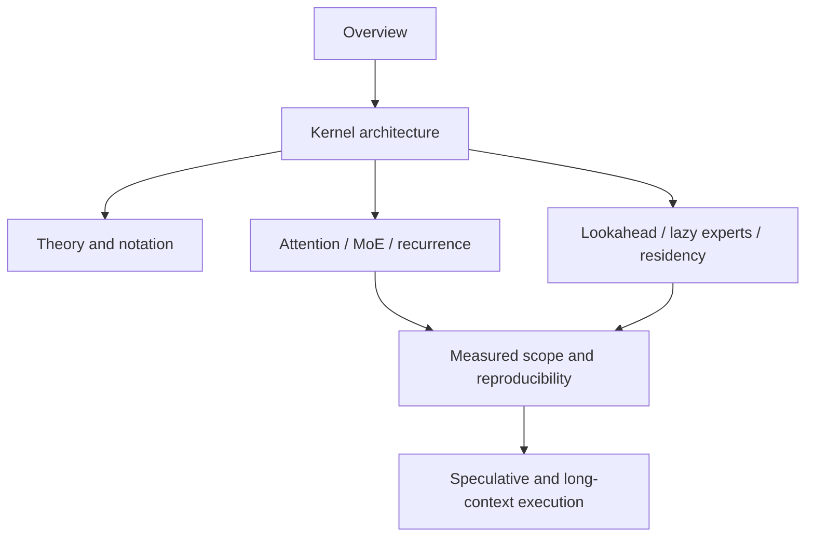
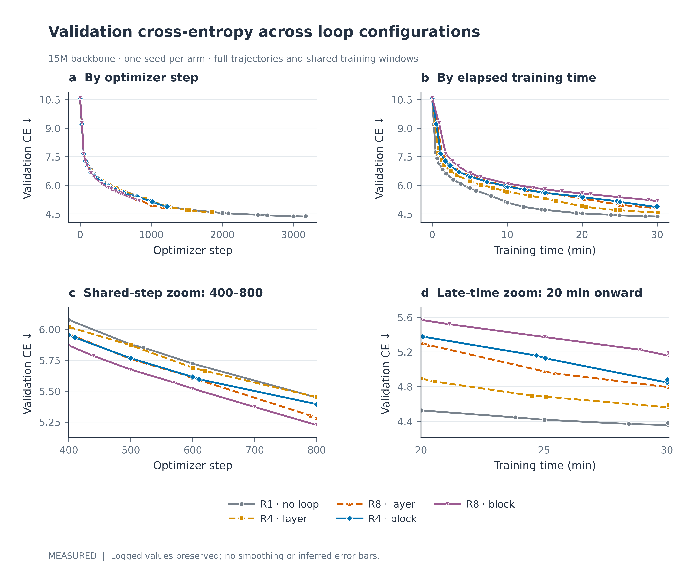
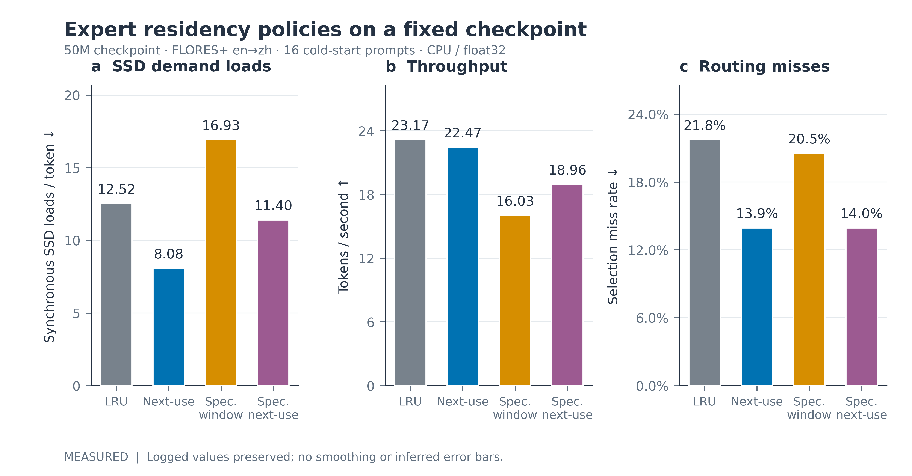
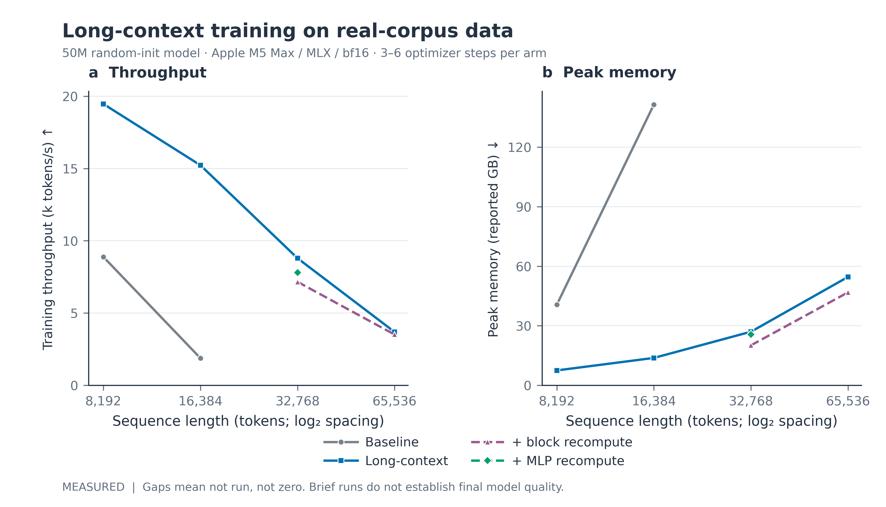

# Project Chronos — architecture and runtime documentation

Chronos combines recurrent-depth execution, routed and shared experts, and out-of-core weight residency. These chapters describe the model and runtime, derive their governing equations, and document the scope of the recorded experiments.

Start with [the overview](OVERVIEW.md), then follow [the integrated kernel chapter](KERNEL_ARCHITECTURE.md). The [symbols chapter](SYMBOLS.md) separates token, layer, iteration, horizon and storage axes.

## What the kernel looks like inside

| Block interior | Expert communities | SSD kernel |
|---|---|---|
|  |  |  |
| MLA/SWA × dense/MoE configuration variants; every block is a two-sublayer Pre-Norm residual module. See [KERNEL_ARCHITECTURE.md §2](KERNEL_ARCHITECTURE.md#2-every-full-block-contains-attention-and-an-mlp) and [ATTENTION.md](ATTENTION.md). | Routed experts selected by a top-$k$ softmax, shared experts always on, cluster-locality objective `1 − I(w;c)/log N_c`. See [MOE_ROUTING.md](MOE_ROUTING.md) and [CLUSTER_LOCALITY.md](CLUSTER_LOCALITY.md). | Cluster-packed `.ctsr` pages, bounded prefetch queue, LRU and planned eviction, `on_demand` vs `sync_on_demand` cold-miss policies. See [RESIDENCY.md](RESIDENCY.md) and [LAZY_EXPERTS.md](LAZY_EXPERTS.md). |

## Reading routes

| Chapter | Main question |
|---|---|
| [OVERVIEW.md](OVERVIEW.md) | How do computation, routing and residency connect? |
| [KERNEL_ARCHITECTURE.md](KERNEL_ARCHITECTURE.md) | What is the implementation-exact end-to-end graph? |
| [SYMBOLS.md](SYMBOLS.md) | Which axes, units and configuration fields are being discussed? |
| [THEORY.md](THEORY.md) | Which stability, information and resource statements can be derived, and under what assumptions? |
| [ATTENTION.md](ATTENTION.md) | What is projected, cached, reconstructed and masked in MLA/SWA? |
| [MOE_ROUTING.md](MOE_ROUTING.md) | How do dispatch, shared averaging, fallback and regularizers work? |
| [CLUSTER_LOCALITY.md](CLUSTER_LOCALITY.md) | How does a fixed partition shape the mutual-information objective? |
| [LOOKAHEAD.md](LOOKAHEAD.md) | How are future-token expert distributions predicted and trained? |
| [LOOP_DEPTH.md](LOOP_DEPTH.md) | What do matched-step and matched-time recurrent experiments show? |
| [LAZY_EXPERTS.md](LAZY_EXPERTS.md) | How do expert pages move through loading, admission and materialization? |
| [RESIDENCY.md](RESIDENCY.md) | Which eviction policies and counters describe the runtime? |
| [SPEC_DECODE.md](SPEC_DECODE.md) | What makes draft/verify sampling correct, and what costs can prevent a speedup? |
| [LONG_CONTEXT.md](LONG_CONTEXT.md) | How do chunked loss, blockwise attention and recomputation change memory? |
| [REPRODUCIBILITY.md](REPRODUCIBILITY.md) | What evidence and controls are required for a performance or quality claim? |
| [vllm_integration.md](vllm_integration.md) | Which serving interfaces are implemented, and what is an integration scaffold? |
| [READING_GUIDE_ZH.md](READING_GUIDE_ZH.md) | 中文阅读路线、核心机制与符号导引。 |

## Measured evidence at a glance

| Loop depth, validation CE across arms | Expert residency, policies on the 50 M checkpoint | Long-context, measured peak memory and throughput |
|---|---|---|
|  |  |  |
| 15 M backbone, one seed per arm; full trajectories and the step range covered by every arm. The matched-step and matched-time comparisons answer different questions. See [LOOP_DEPTH.md](LOOP_DEPTH.md). | `enzh-50m-pretrain-s13996`, FLORES+ en→zh dev, 16 cold-start prompts, CPU / float32. Logical counters — not SSD bandwidth measurements. See [RESIDENCY.md](RESIDENCY.md). | 50 M random-init on Apple M5 Max / MLX / bf16, 3–6 optimizer steps per arm, log₂-spaced context lengths. Short-run CE similarity is a comparability check, not final quality. See [LONG_CONTEXT.md](LONG_CONTEXT.md). |

## How figures and formulas are used

Mechanism diagrams accompany the governing equations. Mermaid source is embedded in Markdown, with rendered SVG copies under `assets/mermaid/`.

Data panels are generated from recorded JSONs. Captions specify the measurement conditions and units. Expert-community diagrams illustrate routing and page partitions; their positions are schematic.

The principal architecture images are under [assets/arch](assets/arch/). Quantitative plots are under [assets](assets/). The source hierarchy is:

1. Implementation and resolved configuration for claims about what executes.
2. Raw experiment records for numerical claims.
3. Explicit assumptions and derivations for mathematical conclusions.
4. Schematic illustrations as explanations of those contracts.

Backend differences and missing measurements are stated in the relevant chapters.

## Defaults and evidence

A class default, a planner recommendation and a saved checkpoint setting can select different graphs. Preserve the resolved configuration when reproducing a result. Do not apply a planner recommendation retrospectively to a checkpoint that omitted the corresponding field.

The recorded benchmarks cover selected small-model experiments. Several are single-seed or short-run studies. The [reproducibility ledger](REPRODUCIBILITY.md) defines the valid scope and the missing controls.

## Source references and language

Implementation and experiment links are relative to the repository root. The English chapters provide the detailed specification. [The Chinese guide](READING_GUIDE_ZH.md) introduces the reading path and key concepts.

