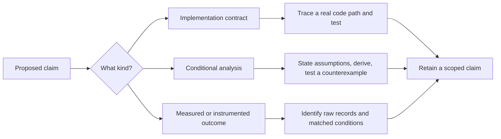
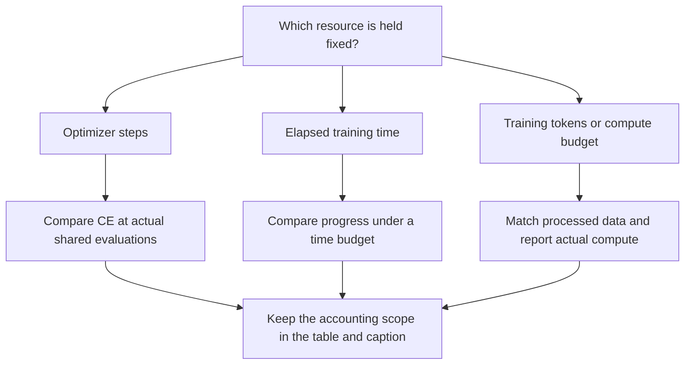
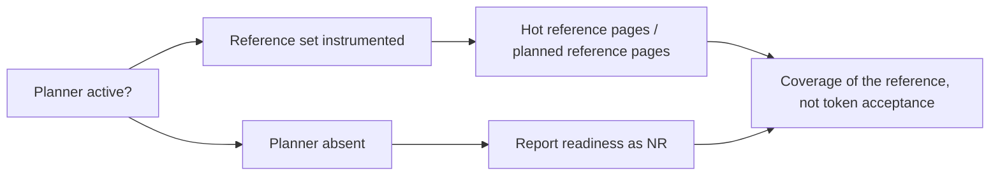
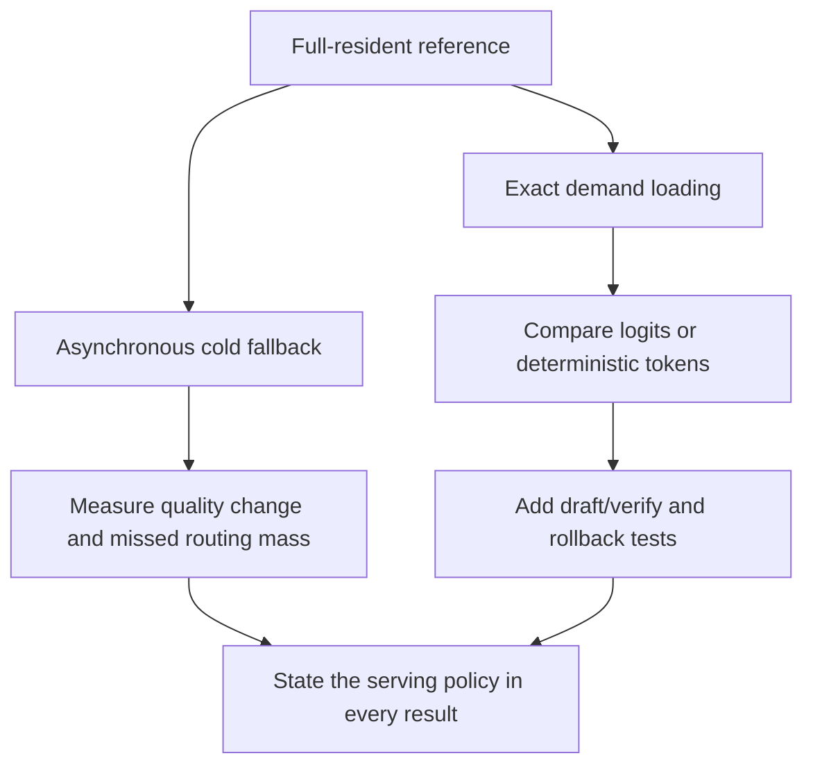

# Reproducibility and evidence boundaries

An architecture mechanism, a conditional derivation and a recorded benchmark answer different questions. This chapter defines what a result must include before it supports a claim about Chronos.

## 1. Three kinds of statements

| Statement type | Supporting evidence | Example |
|---|---|---|
| Implemented contract | Source path, function, resolved configuration and a targeted test | A shared-first reader attends without appending another persistent KV entry |
| Conditional mathematical result | Defined variables, assumptions and a derivation | A Lipschitz bound below one is sufficient for a fixed conditioned map to contract |
| Measured or instrumented result | Raw record, conditions, numerator/denominator and scope | Logged demand loads per generated token for a fixed prompt set |

A derived sufficient condition is not evidence that training enforces it. An implemented optimization is not evidence that it improves every checkpoint.



## 2. The evidence ledger

| Record family | What is present | Valid scope | Remaining limitation |
|---|---|---|---|
| [Loop-depth arms](../experiments/loop_depth_15m/results/arm_d1.json) | Evaluation trajectories, training time, tokens, configuration and per-source final CE | The recorded small-model, single-seed arms | No seed distribution; equal wall time and equal optimizer step answer different questions |
| [Residency benchmark](../reports/residency_20261107/bench_residency_50m_s13996_flores16_cpu.json) | Per-prompt modes and aggregate counters | The saved checkpoint, prompt set, dtype and timer definition | Logical counters are not physical SSD bandwidth measurements |
| [Locality sweep](../reports/residency_20261107/sweep/lam_0.3_w32.json) | Synthetic-task settings, routing metrics and lazy decoding counters | The stated synthetic streams and cache policies | No direct proof of the same gain on the translation checkpoint or arbitrary corpora |
| [Long-context record](../reports/long_context_20261109/real_corpus_ab.json) | Real-corpus short-run throughput, memory and CE | The recorded machine, initialization, sequence lengths and few training steps | Short-run CE similarity does not establish final trained quality |
| Single-layer memory table | Reported values in documentation and original figure source | Explicitly reported measurements with incomplete raw provenance | Missing raw SWA measurements; retained as reported/unverified |

The linked experiment records retain the full numerical values. Plots use recorded observations without smoothing; displayed tables may round those values.

## 3. Match the comparison to the question

Let an arm provide observed evaluations $(s_j,t_j,c_j)$: optimizer step, elapsed training time and CE. A step-matched comparison uses a shared observed step $s$:

$$
\Delta_{\mathrm{step}}(s)=c_A(s)-c_B(s),
\qquad s\in\mathcal S_A\cap\mathcal S_B.
\tag{R.1}
$$

It asks about optimization progress per update. A wall-time comparison instead uses a stated time budget or nearest recorded time. It includes differences in throughput and thus tokens processed.



The final CE from two timed arms is not automatically a matched-step result. A nearest-step comparison must disclose the selected step. Interpolation, if used, requires a separate method statement; the figures use recorded points.

### Aggregates and prompt weighting

For prompt $i$, let $n_i$ be generated tokens and $t_i$ its measured duration. These two throughput summaries differ:

$$
v_{\mathrm{pooled}}=\frac{\sum_i n_i}{\sum_i t_i},
\qquad
\bar v_{\mathrm{prompt}}=\frac1N\sum_i\frac{n_i}{t_i}.
\tag{R.2}
$$

A boxed distribution of per-prompt speeds should not be described as the pooled summary value. Similarly, demand loads per token can be pooled or averaged per prompt. The record and plot must identify the chosen denominator.

## 4. Instrumentation: distinguish missing from zero

The residency benchmark stores a field named `verify_ready_rate`. In the inspected MLX runtime, it is the fraction of a planner reference set already hot before verification. It is not the speculative token-acceptance rate and does not enumerate all experts the verify pass will actually select.

When the planner is absent, its counters remain zero. That structural zero is an uninstrumented condition, not an observed failure to prepare every verification.



The speculative figure shows only the instrumented planned-mode reference coverage. A separate acceptance measurement needs accepted and proposed draft-token counters. Source: [instrumentation](../chronos/mlx/inference.py#L599) and [reported ratio](../chronos/mlx/inference.py#L667).

## 5. An equivalence test is policy-specific

An all-resident path and an exact demand-loading path can be compared with the same weights and inputs. A shared-fallback path may change the MoE output on a cold dispatch. Neither policy should inherit the other's equivalence claim.

A useful validation sequence is:

1. Fix the effective model configuration, tokenizer, weights, compute dtype and sampling settings.
2. Compare full-resident and `sync_on_demand` outputs under deterministic conditions.
3. Log cache/page traces and confirm the expected persistent KV transitions.
4. Test `on_demand` separately, recording fallback mass, quality and latency.
5. For speculation, verify the target distribution and rollback state under the actual cache and miss policies.



Passing a CPU small-model test does not certify a CUDA/MLX kernel, an int8 cache or a different checkpoint. Those are separate coverage dimensions.

## 6. Minimum experiment manifest

Store these fields with each new benchmark:

```json
{
  "checkpoint_hash": "record the actual digest",
  "resolved_config": {},
  "tokenizer_hash": "record the actual digest",
  "dataset_or_prompt_hash": "record the actual digest",
  "backend_and_versions": {},
  "device_and_memory": {},
  "dtype_and_kv_dtype": {},
  "miss_policy": "record the selected policy",
  "residency_policy_and_budget": {},
  "timing_scope": "state prefill, warmup and decode inclusion",
  "seed_and_repeats": {},
  "numerators_and_denominators": {},
  "raw_rows_path": "record the saved observations"
}
```

This schema applies to new benchmark records. Existing records may omit fields; missing hardware measurements remain unspecified.

### Required timing scopes

For generated tokens,

$$
t_{\mathrm{total}}=
t_{\mathrm{setup}}+
t_{\mathrm{prefill}}+
t_{\mathrm{decode}}+
t_{\mathrm{finalization}}
\tag{R.3}
$$

is an accounting decomposition. The actual benchmark timer may include only some terms. Report its boundaries before computing a speedup. Async work can overlap these terms, so the decomposition must not be interpreted as a sum of independently measured, non-overlapping kernel durations unless the instrumentation guarantees that partition.

For a paired prompt speedup, report both raw durations and

$$
S_i=\frac{t_{i,\mathrm{reference}}}{t_{i,\mathrm{candidate}}}.
\tag{R.4}
$$

Use only prompts with a matched task and output stopping rule. A shorter generated sequence can otherwise masquerade as a faster decoder.

## 7. Experiments that would deepen the argument

| Question | Discriminating control | Reported outcome needed |
|---|---|---|
| Does locality training help real workloads? | Same data, seeds and training budget; coefficient off/on; fixed paging policy | CE, routed mass, cluster/page demand and decode timing |
| Does lookahead hide loading? | Same residency budget; prediction off/on; fixed miss policy | Prediction recall, actual selected-page readiness, bytes and wait durations |
| Does next-use planning help beyond LRU? | Same traces, warmup and memory budget | Page/byte counters, latency distribution and eviction errors |
| Does deeper recurrence help at a fixed resource budget? | Match steps, tokens, time or compute explicitly | Separate tables for the chosen budgets and multiple seeds |
| Does fallback preserve acceptable quality? | Same checkpoint under full-resident, exact-load and fallback policies | Fallback mass, task quality, CE where applicable and latency |
| Is speculative sampling exact in the chosen path? | Fixed target and policies; compare greedy tokens or sample distributions as appropriate | Acceptance/proposal counts, cache rollback checks and output comparison |
| Are long-context results stable after training? | Matched trained checkpoints and held-out long documents | Final quality, peak memory, throughput and failure conditions |

These are missing controls and validation proposals. They are not new results.


