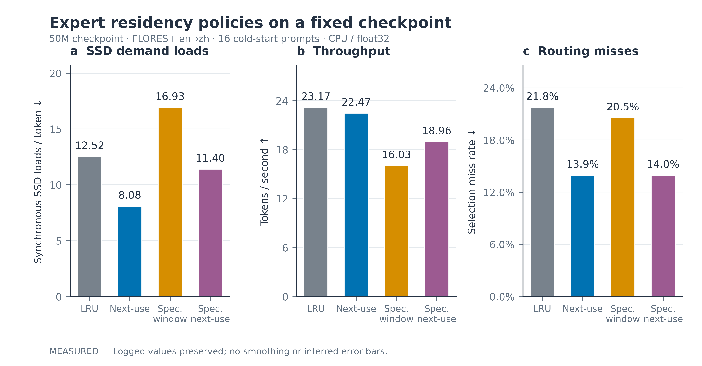
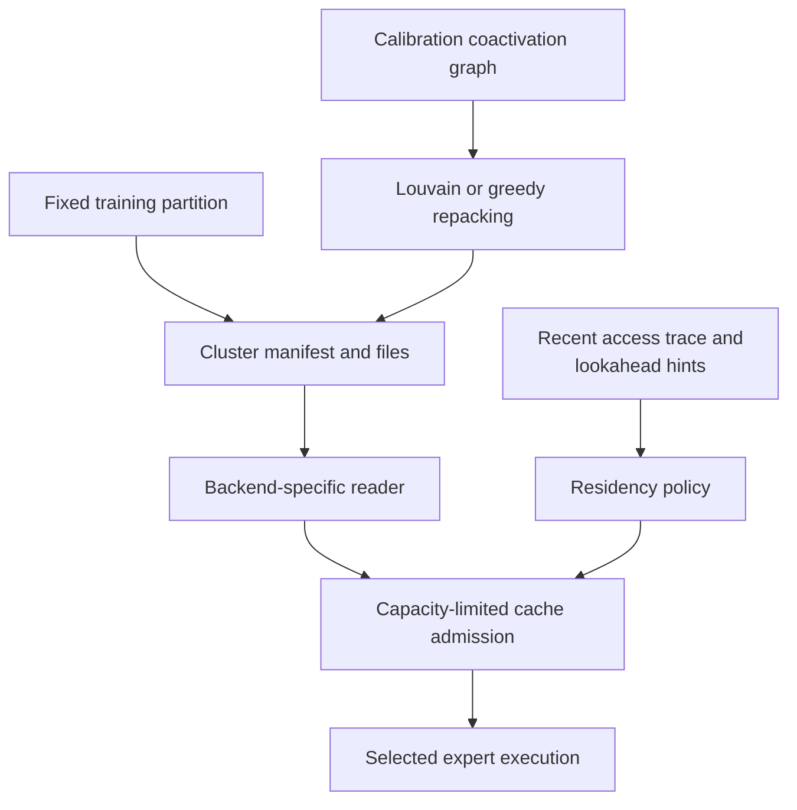
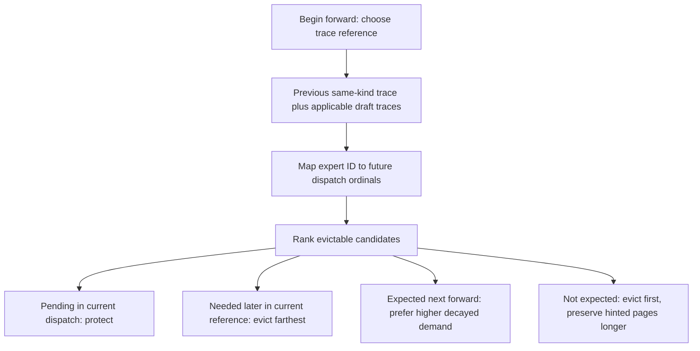
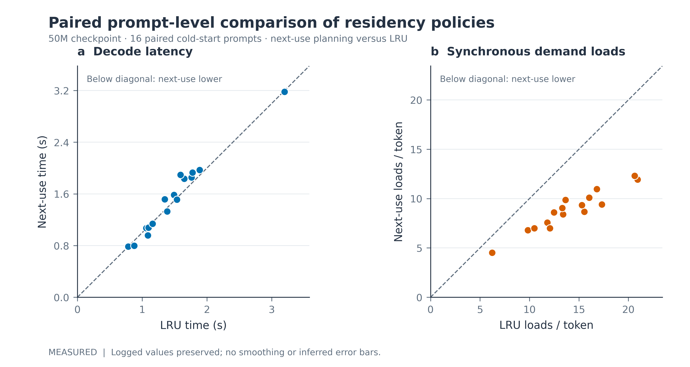

# Expert residency: layout, admission and next-use planning

Residency scheduling decides which expert payloads are available when a forward needs them. It can reduce demand-load stalls without changing model parameters. It preserves the model computation only when every selected expert is eventually materialized; a shared-expert cold fallback changes that computation.

This chapter separates storage layout, cache policy and benchmark accounting. Their counters describe different objects and cannot be used interchangeably.

*Figure 1. Recorded residency comparison on the 50M translation checkpoint. The left panel counts synchronous expert-demand loads per generated token, not physical SSD bytes or cluster-file reads. The middle panel reports aggregate generation throughput. The right panel reports selection-event miss rate. SSD, solid-state drive; CPU, central processing unit; LRU, least recently used.*

## 1. Layout and residency answer different questions

A cluster layout maps expert IDs to `.ctsr` files. A residency policy decides which payloads remain warm or hot. Changing one does not automatically change the other.

*Figure 2. Layout, loading and residency are separate mechanisms. Training-aligned and offline graph-derived partitions are alternative layout routes. Reader granularity differs between Torch and MLX, as detailed in [LAZY_EXPERTS.md](LAZY_EXPERTS.md).* 

For automatic lazy paging, `inference_clusters` uses the fixed training partition when `lambda_cluster_locality>0`. Otherwise it returns singleton expert groups. Explicit `paging="cluster"` or `paging="expert"` overrides that choice. Offline repacking can also be attached through a manifest; it does not imply that the training loss used the new partition. [Layout selection](../chronos/expert_clusters.py#L64), [manifest override](../chronos/runtime/cache_manager.py#L47)

The `.ctsr` extension denotes a safetensors container. The actual sidecar is `cluster_manifest.json`, with cluster membership and filenames. [Storage schema](../chronos/io/storage.py#L38)

## 2. Cache capacity and the working set

Let $\mathcal W_t$ be the set of expert payloads touched during one forward and $K$ the retained capacity. If $|\mathcal W_t|>K$, some payload must be evicted before the forward ends. This is a capacity constraint, not necessarily a correctness failure: execution can materialize and run experts sequentially.

The distinction matters for recurrent depth. Reusing parameter blocks does not imply zero expert traffic. Different iterations can select different experts, and the same aggregate page can be needed several times.

For equal-size pages of $p$ bytes, a retained working set contributes roughly

$$
M_{\mathrm{retained}}\approx Kp.
\tag{1}
$$

This accounting excludes non-expert weights, attention cache, activations, allocator cache and transient loads. On MLX, hot and warm arrays can refer to the same unified-memory storage, so their logical capacities should not be added as independent byte allocations. See [page-size derivation](LAZY_EXPERTS.md#1-what-is-a-page).

## 3. LRU and the implemented next-use ranking

The MLX generation API defaults to `residency="window"`. It combines LRU bookkeeping with a protected prediction window. `residency="planned"` installs `NextUsePlanner` when the lazy path is active. The class itself is backend-free, but this integration is currently in the MLX runtime. It is not automatically enabled whenever lookahead exists. [Generation arguments](../chronos/mlx/inference.py#L343), [installation](../chronos/mlx/inference.py#L427)

`NextUsePlanner` predicts access order from the previous forward of the same kind. A forward is classified as single-token, multi-token or draft. During speculative verification, draft traces provide an additional reference for the positions being verified. Lookahead supplies hints; it is not the only source of the schedule. [Trace construction](../chronos/residency_planner.py#L61)

*Figure 3. The next-use ranking is a prediction over recorded dispatch order. It is not an oracle over future tokens. A dispatch identifies a physical MoE layer and loop iteration; cache payloads retain their backend-specific granularity.*

At each access, the planner knows the current dispatch ordinal $a$. For expert $i$, let $n_i(a)$ be the next ordinal in the reference trace. Within the same-forward class, the candidate with largest $n_i(a)$ is evicted first. The complete implemented ordering is lexicographic:

| Priority class | Meaning | Tie-break behavior |
|---|---|---|
| $-1$ | Selected but not yet executed in the current dispatch | Protect from ordinary victim selection. |
| $0$ | Referenced again later in this forward | Larger next-use ordinal is evicted first. |
| $1$ | Expected in the next forward | Lower decayed demand is evicted first. |
| $2$ | Not expected in those references | Unhinted pages first, then lower decayed demand. |

The store chooses the largest eviction key among eligible candidates. The demand score obeys

$$
s_i^{(t+1)}=\rho s_i^{(t)}+\mathbf 1\{i\text{ was used in forward }t\},
\qquad 0\leq\rho<1.
\tag{2}
$$

This is an exponentially weighted usage indicator per forward, not a learned probability. The rule and actual tuple order are in [the planner](../chronos/residency_planner.py#L98).

The intuition resembles farthest-next-use eviction, but optimality would require a correct future trace and the corresponding cache assumptions. Chronos predicts its trace. A changed routing pattern can make that prediction wrong. Protection also yields to a hard capacity when necessary, except for the page currently being inserted. [Warm eviction](../chronos/mlx/expert_store.py#L394)

### Bounded prefetch admission

Let $r$ be the number of resident pages, $K$ capacity and $U$ the number of resident class-2 pages. The planner admits at most

$$
B_{\mathrm{prefetch}}=\max(0,K-r)+U
\tag{3}
$$

missing pages from the early part of its reference. Free slots and pages judged unnecessary create the admission budget. This avoids deliberately displacing a page predicted to be needed sooner; it cannot guarantee that the prediction remains correct. [Prefetch plan](../chronos/residency_planner.py#L143)

## 4. Why fewer misses need not produce more tokens per second

For generated token count $N$, total timed duration $T$, and synchronous expert-demand load count $D$, the reported rates are

$$
\mathrm{throughput}=\frac{N}{T},\qquad
\mathrm{demand\ loads/token}=\frac{D}{N}.
\tag{4}
$$

A policy can reduce $D$ while increasing planning, synchronization or background-loading cost. A simple accounting model is

$$
T=T_{\mathrm{compute}}+T_{\mathrm{unhidden\ I/O}}+
T_{\mathrm{planning}}+T_{\mathrm{synchronization}}.
\tag{5}
$$

Equation (5) is explanatory accounting, not a measured decomposition. Page-count reductions establish a change in software demand events. They do not alone establish SSD bandwidth savings or end-to-end acceleration.

*Figure 4. Per-prompt paired comparison. Each point is one recorded prompt; the diagonal denotes equal outcomes. Latency and demand loads are separate axes in separate panels. A prompt can have fewer misses without becoming faster. LRU, least recently used; SSD, solid-state drive.*

## 5. Recorded 50M benchmark

The source is [the FLORES+ residency JSON](../reports/residency_20261107/bench_residency_50m_s13996_flores16_cpu.json). It records MLX on CPU, float32, batch-one greedy generation, 16 prompts and equal cold-start treatment across modes. The checkpoint is identified in the JSON by its complete SHA-256. Output lengths range from 15 to 90 tokens, totaling 549 per mode; they are not 53 tokens for every prompt.

| Mode | Generated tokens | Timed seconds | Tokens/s | Synchronous expert loads | Loads/token | Selection miss rate | Prefetch-load counter |
|---|---:|---:|---:|---:|---:|---:|---:|
| plain | 549 | 23.698 | 23.17 | 6,876 | 12.5246 | 0.2175 | 7,376 |
| planned | 549 | 24.433 | 22.47 | 4,438 | 8.0838 | 0.1394 | 5,396 |
| spec-window | 549 | 34.244 | 16.03 | 9,297 | 16.9344 | 0.2054 | 11,394 |
| spec-planned | 549 | 28.961 | 18.96 | 6,258 | 11.3989 | 0.1395 | 7,004 |

*Table 1. Measured software counters and generation timings from the recorded 16-prompt run. These are not independent repeated-run confidence estimates. The JSON stores `identical_to_plain=16` for every compared mode. That is observed greedy-output identity on this set, not an evaluation of approximate Torch cold fallback.*

The planned mode reduces the demand count by

$$
1-\frac{4438}{6876}\approx35.46\%,
\tag{6}
$$

while the recorded throughput changes from 23.17 to 22.47 tokens/s. These data support fewer synchronous demand events in this configuration; they do not show an end-to-end speedup over plain mode.

### Counter dictionary

| Field | What it actually measures |
|---|---|
| `sync_ssd_loads` | Cold selected-expert demand events counted by the MLX runtime loader. |
| `ssd_loads_per_token` | Those events divided by generated tokens. |
| `selection_miss_rate` | Miss events divided by selection hit-plus-miss events; it is not missing gate-weight mass. |
| `prefetch_loads` | Store loading events, with backend/store-specific granularity. It is not a count of physical SSD reads known to be wasted. |
| `cluster_loads` | Cluster-file load events in the store, distinct from selected-expert demand events. |
| `verify_ready_rate` | Coverage of the planner's bounded reference set by hot expert IDs, when that instrumentation runs. It is not draft acceptance. |

Definitions follow [MLX demand hooks](../chronos/mlx/inference.py#L87), [store counters](../chronos/mlx/expert_store.py#L290) and [planner verification instrumentation](../chronos/mlx/inference.py#L599).

The older record lacks the newer `warmup_cluster_loads`, `prefill_cluster_loads` and `decode_cluster_loads` breakdown. It cannot be retroactively relabelled decode-only. The current benchmark tool times generation after resetting residency and separately records warm-up/prefill/decode read counters; those newer fields require a fresh run. [Current timing and aggregation](../tools/bench_residency.py#L98)

### Budget scope

The report records `effective_expert_budget=12`, with six MoE layers and top-2 routing. In the MLX aggregate store, one cached expert ID carries that expert across the physical layers. The budget is therefore not twelve pages **per layer**. `ideal_active_experts=12` is a benchmark budget heuristic derived from the configured active count; it is not a guarantee that all forwards touch only twelve distinct expert IDs.

## 6. Configuration ownership and remaining measurements

| Owner | Actual argument / field | Meaning |
|---|---|---|
| MLX generation API | `residency="window"` or `"planned"` | Residency policy; default is window. |
| MLX generation API | `residency_decay` | Demand-score decay; default 0.7. |
| MLX generation API | `decode_wait_s`, `verify_wait_s` | Bounded pre-forward waiting for prefetched pages. |
| Expert store / budget setup | `recommended_resident_experts`, `recommended_ram_experts` | Hot and warm expert-count requests, where provided. |
| Model budget configuration | `max_resident_experts`, `ram_budget_mb` | Hard cache-page counts or a byte-derived page count. |
| Torch generation API | `miss_policy` | Exact demand loading or explicit shared fallback policy. |

Nested names such as `residency.policy`, `residency.budget` and `lookahead.depth` are not the current API. The allocator-cache ceiling in `chronos/mlx/memory.py` is also separate from expert residency.

Useful next measurements are repeated-run timing intervals, prefill/decode separation, bytes materialized per request, transient MLX cluster peaks, and demand miss **weight mass** alongside miss counts. The missing `lazy_inference_trace.json` and `prefetch_depth.json` inputs should remain missing-data entries until those traces are recorded. No CUDA residency benchmark is claimed by the CPU record above.

Abbreviations: MoE, mixture of experts; MLA, multi-head latent attention; SWA, sliding-window attention; KV, key–value; LRU, least recently used; SSD, solid-state drive; RAM, random-access memory; CPU, central processing unit; CUDA, NVIDIA's accelerator programming platform.
