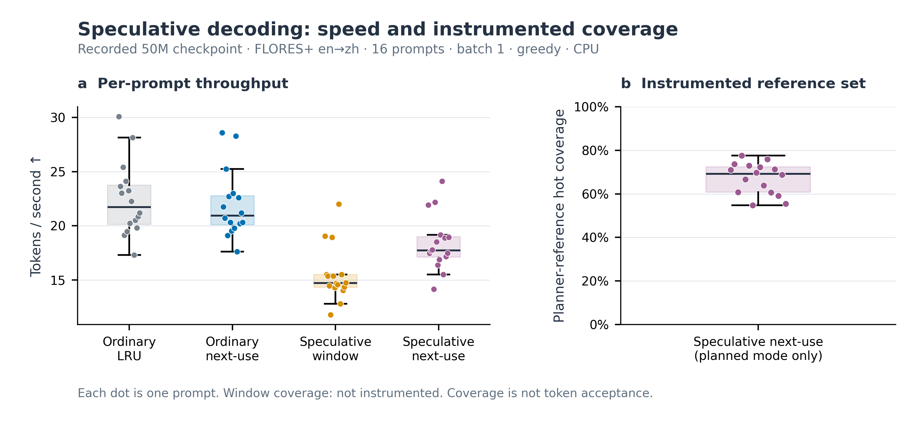
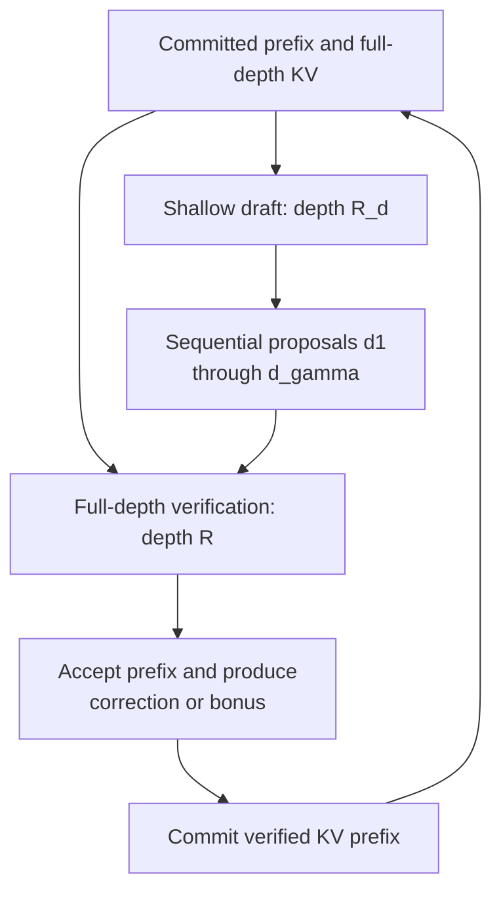
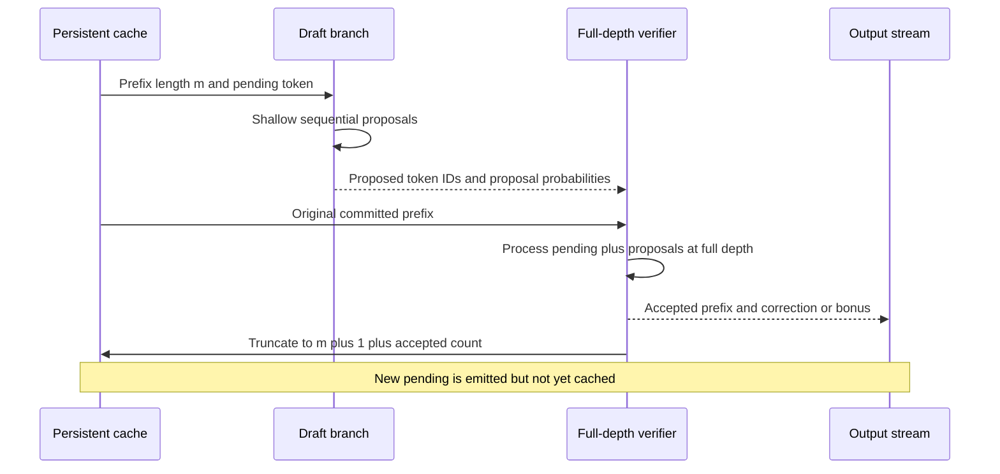
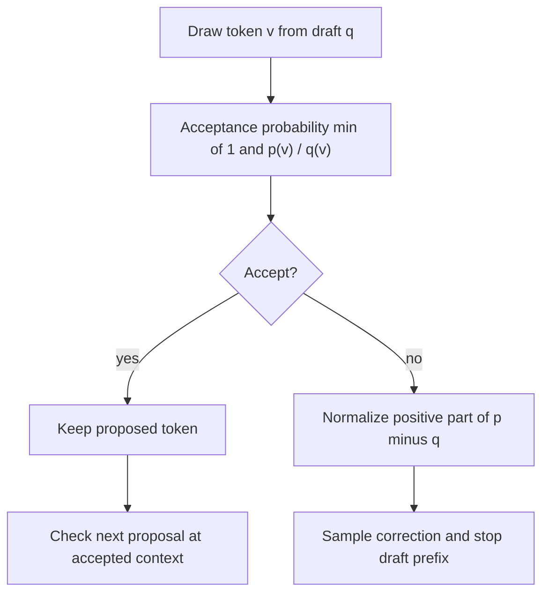
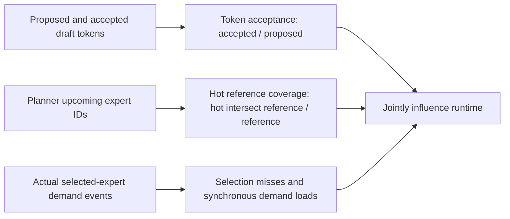

# Self-speculative decoding: proposal, verification and cache rollback

Chronos can use a shallow recurrent execution as its draft model. A full-depth execution then verifies several proposed tokens together. Both passes use the same parameters; their recurrent depths differ. This reduces the need for a separate draft checkpoint, but does not guarantee a speedup.

The implementation has two independent correctness obligations. Verification must evaluate the intended full model, and accepted tokens must leave the persistent key–value (KV) cache in the same state as ordinary decoding. Exact expert loading is part of the first obligation. Cache branching and rollback establish the second. [Torch implementation](../chronos/runtime/speculative.py#L118), [MLX implementation](../chronos/mlx/speculative.py#L106)

*Figure 1. Recorded batch-one greedy generation on the 50M checkpoint. The throughput panel includes ordinary generation, planned residency, speculative window and speculative planned residency. The coverage panel shows only instrumented planned-verification observations: hot expert IDs divided by the planner's bounded reference set. Window coverage is not recorded. This quantity is neither token acceptance nor proof that all verification experts are ready. KV, key–value; SSD, solid-state drive.*

## 1. What the draft actually skips

Let $F_R$ denote execution with $R$ recurrent iterations, including its configured prelude, coda and output head. The draft uses $F_{R_d}$ with $1\leq R_d<R$. It does not own a smaller parameter set. A proposal width $\gamma$ requests up to $\gamma$ draft tokens before full-depth verification.

*Figure 2. Proposal and verification share weights but have separate cache branches. Verification re-executes the shallow part as well as the remaining recurrent computation; it is not a continuation from a saved shallow hidden state.*

The full-depth call receives the current pending token and its draft successors as one causal sequence. Batched verification can amortize dispatch and weight access across positions. It still computes all configured full-depth operations for those positions. [Draft loop and verification call](../chronos/runtime/speculative.py#L173)

The shallow cache is a temporary branch from the committed prefix. Draft forwards return new cache values; the persistent reference is replaced only after verification and truncation. This distinction is separate from attention reuse *within* one recurrent forward. [Cache contract](../chronos/runtime/speculative.py#L10), [MLX cache contract](../chronos/mlx/speculative.py#L9)

## 2. The pending-token invariant

The generator first runs full-depth prompt prefill and emits the next token. It calls that emitted token `pending`, because it has not yet been appended to the persistent cache. At every subsequent round:

1. The persistent cache contains $m$ committed input positions.
2. `pending` is already final and emitted, but is absent from those $m$ positions.
3. The draft proposes $d_1,\ldots,d_\gamma$ after `pending` using a temporary branch.
4. Verification processes $[\mathrm{pending},d_1,\ldots,d_\gamma]$ from the original committed cache.
5. If $a$ draft tokens are accepted, the persistent cache is truncated to $m+1+a$ positions.
6. A correction or all-accepted bonus becomes the next emitted `pending` token.

This avoids a separate full-depth call solely to cache the correction. The next round caches it while verifying its successors. [Invariant and initialization](../chronos/runtime/speculative.py#L124), [commit and next pending](../chronos/runtime/speculative.py#L208)

*Figure 3. One verification round. Rejected suffix KV is discarded. The correction is emitted now and cached in the next round. The output limit or end-of-sequence token can stop a round early.*

For a sliding-window attention cache, rollback must not destroy keys needed by the accepted prefix. The implementation retains extra cache slack derived from `gamma_max`, then truncates with the absolute end position. Multi-head latent attention (MLA) cache entries are sliced to the committed length. [Truncation and slack](../chronos/runtime/speculative.py#L23)

The supported shallow/full cache layout must be depth independent. `shared_first` and `first_only` satisfy the intended layout condition. `per_iteration` uses separate virtual-layer slots and falls back to full-depth ordinary generation. This is a layout restriction, not an accuracy setting. [Support check](../chronos/runtime/speculative.py#L50), [MLX fallback](../chronos/mlx/speculative.py#L126)

## 3. Greedy parity and sampled correctness

### Greedy acceptance

At proposal position $i$, let $d_i$ be the shallow proposal and $p_i$ the full-depth distribution conditioned on the committed prefix and all previously accepted proposals. Greedy verification accepts while

$$
d_i=\operatorname*{arg\,max}_{v}p_i(v).
\tag{1}
$$

At the first disagreement, the verifier emits its own argmax and discards later proposals. Therefore, the emitted prefix matches full-depth greedy decoding when verification computes the same target function, causal masks, positions and cache states. [Greedy branch](../chronos/runtime/speculative.py#L192)

The condition matters in a lazy model. A verifier using approximate shared fallback is evaluating a modified target function on a cold miss. It cannot establish parity with the fully materialized model merely by comparing tokens. The MLX engine installs synchronous demand-loading hooks; Torch's selected `miss_policy` must be reported. [MLX exact loading](../chronos/mlx/inference.py#L87), [Torch policy semantics](LAZY_EXPERTS.md#6-exact-loading-and-approximate-fallback)

### Rejection sampling derivation

For sampled generation, let $q(v)$ be the normalized draft distribution and $p(v)$ the normalized full-depth target distribution at the same accepted context. The code applies temperature, top-$k$ and nucleus filtering before normalization. These filters define the target distribution being preserved. [Probability construction](../chronos/runtime/speculative.py#L87)

A token $v\sim q$ is accepted with probability

$$
a(v)=\min\!\left(1,\frac{p(v)}{q(v)}\right).
\tag{2}
$$

Its unconditional accepted probability mass is $q(v)a(v)=\min[p(v),q(v)]$. The total rejection probability is

$$
Z=1-\sum_v\min[p(v),q(v)]
 =\sum_v[p(v)-q(v)]_+,
\qquad [x]_+=\max(x,0).
\tag{3}
$$

On rejection, sample a correction from $r(v)=[p(v)-q(v)]_+/Z$. Combining the accepted and rejected branches gives

$$
\Pr(\mathrm{output}=v)
=\min[p(v),q(v)]+Zr(v)=p(v).
\tag{4}
$$

Equation (4) proves the single-step distributional result in exact arithmetic. Applying it successively after each accepted context establishes the sequence result. The implementation uses a denominator guard and finite precision; an empirical numerical-parity check remains necessary for each backend. [Rejection implementation](../chronos/runtime/speculative.py#L102), [MLX counterpart](../chronos/mlx/speculative.py#L95)

*Figure 4. Sampled verification. A mismatch is corrected by residual sampling, rather than unconditional sampling from the target. The latter would generally bias the output distribution.*

The currently exposed MLX speculative path requires `repetition_penalty=1`. A future repetition transform must be applied consistently to the proposal and target contexts before the argument above can be reused. The present API explicitly rejects the unsupported combination. [Argument validation](../chronos/mlx/inference.py#L385)

## 4. When speculation can save time

High acceptance is necessary for useful speculation, but is insufficient for acceleration. As an explanatory model, assume each proposal is accepted with a constant conditional probability $\alpha$. Then the number $A$ of accepted draft tokens satisfies

$$
\mathbb E[A]=\sum_{i=1}^{\gamma}\Pr(A\geq i)
=\sum_{i=1}^{\gamma}\alpha^i.
\tag{5}
$$

A round emits approximately $1+\mathbb E[A]$ new tokens, ignoring output limits and end-of-sequence termination. If one shallow proposal costs $C_d$, verification of $\gamma+1$ positions costs $C_v(\gamma+1)$, and additional loading/planning costs $C_{\mathrm{io}}$, the corresponding cost per emitted token is approximately

$$
\overline C_{\mathrm{spec}}\approx
\frac{\gamma C_d+C_v(\gamma+1)+C_{\mathrm{io}}}
{1+\sum_{i=1}^{\gamma}\alpha^i}.
\tag{6}
$$

A speedup requires $\overline C_{\mathrm{spec}}<C_{\mathrm{plain}}$. Equations (5)–(6) are an analysis model, not a fit to the recorded benchmark. Acceptance probabilities can vary by position, and draft and verify passes compete for the same expert cache.

The depth ratio $R_d/R$ is not the full runtime ratio. Prelude, coda, output projection, cache operations and expert materialization remain. Verification can also revisit experts displaced by the drafts. A larger $\gamma$ increases the possible accepted prefix and the amount of wasted draft work after an early rejection.

The adaptive controller uses the accepted fraction of the latest proposal batch. It increases $\gamma$ by one at a fraction of at least 0.8 and decreases it below 0.4, within the configured bounds. These thresholds control batch width; they are not halting-head thresholds. [Adaptive width](../chronos/runtime/speculative.py#L217)

## 5. Three metrics that must remain separate

*Figure 5. Acceptance, predicted reference coverage and actual demand misses describe different events. No one metric is a substitute for the other two.*

The runtime exposes true token acceptance as `SpecStats.accepted / SpecStats.proposed`. It also exposes draft calls, verify calls and generated tokens. [Statistics](../chronos/runtime/speculative.py#L64), [MLX final statistics](../chronos/mlx/inference.py#L664)

The separate field `verify_ready_rate` is computed only when a planner is attached. Before verification, the runtime asks for at most the hot-capacity number of upcoming reference IDs and counts those already hot:

$$
\mathrm{reference\ coverage}=
\frac{\sum_j|U_j\cap H_j|}{\sum_j|U_j|},
\tag{7}
$$

where $U_j$ is that bounded reference set and $H_j$ the hot set. It does not enumerate all experts subsequently selected by verification. In window mode, this instrumentation does not run; its initialized zero is **not a measured zero readiness rate**. [Exact instrumentation](../chronos/mlx/inference.py#L599)

The archived [16-prompt CPU report](../reports/residency_20261107/bench_residency_50m_s13996_flores16_cpu.json) records 549 generated tokens per mode. Its aggregate rates are 23.17 tokens/s for plain, 22.47 for planned, 16.03 for spec-window and 18.96 for spec-planned. All 16 outputs in each comparison match the greedy plain outputs. These are measured generation results for this checkpoint and prompt set, not a universal acceleration claim. [Detailed accounting](RESIDENCY.md#5-recorded-50m-benchmark)

That older report does not retain the true token acceptance counters, even though the current runtime exposes them. Acceptance cannot be reconstructed from reference coverage. The planned coverage value and its per-prompt distribution should be labelled by their actual scope, as in Figure 1.

## 6. Actual controls and verification checklist

| Owner | Argument or field | Role |
|---|---|---|
| MLX generation | `speculative` | Enable the speculative generator; default false. |
| Torch speculative function / MLX generation | `draft_depth` | Shallow recurrent depth; default 1. |
| Both speculative implementations | `gamma`, `gamma_max`, `adaptive_gamma` | Proposal width, maximum width and adaptive controller. Defaults are 4, 8 and true. |
| Model configuration | `recurrent_attention_mode` | Determines whether the depth-independent cache layout is supported. |
| MLX generation | `residency`, `verify_wait_s` | Residency policy and bounded pre-verification prefetch wait. |
| Torch runtime | `miss_policy` | Determines whether cold expert execution is exact or approximate. |

The arguments are defined in [the Torch function](../chronos/runtime/speculative.py#L118) and [MLX generation](../chronos/mlx/inference.py#L343). Self-speculation uses an explicit draft depth; a halting-head confidence trigger does not select that depth.

For each backend, verify cached greedy parity, rejection and all-accepted rollback, end-of-sequence handling, sliding-window boundaries, and unsupported-layout fallback. Record true acceptance, full-depth token cost, expert-load events, prefill time and decode time separately. The archived CPU run provides observed greedy equality, but does not replace those targeted state tests or sampled-distribution tests.
