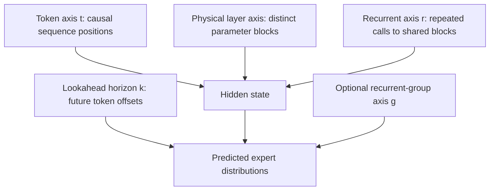
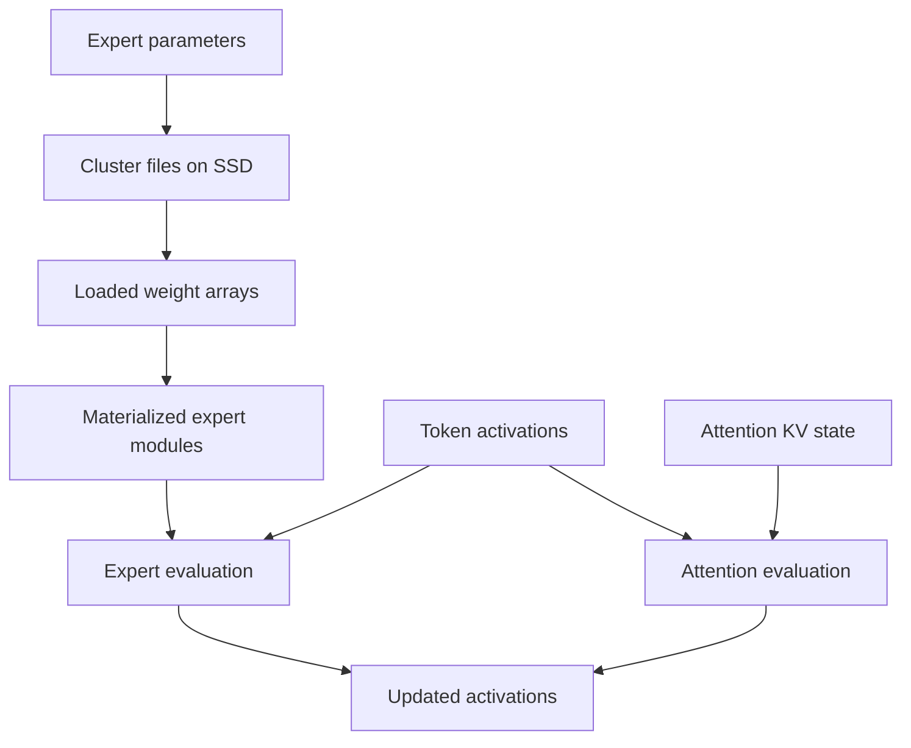
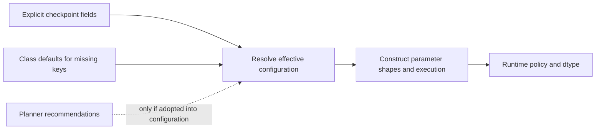

# Symbols, tensor axes and units

This chapter separates token position, physical layer, recurrent iteration and predicted horizon. Confusing these axes changes the meaning of the architecture.

## 1. Indices and configuration symbols

| Symbol | Meaning | Source/configuration name |
|---|---|---|
| $B$ | Batch size | Tensor batch axis |
| $T$ | Query tokens in the current input chunk | Source functions sometimes call this `S` |
| $L$ | Keys visible to the current attention operation | Retained prefix plus current chunk, before applicable eviction |
| $d$ | Hidden width | `hidden_size` |
| $V$ | Vocabulary size | `vocab_size` |
| $P,G,C$ | Prelude blocks, recurrent physical groups, coda blocks | `prelude_layers`, `recurrent_groups`, `coda_layers` |
| $R$ | Maximum configured recurrent depth | `recurrent_depth` |
| $\ell$ | Physical layer index | Index in `model.layers` |
| $g$ | Recurrent group index | Physical layer is $\ell=P+g$ |
| $r$ | Recurrent iteration | Depth index, distinct from token time |
| $h_{b,t}$ | Token hidden state | Last axis has width $d$ |
| $\alpha_g$ | Effective group step size | Controller `step_size(g)` |
| $H_q,H_{\mathrm{kv}}$ | Query heads and KV heads | `num_attention_heads`, `num_key_value_heads` |
| $d_h,d_r,d_c$ | Head width, rotary width, shared KV latent width | `head_dim`, `rope_dim`, `kv_latent_dim` |
| $W$ | Local attention window | `sliding_window_size` |
| $E,k,S_s$ | Routed experts, selected experts, shared experts | `num_experts`, `num_experts_per_tok`, `num_shared_experts` |
| $d_{\mathrm{ff}},d_e$ | Dense FFN and expert intermediate widths | `intermediate_size`, `moe_intermediate_size` |
| $K$ | Predicted future token horizons | `lookahead_steps`; head also has a current-token slot |
| $N_c$ | Number of expert clusters | Distinct from coda length $C$ |
| $A_{i,c}$ | Expert-to-cluster membership indicator | Fixed training partition |
| $w$ | Window or document segment | Aggregation unit for locality |
| $b$ | Bytes per stored element | Precision/storage dependent |
| $\tau$ | A mathematical depth-time coordinate | Not token sequence length |

Code-local symbols can differ. For example, an implementation variable `H` may denote hidden width. The mathematical meaning follows the table and each chapter's explicit aliases.

## 2. The four independent execution axes

A flattened dispatch axis is useful for locality statistics. It is not a new parameter axis. A recurrent group contributes multiple dispatch records because the same router can be called repeatedly.

For ordinary fixed-depth execution without early exits, the number of physical block calls is

$$
N_{\mathrm{calls}}=P+RG+C.
\tag{S.1}
$$

Later-group truncation or adaptive halting changes this count. The expression counts calls, not trainable blocks. The parameterized backbone still has $P+G+C$ physical blocks.

## 3. Hidden states, logits and predictor shapes

| Tensor | Shape | Interpretation |
|---|---|---|
| Token IDs | $(B,T)$ | Integer lookup indices |
| Hidden states | $(B,T,d)$ | Backbone activations |
| Current MoE scores | $(B,T,E)$ | Expert probabilities for one dispatch |
| Collected routing | $(B,T,D_{\mathrm{disp}},E)$ | Actual dispatch records; $D_{\mathrm{disp}}$ is not hidden width |
| Group-aware recurrent routing | $(B,T,G,R_{\mathrm{exec}},E)$ when assembled | All groups must have the same actual count $R_{\mathrm{exec}}\ge2$; otherwise current Torch/MLX helpers return `None` |
| Lookahead probabilities | $(B,T,K+1,E)$ | Current slot plus future-token slots |
| Group-aware lookahead | $(B,T,K+1,G,E)$ | Adds recurrent-group predictions |
| Returned logits | $(B,T',V)$ | $T'$ can be reduced by `logits_to_keep` |
| One MLA latent cache | $(B,L,d_c)$ | Persistent latent payload |
| Optional MLA rotary keys | $(B,L,H_{\mathrm{kv}},d_r)$ | Separate persisted component when enabled |
| SWA keys and values | Two $(B,L_w,H_{\mathrm{kv}},d_h)$ tensors | Retained entries plus separately tracked absolute position |

The predictor's $K+1$ axis is a token-horizon axis. It does not mean $K+1$ future physical layers. The optional group axis is described in [LOOKAHEAD.md](LOOKAHEAD.md).

## 4. Storage objects and activation objects

The SSD cache stores expert weights. Token activations and attention KV are different state objects. Moving an expert page does not append a KV entry. Reusing a KV view does not guarantee the needed expert weights are resident.

### Dimensions are not bytes

For an unquantized tensor with shape $(n_1,\ldots,n_m)$, payload bytes are

$$
M_{\mathrm{payload}}=b\prod_{j=1}^{m}n_j.
\tag{S.2}
$$

Allocator overhead, quantization scales, tensor metadata, temporary copies and asynchronous in-flight buffers require separate accounting. A warm-cache capacity bounds admission; it may not bound transient load memory.

| Unit or counter | Meaning | What it does not determine alone |
|---|---|---|
| GB | $10^9$ bytes when explicitly defined | GiB |
| GiB | $2^{30}$ bytes | Physical RAM capacity or peak allocation policy |
| Expert-page request | A logical expert/layer request | Number of file opens or physical SSD operations |
| Cluster load counter | An instrumented container load | Bytes materialized or device-level reads |
| Demand-miss counter | Selected expert needed a load/fallback path | Number of distinct clusters |
| Tokens/s | Generated or trained tokens divided by a stated time scope | Decode-only speed unless the timer excludes prefill |
| CE | Cross-entropy | Perplexity unless the log base and aggregation are known |
| Normalized entropy | $H/\log N_c$ | Entropy in nats |

The original JSON field `peak_gb` does not always carry its conversion convention. [REPRODUCIBILITY.md](REPRODUCIBILITY.md) preserves this ambiguity rather than silently changing the unit.

## 5. Defaults are resolved values

A class default, planner recommendation and saved checkpoint setting can disagree without changing the code.

Record the resolved configuration together with the checkpoint and runtime policy. A figure with symbolic dimensions is a configuration-family diagram; a figure with concrete dimensions requires those resolved fields. See [KERNEL_ARCHITECTURE.md](KERNEL_ARCHITECTURE.md).

