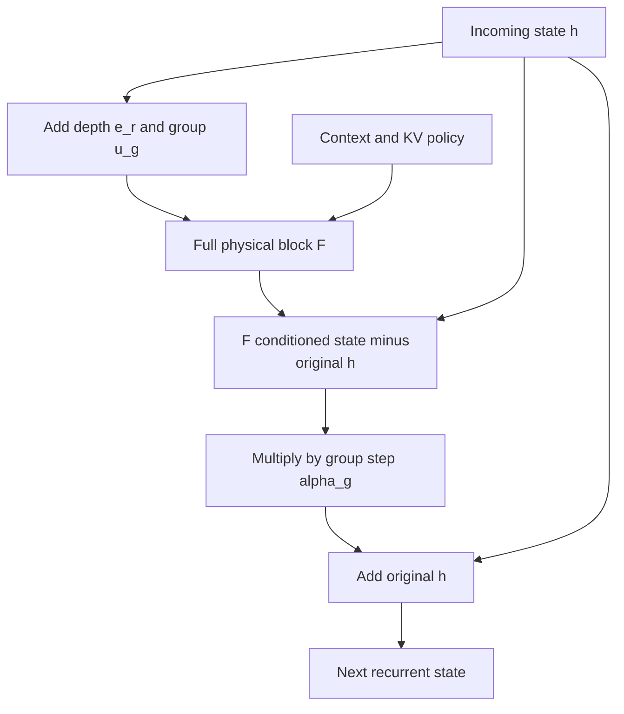
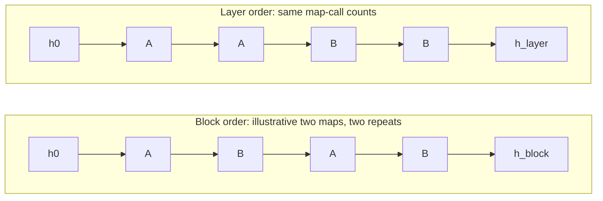
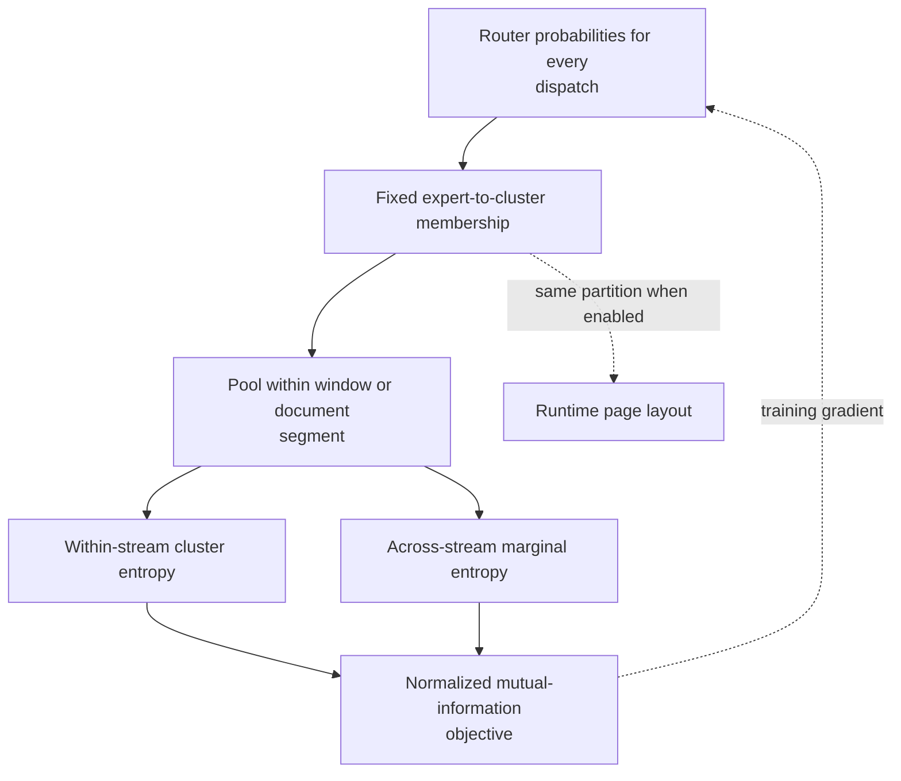
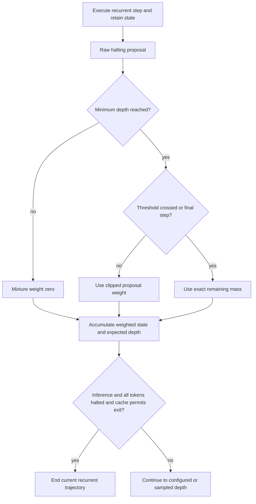

# Mathematical model and implementation boundaries

Chronos reuses physical transformer blocks across recurrent depth and couples sparse expert routing to a paged runtime. Its equations describe a stateful, conditioned computation. They do not establish global convergence, autonomous expert migration or a hardware-independent speedup.

The operator definitions below follow the Chronos implementation. [KERNEL_ARCHITECTURE.md](KERNEL_ARCHITECTURE.md) gives the execution graph. [LOOP_DEPTH.md](LOOP_DEPTH.md) separates recorded measurements from interpretation. [SYMBOLS.md](SYMBOLS.md) collects notation across chapters.

## 1. State, blocks and two kinds of residual

Use $h\in\mathbb R^{B\times T\times d}$ for hidden states. The physical layer index is $\ell$. The recurrent group is $g\in\{0,\ldots,G-1\}$ and the repeat index is $r\in\{0,\ldots,R-1\}$. Prelude, recurrent and coda blocks occupy $P$, $G$ and $C$ physical positions.

A full pre-normalization block is the map $F_\ell$, not merely its residual increment:

$$
\begin{aligned}
a &= h + A_\ell\left(N_{\ell,1}(h);\mathcal K_\ell\right),\\
F_\ell(h;\mathcal K_\ell)
  &=a+M_\ell\left(N_{\ell,2}(a)\right).
\end{aligned}
\tag{T1}
$$

Here $A_\ell$ is attention, $M_\ell$ is a dense feed-forward network or mixture of experts (MoE), and $N$ is root mean square normalization (RMSNorm). The key–value state is denoted $\mathcal K_\ell$. Both residual additions are inside $F_\ell$. The implementation is [ChronosBlock.forward](../chronos/model/model_chronos.py#L83).

The recurrent controller first adds learned depth and group embeddings:

$$
\widetilde h_{r,g}=h_{r,g}+e_r+u_g.
\tag{T2}
$$

It then applies a separate outer update:

$$
\Phi_{r,g}(h)
=h+\alpha_g\left[F_{P+g}(h+e_r+u_g;\mathcal K_g)-h\right].
\tag{T3}
$$

The subtraction uses the **unconditioned** state $h$. This distinction follows [condition and contract](../chronos/model/recurrent.py#L136) and [run_layer](../chronos/model/model_chronos.py#L282). Replacing the subtracted state with $h+e_r+u_g$ changes the implemented model.

Equation T1 describes an attention-bearing call. Under `first_only`, later repeats use $F_\ell^{\mathrm{skip}}(x)=x+M_\ell(N_{\ell,2}(x))$ instead. Under `shared_first`, $\mathcal K_g$ is the first repeat's writer view; readers form fresh queries. Under `per_iteration`, the context is repeat-specific. The cache policy is therefore part of the transition definition.

*Figure T1. Conditioned recurrent update. The physical block contains attention and MLP residuals; the outer controller scales the difference between its output and the incoming state. KV, key–value; MLP, multilayer perceptron. This diagram is a mechanism schematic, not a convergence result.*

For $R=1$, the backbone uses its ordinary physical-layer path. It bypasses recurrent conditioning, contraction and adaptive mixing. The lookahead observation also moves from post-prelude state to physical block zero. This is an explicit [depth-one execution branch](../chronos/model/model_chronos.py#L479), not a small-step approximation.

## 2. What the Euler interpretation means

### 2.1 A conditional autonomous reduction

Freeze the cache/context and the conditioning embeddings at $e,u$. Define the conditioned map $\overline F(h)=F(h+e+u;\mathcal K)$ and its residual field $v(h)=\overline F(h)-h$. Equation T3 then reduces to

$$
h_{r+1}=h_r+\alpha\,v(h_r).
\tag{T4}
$$

This is the forward Euler form for

$$
\frac{dh}{d\tau}=v(h),\qquad \tau_r=r\alpha.
\tag{T5}
$$

At fixed $\overline F$ and constant $\alpha$, the formal horizon is $\mathcal H=R\alpha$. Choosing $\alpha=\mathcal H/R$ reduces the discretization step while keeping that horizon fixed. This is an algebraic interpretation under stated assumptions. A numerical convergence theorem would also require regularity, a controlled family of discretizations and an error analysis.

The implemented map depends on $e_r$, the group, cached context and sometimes routing policy. Training may also use dropout. These features prevent an unconditional claim that every trained depth executes a finer discretization of one autonomous ordinary differential equation (ODE). A more faithful abstraction is a composition of conditioned discrete maps.

The helper [recommended_dt_init](../chronos/model/recurrent.py#L17) returns

$$
\alpha_0(R)=\min\left(0.5,\frac{2}{R}\right).
\tag{T6}
$$

This gives an initial formal horizon of $2$ only when the cap is inactive. It is a planner heuristic, not a fitted optimum or a global convergence guarantee. The constructor, a newly generated recipe and a stored checkpoint can resolve different values; see [LOOP_DEPTH.md](LOOP_DEPTH.md).

### 2.2 Bounded step size does not imply a contractive network

In this subsection, $F$ denotes the frozen conditioned full-block map $\overline F$ above. Suppose it is $L_F$-Lipschitz in a selected norm. For $0\le\alpha\le1$, the relaxed map $\Phi=(1-\alpha)I+\alpha F$ satisfies

$$
\begin{aligned}
\|\Phi(x)-\Phi(y)\|
&\le(1-\alpha)\|x-y\|+\alpha\|F(x)-F(y)\|\\
&\le\left[(1-\alpha)+\alpha L_F\right]\|x-y\|.
\end{aligned}
\tag{T7}
$$

If $L_F<1$, this bound gives a contraction for positive $\alpha$. If $L_F>1$, reducing $\alpha$ does not make this bound less than one. The implementation does not enforce $L_F<1$.

A local linearization gives a different, weaker diagnostic. At a fixed point, with frozen conditioning and context,

$$
J_\Phi=(1-\alpha)I+\alpha J_F.
\tag{T8}
$$

For an eigenvalue $\mu$ of $J_F$, local linear stability requires

$$
|1+\alpha(\mu-1)|<1.
\tag{T9}
$$

For $\mu\ne1$, this requires $\mathrm{Re}\mu<1$ and

$$
0<\alpha<\frac{2(1-\mathrm{Re}\mu)}{|\mu-1|^2}.
\tag{T10}
$$

These conditions analyze a frozen differentiable map. Sparse routing can change active sets, and changing $e_r$ changes the map across repeats. Local spectral stability also does not exclude transient amplification in a non-normal system.

The quantity named `contraction` in [recurrent_auxiliary_state](../chronos/model/recurrent.py#L239) is a relative step norm. It is not a measured Lipschitz constant. The optional penalty above `recurrent_contraction_budget` regularizes this diagnostic; it does not prove Equation T7.

### 2.3 Sigmoid and clamp parameterizations

With a raw learned parameter $\theta_g$, the sigmoid option is

$$
\alpha_g=\alpha_{\min}+
(\alpha_{\max}-\alpha_{\min})\sigma(\theta_g),
\quad
\frac{\partial\alpha_g}{\partial\theta_g}
=(\alpha_{\max}-\alpha_{\min})\sigma(\theta_g)[1-\sigma(\theta_g)].
\tag{T11}
$$

The derivative is positive for finite $\theta_g$ in real arithmetic. It can become very small near saturation, and finite precision can round it to zero. This removes the explicit dead region of a hard clamp; it does not eliminate vanishing gradients.

The clamp option computes $\alpha_g=\mathrm{clip}(\theta_g,\alpha_{\min},\alpha_{\max})$. Parameters outside the interval have zero derivative. The MLX implementation uses an explicit inclusive-boundary rule to match Torch; see [RecurrentControllerMLX.contract](../chronos/mlx/recurrent.py#L54). Monitoring should include raw $\theta_g$, effective $\alpha_g$ and gradients, not only effective step size.

## 3. Why loop order changes the computation

For two frozen maps $\Phi_A$ and $\Phi_B$, the two orders with two repeats are

$$
\begin{aligned}
h_{\mathrm{block}}&=(\Phi_B\circ\Phi_A)\circ(\Phi_B\circ\Phi_A)(h_0),\\
h_{\mathrm{layer}}&=\Phi_B\circ\Phi_B\circ\Phi_A\circ\Phi_A(h_0).
\end{aligned}
\tag{T12}
$$

Each physical map appears equally often. Equality still requires additional structure, such as commuting maps. Reusing the same weights does not make the compositions interchangeable.

*Figure T2. Operator order under parameter reuse. A and B denote physical transition maps, not attention-free versus attention-bearing layer types. Equal call counts do not imply equal states, cache locality or measured runtime. The example is schematic.*

For smooth vector fields $a,b$ and small $\epsilon$, write $\Phi_A(h)=h+\epsilon a(h)$ and $\Phi_B(h)=h+\epsilon b(h)$. Taylor expansion gives

$$
\begin{aligned}
\Phi_B(\Phi_A(h))
&=h+\epsilon(a+b)+\epsilon^2J_ba+O(\epsilon^3),\\
\Phi_A(\Phi_B(h))
&=h+\epsilon(a+b)+\epsilon^2J_ab+O(\epsilon^3).
\end{aligned}
\tag{T13}
$$

Their leading difference is $\epsilon^2(J_ba-J_ab)$. This explains why order can matter. It does not establish that one order improves language-model quality. The experiment needed to establish that claim is described in [LOOP_DEPTH.md](LOOP_DEPTH.md).

## 4. Sparse experts and routing-locality objectives

For a normalized MLP input $z$, the router computes $p(z)=\mathrm{softmax}(W_gz)$ in FP32. Let $\mathcal I_k(z)$ be the selected expert IDs. If `norm_topk_prob=True`,

$$
\widehat p_i(z)=\frac{p_i(z)}{\sum_{j\in\mathcal I_k(z)}p_j(z)},\qquad
M(z)=\sum_{i\in\mathcal I_k(z)}\widehat p_i(z)E_i(z)
+\frac1{S_s}\sum_{s=1}^{S_s}E_s^{\mathrm{shared}}(z).
\tag{T14}
$$

Equation T14 assumes $S_s>0$; omit the shared branch when no shared experts are configured. When top-k normalization is disabled, selected probabilities retain their original softmax mass. The shared branch is an **average** and runs independently of routed selection. Cache-miss substitution is an additional runtime policy. Its formula and quality boundary are covered in [MOE_ROUTING.md](MOE_ROUTING.md) and [LAZY_EXPERTS.md](LAZY_EXPERTS.md). Code: [router and top-k weights](../chronos/model/moe_chronos.py#L138), [shared average](../chronos/model/moe_chronos.py#L117).

Let $A_{ic}$ be the fixed expert-to-cluster membership matrix. Aggregate routing mass across tokens and all dispatches in a window $w$:

$$
p_w(c)=\mathrm{mean}_{(b,t,v)\in w}\sum_i p_{b,t,v,i}A_{ic}.
\tag{T15}
$$

For more than one cluster, the implemented window objective is

$$
\mathcal L_{\mathrm{cluster}}
=1-\frac{H(\overline p)-\mathrm{mean}_wH(p_w)}{\log N_c},
\qquad \overline p=\mathrm{mean}_wp_w.
\tag{T16}
$$

Low within-window entropy concentrates a stream. High marginal entropy preserves diversity across streams. The segment variant weights document segments by valid-token count. These are [normalized mutual-information objectives](../chronos/model/temporal_loss.py#L87), not a rolling dot-product loss.

*Figure T3. Routing-locality training and page-layout alignment. The objective changes routing probabilities over an expert-ID partition. It does not move expert vectors in a measured geometric embedding. The mechanism is conditional on enabling its coefficient. Detailed definitions and optional offline clustering are in [CLUSTER_LOCALITY.md](CLUSTER_LOCALITY.md).*

Temporal smoothness, top-k overlap and cluster locality operate on different objects. The first compares adjacent token probability vectors. The second rewards mass on a detached previous top-k set. The third aggregates routing into clusters. They can be combined, but their effects and coefficients need separate ablations.

## 5. Future-token lookahead

The lookahead horizon indexes **future token positions**. It does not index future physical layers. With group-aware prediction,

$$
Q\in[0,1]^{B\times T\times(K+1)\times G\times E}.
\tag{T17}
$$

Index zero is the current-token prediction. Indices $j=1,\ldots,K$ predict expert distributions at $t+j$. The legacy group-agnostic form omits $G$. Both are implemented by [LookaheadRouter](../chronos/model/lookahead_router.py#L22).

For a detached teacher distribution $P$, the basic supervision is soft-target cross-entropy:

$$
\mathcal L_{\mathrm{LA}}
=\mathrm{mean}_{j\in\mathcal J}
\left[-\mathrm{mean}_{b,t,g}
\sum_iP_{b,t+j,g,i}\log Q_{b,t,j,g,i}\right].
\tag{T18}
$$

Only horizons $\mathcal J$ with available token pairs contribute. The implementation clamps predicted probabilities below at $10^{-9}$ before taking logs. For fixed detached $P$, soft-target cross-entropy equals $\mathrm{KL}(P\|Q)+H(P)$. The teacher entropy has no gradient through this loss, so its optimization direction matches forward KL.

Padding and document-boundary handling depend on the active training path. This loss differs from classifying one cluster ID. Expert-to-page mapping occurs later in the runtime. Code: [lookahead_supervision_loss](../chronos/model/temporal_loss.py#L259).

The teacher can use first-iteration routing or an iteration mean. The recurrent path reads the post-prelude state. The depth-one path reads physical block zero. [LOOKAHEAD.md](LOOKAHEAD.md) details those contracts and separates prediction quality from page readiness.

## 6. Adaptive state mixing and physical early exit

Use $j=r+1$ for the one-based executed depth in this section. The halting head produces raw proposals $a_j\in[0,1]$. These proposals are not the final mixture weights. Before minimum depth, the mixture weight is zero. The threshold-crossing or final iteration receives the exact remaining mass.

Let $c_{j-1}=\sum_{i<j}w_i$, and let $j_{\min}$ be the effective minimum executed depth. For an eligible active token,

$$
w_j=\begin{cases}
0,&j<j_{\min},\\
1-c_{j-1},&\text{threshold crossed or final executed iteration},\\
a_j,&\text{otherwise}.
\end{cases}
\qquad
\overline h=\sum_jw_jh^{(j)},\quad\sum_jw_j=1.
\tag{T19}
$$

The expectation and unweighted ponder penalty are

$$
D_{\mathrm{used}}=\sum_jjw_j,
\qquad
\mathcal L_{\mathrm{ponder}}=
\mathrm{mean}\max(D_{\mathrm{used}}-1,0).
\tag{T20}
$$

Subtracting one sets the ponder baseline at a single mandatory pass. With a minimum depth above one, the smallest attainable penalty is correspondingly higher. Already halted tokens receive zero subsequent weight. The threshold is numerically clipped into $[10^{-6},1]$, and a draft override clips minimum depth to the executed state count. The coefficient `ponder_loss_coef` is applied once in the trainer. The [implementation](../chronos/model/recurrent.py#L180) does not divide Equation T20 by configured $R$.

*Figure T4. Adaptive-computation state mixing and physical early exit. Training retains the scheduled computation graph. Inference can end a recurrent trajectory only when all tokens in its batch have halted and the cache contract permits it. In layer order, execution then advances to the next physical group; coda blocks still run. ACT, adaptive computation time; KV, key–value. This diagram depicts the implemented control rule, not a proof of optimal stopping.*

Training does not physically break on halting. However, scheduled depth jitter can choose a smaller batch-wide depth before execution. Thus “training always runs configured maximum depth” is too strong. Inference with per-iteration cache slots cannot leave unwritten cache holes; the [executor](../chronos/model/model_chronos.py#L267) restricts early exit accordingly.

## 7. The implemented objective is a configurable sum

The base loss depends on the training stage. The following decomposition avoids applying any coefficient twice:

$$
\mathcal L=\mathcal L_{\mathrm{base}}+\sum_j\lambda_j\mathcal R_j.
\tag{T21}
$$

| Unweighted term or family | Config coefficient | Role and boundary |
|---|---|---|
| Load balance | `lambda_balance` | Uses raw per-layer auxiliary terms; iteration averaging avoids an extra depth multiplier. |
| Temporal locality | `lambda_temporal` | Adjacent-token probability changes per dispatch. |
| Expert-set overlap | `lambda_router_locality` | Probability mass on the detached previous top-k set. |
| Cluster locality | `lambda_cluster_locality` | Window or document-segment mutual information. |
| Iteration cluster spread | `lambda_iteration_cluster` | Cluster distribution consistency across repeats. |
| Lookahead soft targets / top-k / union | `lambda_lookahead`, `lambda_lookahead_topk`, `lambda_lookahead_union` | Different prediction objectives; future-token teacher is detached. |
| Ponder / depth stability / depth consistency | `ponder_loss_coef`, `recurrent_stability_coef`, `recurrent_distill_coef` | Expected depth, successive-update curvature, and symmetric state consistency. |
| Relative-step penalty | `recurrent_contraction_coef` | Penalizes a diagnostic above its budget; no Lipschitz guarantee. |
| Draft-exit KL | `draft_exit_kl_coef` | Aligns shallow-exit logits with detached full-depth logits. |

The coefficient application is in [chronos_loss_term](../chronos/trainer/loss_mixin.py#L152). Each term also requires its source tensors and the caller's activation conditions. In that helper, top-k and union lookahead terms are nested under the enabled soft-target lookahead path. Stage-specific anchoring and masking also depend on the caller. The retained name `recurrent_distill_coef` refers to symmetric depth-state consistency in this implementation. It should not be confused with the detached teacher in draft-exit Kullback–Leibler (KL) divergence.

## 8. What is established and what remains conditional

The implementation specifies module placement, tensor shapes, cache ownership and coefficient application. Stored JSONs establish the recorded experiment values under their logged conditions. They do not establish global ODE convergence, a contraction certificate, optimal halting or a universal architecture ranking.

A stronger theoretical evaluation would measure local sensitivity under controlled context, distinguish writer and reader Jacobians, and test order effects across matched budgets. A stronger systems evaluation would connect routing decisions to byte traffic, wait time and final task quality. Those measurements belong alongside the conditional derivations, with source records and independent repetitions.

