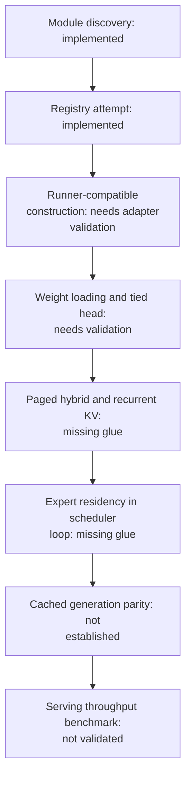
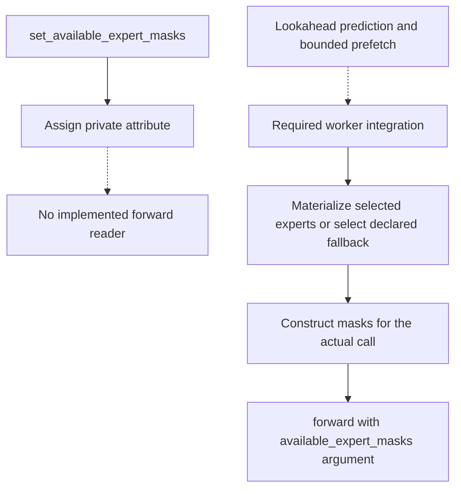
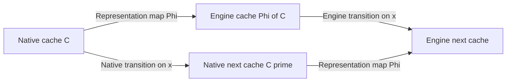

# vLLM integration: implemented registration and the missing execution contract

This release contains an optional **registration shim**, not a validated end-to-end vLLM backend. The shim can register the name `ChronosForCausalLM`. It does not implement paged KV-cache interoperability, an expert-aware vLLM worker or a versioned serving compatibility test.

The distinction determines how to interpret the examples below. A successful registry call establishes model discovery only. It does not establish that stock `LLM.generate` can construct, load and execute Chronos correctly. For the implemented lazy-loading pipeline, use the native [Chronos inference runtime](../chronos/runtime/inference_engine.py#L745) and its backend-specific controls.

## 1. What exists in the release

| Component | Source-backed status | What the status establishes |
|---|---|---|
| Optional dependency detection | Implemented with `importlib.util.find_spec`. | Whether the `vllm` module can be found. |
| Registry call | Implemented, including a fallback call signature. | Whether the registration attempt returned successfully. |
| Model class | Native Transformers-style `ChronosForCausalLM`. | Chronos's own constructor, forward and cache interface. |
| Expert-mask setter | Placeholder attribute assignment. | Stores an attribute; it does not connect that attribute to forward. |
| vLLM paged cache, model runner and lazy expert worker | Not implemented by this shim. | No serving-correctness or performance claim follows from registration. |
| Included adapter smoke test | Checks boolean return and availability consistency. | Graceful optional-dependency behavior, not generation parity. |

*Table 1. Integration status determined from [the adapter](../chronos/serving/vllm_adapter.py#L24), [native model interface](../chronos/model/model_chronos.py#L551) and [the smoke test](../tests/test_smoke.py#L979).*


*Figure 1. Registration is the first gate in an execution integration. Later gates are required work, rather than features implicitly enabled by the registry entry. KV, key–value.*

The upstream model registry is the discovery mechanism for external architectures. Its documentation also describes plugin-based registration. Neither mechanism removes the need for a compatible model implementation. [Official model-registration documentation](https://docs.vllm.ai/en/latest/contributing/model/registration/)

## 2. A truthful registration check

```python
from chronos.serving import register_chronos_with_vllm

registered = register_chronos_with_vllm(verbose=True)
print({"registry_call_succeeded": registered})
```

The function returns false if vLLM is absent, the registry API is unsupported, or registration raises an exception. It catches errors and optionally prints the reason. A true value means the attempted call completed; it is not a generation smoke test. [Return paths](../chronos/serving/vllm_adapter.py#L27)

The current shim first passes the class object to `ModelRegistry.register_model`. On a `TypeError`, it tries an older three-argument form. This narrow fallback is not a compatibility matrix across vLLM releases. Pin the actual vLLM, PyTorch, accelerator and Chronos versions when developing an adapter.

Upstream plugins can register an external architecture without modifying vLLM. Their discovery uses Python entry points, and worker processes need the plugin loaded. The Chronos module exposes a callable registration shim. An entry-point plugin and a compatible multiprocess worker adapter remain to be implemented. [Official plugin-system documentation](https://docs.vllm.ai/en/stable/design/plugin_system/)

Installation requirements depend on the pinned vLLM release and platform. Follow that release's installation documentation, then validate Chronos separately.

## 3. Why the expert-mask hook is not wired

The native model accepts `available_expert_masks` explicitly in its forward arguments and passes them into the model stack. [Native argument](../chronos/model/model_chronos.py#L565)

By contrast, `set_available_expert_masks(model, masks)` only performs

```python
setattr(model, "_chronos_available_expert_masks", masks)
```

The current native forward does not read that attribute. An integration must pass the masks into the actual call or introduce and test an explicit reader. Calling the setter alone does not change routing. [Placeholder implementation](../chronos/serving/vllm_adapter.py#L73)



*Figure 2. Existing placeholder and required execution path. Dotted arrows indicate missing or proposed connections. The explicit native forward argument is implemented; the surrounding vLLM worker path is not implemented.*

Expert availability also carries a correctness choice. A worker that executes real selected experts after loading implements exact demand semantics. A worker that substitutes shared output on misses implements an approximate model. A production adapter must declare that policy and measure both miss counts and affected routing weight. [Exact and approximate semantics](LAZY_EXPERTS.md#6-exact-loading-and-approximate-fallback)

The shim does not implement lazy expert demand loading or a mapping to vLLM's fused expert kernels. Serving requires a concrete worker adapter and validation of its expert-availability policy.

## 4. A cache adapter must preserve state, not only shapes

Chronos combines global MLA and SWA with configurable recurrence. A valid external cache representation must preserve the logical attention slot, absolute sequence position, causal visibility and recurrent reuse rules. A physical layer is not always the full cache identity: `per_iteration` recurrence can require separate iteration slots. [Recurrent cache mode check](../chronos/runtime/speculative.py#L50)

Let $C$ be a native cache, $\Phi(C)$ its proposed engine representation, and $F$ one decode transition on input token block $x$. A suitable compatibility target is

$$
F_{\mathrm{native}}(x,C;\theta)=(z,C'),
\qquad
F_{\mathrm{engine}}(x,\Phi(C);\theta)=(\widehat z,\widehat C'),
\tag{1}
$$

with a documented numerical tolerance for $z\approx\widehat z$ and the state condition

$$
\widehat C'=\Phi(C').
\tag{2}
$$

Equation (2) is a proposed acceptance criterion for an adapter, not a property established by the current shim. Shape compatibility alone does not establish it. A cache can have the right dimensions while associating a page with the wrong recurrent iteration or absolute position.



*Figure 3. Required state-equivalence diagram. Both routes must produce the same logical next cache, up to the explicitly chosen representation and numerical tolerance. This is a design and testing criterion for future integration.*

For MLA, the adapter must define whether it stores latents and rotary keys or expanded K/V, and how the attention kernel reconstructs the same scores. For SWA, it must preserve the moving window and absolute end index. For speculation, append and rollback must commute with $\Phi$:

$$
\Phi(\operatorname{truncate}(C,n))
=\operatorname{truncate}_{\mathrm{engine}}(\Phi(C),n).
\tag{3}
$$

The native speculative code already defines the truncation behavior, including extra SWA retention for rollback. Reusing a serving engine's ordinary full-attention cache without these conditions would be insufficient. [Native truncation](../chronos/runtime/speculative.py#L23), [speculative state contract](SPEC_DECODE.md#2-the-pending-token-invariant)

## 5. A concrete integration validation sequence

The following sequence defines the evidence needed before publishing a serving recipe. It describes required work rather than an implemented command pipeline.

1. Pin one upstream version and validate registry loading in every runner process.
2. Implement the runner's constructor, weight-loading, forward and output contracts. Verify saved configuration, exact weights and embedding/head tying.
3. Establish uncached-logit parity on a small all-resident model before introducing paging.
4. Establish prefill and multi-step cached parity for MLA, SWA and each supported recurrent attention mode.
5. Add lazy expert demand loading, per-request state isolation, mask delivery and asynchronous transfer dependencies. Test cold and warm starts separately.
6. Add speculative append/rollback tests if the integration exposes shallow drafting.
7. Measure serving behavior only after those gates pass: request throughput, token throughput, time to first token, inter-token latency, tail latency, memory and expert-loading counters.

Continuous batching introduces multiple request histories. Their KV state, positions and planner traces must remain request scoped, even when expert weights are shared globally. Page eviction must respect all in-flight users. This concurrency obligation follows from the proposed state contract; the current registration module supplies no scheduler-level implementation of it.

The native Torch and MLX runtimes provide executable references for model semantics, but their timing results cannot be re-labelled vLLM benchmarks. This release has no validated vLLM compatibility version, paged-cache parity result or end-to-end Chronos/vLLM performance record. Until those exist, the native runtime is the documented route for the complete Chronos lazy expert pipeline.

Abbreviations: KV, key–value; MLA, multi-head latent attention; SWA, sliding-window attention; MoE, mixture of experts; SSD, solid-state drive; CUDA, NVIDIA's accelerator programming platform.
